# Đề Án Tư Vấn Chiến Lược AI & Công Trường Số — Tổng Công ty Xây dựng Số 1 (CC1)

> **Bộ Hồ Sơ Trực Quan 20 Checkpoints / Touchpoints (Lộ Trình 1–3 Năm & Tầm Nhìn 2030 + Kiến Trúc 3D Spatial Re-ID & Sensor Fusion)**
> Thư mục dự án: `/Users/jangtrinh/Products/cc1`
> **Mới (2026-10-29):** Công trường **tuyến** (cao tốc · cầu · đường) dùng mô hình **NODE + CORRIDOR** — xem [`CHAPTER_OPEN_LINEAR_SITES_HIGHWAY_BRIDGE.md`](./CHAPTER_OPEN_LINEAR_SITES_HIGHWAY_BRIDGE.md) (12 touchpoint L1–L12, demo cao tốc TP.HCM–Đà Lạt).

---

## Danh Mục Toàn Bộ 20 Hình Ảnh Chi Tiết Theo Từng Checkpoint

### PHẦN I — GIAI ĐOẠN 1 (NĂM THỨ NHẤT): SỐ HÓA "TAI MẮT" & AN NINH HIỆN TRƯỜNG (LÀM TRƯỚC)

#### 01. Checkpoint 1.1 — Cổng Kiểm Soát AI (AI Access Control & PPE Safety Check)
- **File:** [`01_GD1_CP1_Cong_Kiem_Soat_AI_PPE.jpg`](./01_GD1_CP1_Cong_Kiem_Soat_AI_PPE.jpg)
- **Quy trình:** Công nhân CC1 và nhà thầu phụ xếp hàng qua cổng xoay Turnstile. Hệ thống AI Camera ngang tầm mắt quét khuôn mặt (Face ID) chấm công đồng thời dùng Computer Vision kiểm tra đồ bảo hộ (Mũ bảo hộ, Áo phản quang CC1).
- **Trạng thái hiển thị:** Màn hình LED hiển thị tên công nhân, trạng thái `"HỢP LỆ (GRANTED) - MỞ CỔNG TỰ ĐỘNG"`. Nếu thiếu đồ bảo hộ, hệ thống cảnh báo âm thanh và giữ cổng đóng.

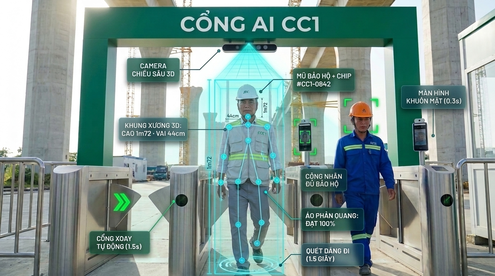

---

#### 02. Checkpoint 1.2 — Camera AI Giám Sát Hành Vi & PPE 24/7 (CCTV AI Vision)
- **File:** [`02_GD1_CP2_Camera_AI_Giam_Sat_An_Toan_24_7.jpg`](./02_GD1_CP2_Camera_AI_Giam_Sat_An_Toan_24_7.jpg)
- **Quy trình:** Tận dụng hệ thống camera hiện hữu tích hợp AI Vision quét 24/7 toàn công trường, tự động phát hiện và bắn cảnh báo về Trung tâm chỉ huy / Zalo Ban chỉ huy trong `< 1 giây`: không đeo dây an toàn khi làm việc trên cao, đi vào vùng nguy hiểm dưới tầm cẩu tháp, hoặc hỏa hoạn/trượt ngã.

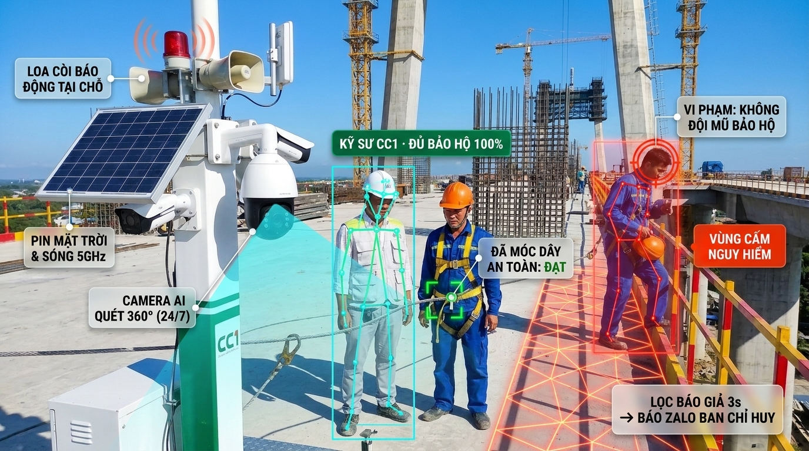

---

#### 03. Checkpoint 1.3 — Drone AI Quét 3D & Đối Soát Tiến Độ Tự Động (Point Cloud & BIM 4D)
- **File:** [`03_GD1_CP3_Drone_AI_Quet_3D_Doi_Soat_BIM.jpg`](./03_GD1_CP3_Drone_AI_Quet_3D_Doi_Soat_BIM.jpg)
- **Quy trình:** Drone tự hành bay theo lộ trình lập trình sẵn hàng tuần, quét đám mây điểm (3D Point Cloud) để tự động hóa trắc đạc, dựng mô hình 3D và đối chiếu trực tiếp với mô hình BIM 4D nhằm tính chính xác % khối lượng hoàn thành và phát hiện sai lệch kết cấu.

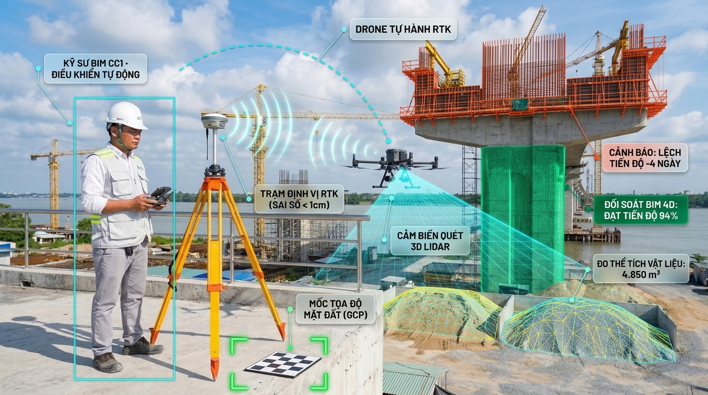

---

#### 04. Checkpoint 1.4 — Hệ Thống Kiểm Soát Xe & Vật Tư Thông Minh (Smart Gate & AI OCR)
- **File:** [`04_GD1_CP4_Smart_Gate_AI_OCR_Kiem_Soat_Xe.jpg`](./04_GD1_CP4_Smart_Gate_AI_OCR_Kiem_Soat_Xe.jpg)
- **Quy trình:** Camera AI OCR tại cổng Logistics nhận diện biển số xe tải/xe bồn bê tông thương phẩm, đối chiếu lệnh điều xe điện tử, ghi nhận thời gian thực ra/vào và mở barrier tự động, xóa bỏ hoàn toàn sổ sách ghi tay của bảo vệ.

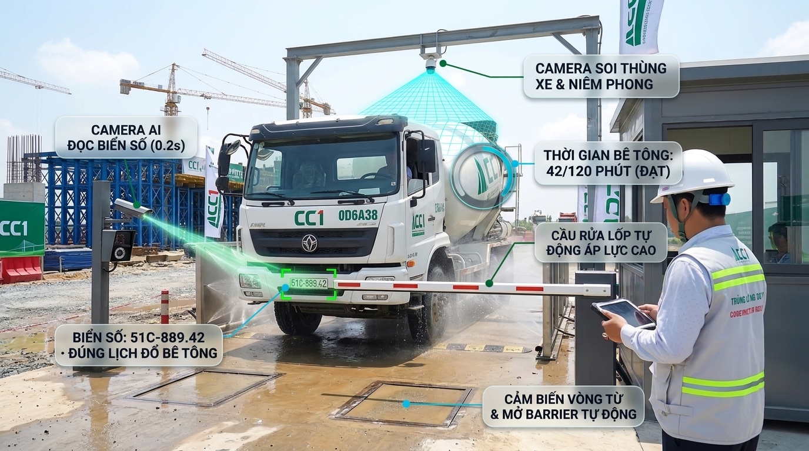

---

### PHẦN II — CHUYÊN ĐỀ ĐẶC BIỆT: HỆ THỐNG ĐỊNH DANH SINH TRẮC KHÔNG GIAN 3D & THEO VẾT ĐA TẦNG (3D SPATIAL Re-ID & SENSOR FUSION)

> Giải quyết triệt để **"điểm mù chết người" của Face ID (tỷ lệ nhận diện = 0% ngoài công trường khi công nhân trùm kín khẩu trang/khăn chống nắng, quay lưng với CCTV trên cao hoặc nhìn từ đỉnh đầu Drone 50m)** mà không rơi vào bẫy chi phí/GPU của "3D Avatar tĩnh".

#### 05. Tầng 1 — Trích Xuất Khung Xương Động Học 3D & Vector Ca Làm Việc Tại Cổng (Passthrough 3D Re-ID)
- **File:** [`05_GD1_ReID_Tang1_Passthrough_3D_Skeleton_Gait_Gate.jpg`](./05_GD1_ReID_Tang1_Passthrough_3D_Skeleton_Gait_Gate.jpg)
- **Quy trình (07:00 sáng - 1.5 giây Passthrough):** Khi công nhân bước tự nhiên qua cổng xoay Face ID, 2 camera cảm biến chiều sâu (RGB-D / Stereo) dọc hành lang cổng âm thầm trích xuất **Daily 3D Re-ID Token** (nhẹ hơn Avatar 3D gấp 1.000 lần):
  1. **Tỷ lệ nhân trắc học khung xương 3D (3D Anthropometrics):** Chiều cao thực tế, độ rộng vai, tỷ lệ chân/lưng bất biến dù cúi gập người hay vác đồ.
  2. **Chữ ký dáng đi (3D Gait Recognition):** Tốc độ sải bước, độ nghiêng vai, nhịp vung tay.
  3. **Đặc trưng trang phục trong ngày (Daily Appearance Vector)** + ghép cặp mã **Chip Mũ UWB `#CC1-0842`**.

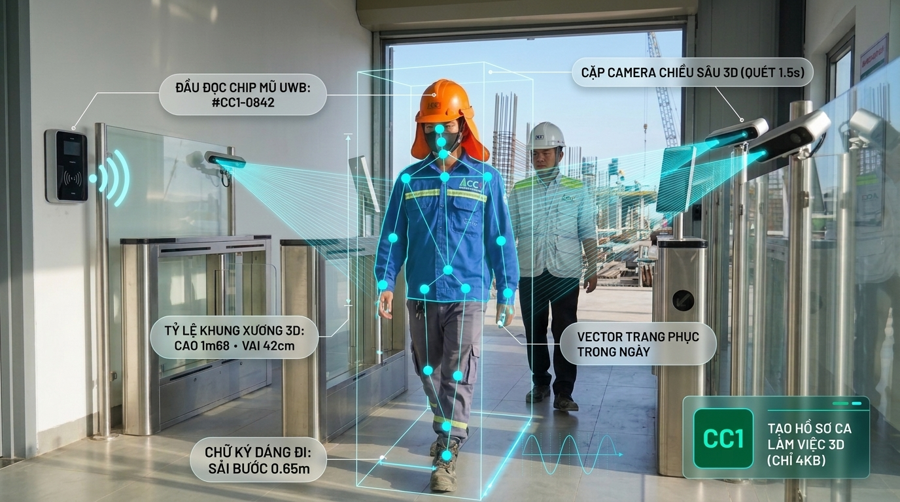

---

#### 06. Tầng 2 — Theo Vết Liên Camera Bằng Khung Xương 3D & Dáng Đi (Multi-Camera Person Re-ID)
- **File:** [`06_GD1_ReID_Tang2_Multi_Camera_3D_Pose_Tracking.jpg`](./06_GD1_ReID_Tang2_Multi_Camera_3D_Pose_Tracking.jpg)
- **Quy trình:** Ở góc nhìn CCTV lắp trên cột cao (công nhân chỉ còn `30x80 pixels` và quay lưng/bịt mặt), thuật toán **Person Re-ID** liên tục bàn giao (hand-off) mục tiêu giữa các camera (`CAM 01 -> CAM 04 -> CAM 09`) dựa trên **Khung xương 3D + Dáng đi + Vector trang phục**, định danh chính xác *"Nguyễn Văn A - #CC1-0842 - Tổ cốt thép số 3"* khi bước vào vùng cấm (*Restricted Area*) hoặc tháo mũ bảo hộ.

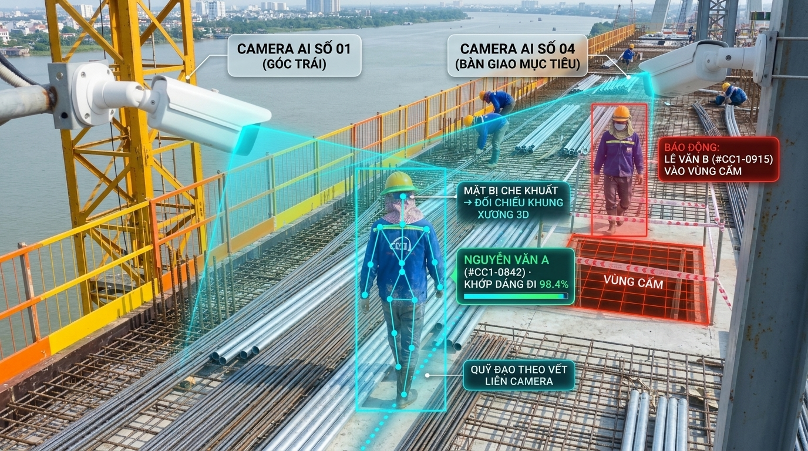

---

#### 07. Tầng 3 — Giải Bài Toán Góc Nhìn Đỉnh Đầu Drone 50m Bằng Hợp Nhất Cảm Biến (Vision + Smart Helmet UWB Tag & Chống Tráo Mũ)
- **File:** [`07_GD1_ReID_Tang3_Drone_50m_UWB_Helmet_Sensor_Fusion.jpg`](./07_GD1_ReID_Tang3_Drone_50m_UWB_Helmet_Sensor_Fusion.jpg)
- **Quy trình:** Khi Drone bay ở độ cao 50m nhìn thẳng từ đỉnh đầu xuống (công nhân chỉ là chấm tròn mũ bảo hộ), hệ thống kết hợp **Computer Vision + Chip UWB/BLE RTK siêu mỏng trong lòng mũ (pin 2 năm, vài USD)**:
  - **Cross-Verification tại tọa độ (X, Y, Z):** Drone phát hiện hành vi vật lý + sóng UWB định danh chính xác `#CC1-0842`.
  - **Chống gian lận tráo mũ (Anti-Spoofing):** Nếu công nhân A đưa mũ cho công nhân B đội hộ để điểm danh khống, hệ thống phát hiện lệch pha nhân trắc học (*"Chip mũ báo Nguyễn Văn A cao 1m74 ≠ Khung xương 3D thực tế đang đội mũ cao 1m62"*) và báo động đỏ ngay về Ban chỉ huy CC1.

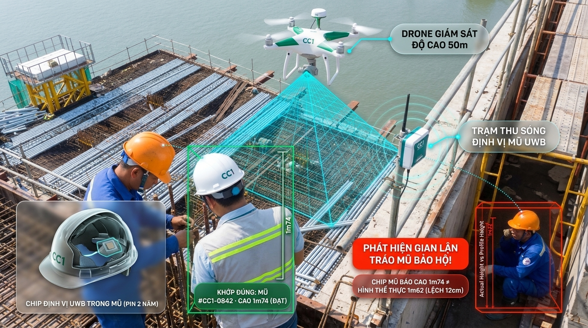

---

#### 08. Quy Trình 4 Bước Khép Kín (07:00 Sáng -> 17:00 Chiều) — 3D Spatial Re-ID & Chấm Công Minh Bạch
- **File:** [`08_GD1_ReID_Quy_Trinh_4_Buoc_Khep_Kin_07h_17h.jpg`](./08_GD1_ReID_Quy_Trinh_4_Buoc_Khep_Kin_07h_17h.jpg)
- **Quy trình 4 bước trên Slide trình Ban lãnh đạo CC1:**
  1. **Bước 1 (07:00):** Đăng ký Động học tại Cổng (1.5s Passthrough).
  2. **Bước 2 (07:01):** Đồng bộ Danh tính + ID Mũ thông minh xuống Edge AI Box tại công trường.
  3. **Bước 3 (Trong giờ làm):** Giám sát xuyên suốt bằng CCTV (tầm trung) & Drone + UWB (tầm cao).
  4. **Bước 4 (17:00):** Nghiệm thu nhân sự & chấm công tự động theo thời gian thực tế tại vùng phân công (Heatmap), xóa bỏ triệt để tình trạng quét mặt ở cổng xong trốn ra quán cà phê hoặc ngủ góc khuất.

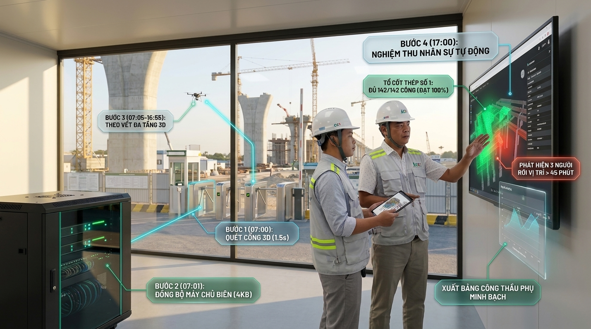

---

#### 09. Phụ Lục Kỹ Thuật — Tại Sao Bác Bỏ "3D Avatar Tĩnh" & Kiến Trúc Phần Cứng Edge AI Box Thực Chiến
- **File:** [`09_GD1_ReID_Phu_Luc_Bac_Bo_3D_Avatar_vs_Edge_AI_Box.jpg`](./09_GD1_ReID_Phu_Luc_Bac_Bo_3D_Avatar_vs_Edge_AI_Box.jpg)
- **Nội dung:** So sánh trực diện **3 sự thật phũ phàng bác bỏ Quét 3D Avatar tĩnh** (Bẫy đồng phục & che khuất 60%, Đói điểm ảnh `30x80px` gây 40–50% False Positive, Biến động nhân công thời vụ) với **Kiến trúc CC1 On-site Edge AI Box (Jetson Orin / TensorRT)** xử lý hợp nhất 3 luồng dữ liệu tại chỗ.

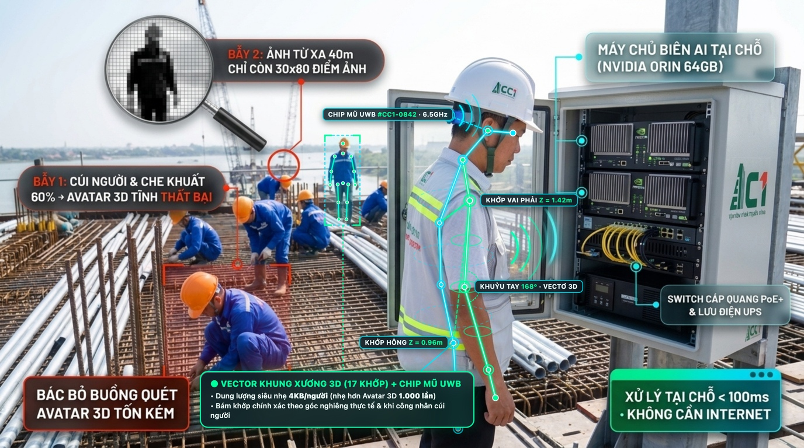

---

### PHẦN III — GIAI ĐOẠN 2 (NĂM THỨ HAI): AI TỐI ƯU VẬT TƯ, THIẾT BỊ & TRẮC ĐẠC THÔNG MINH

#### 10. Checkpoint 2.1 — AI Cân & Kiểm Tra Vật Tư Tự Động (AI Weighbridge & 3D LiDAR Cargo Scanning)
- **File:** [`10_GD2_CP1_Tram_Can_AI_Quet_3D_LiDAR_Vat_Tu.jpg`](./10_GD2_CP1_Tram_Can_AI_Quet_3D_LiDAR_Vat_Tu.jpg)
- **Quy trình:** Khi xe tải chở thép/vật liệu tiến lên bàn cân CC1, cổng Gantry tích hợp Camera AI, máy quét 3D LiDAR và OCR tự động bắt biển số, quét thể tích 3D và đếm số lượng bó thép, đối chiếu tự động 100% với đơn hàng trên ERP (`"AI ĐỒNG BỘ ERP: HỢP LỆ - MATCHED 100%"`).

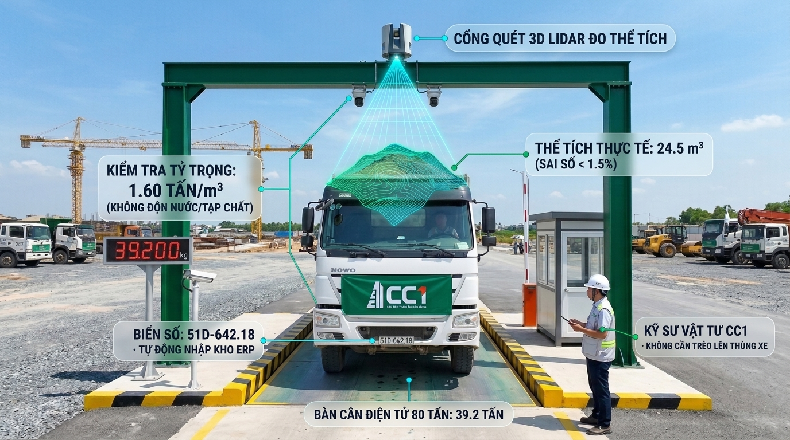

---

#### 11. Checkpoint 2.2 — Robot Tự Hành In Bản Vẽ BIM Trực Tiếp Lên Sàn (Robotic Field Layout / FieldPrinter)
- **File:** [`11_GD2_CP2_Robot_In_Ban_Ve_BIM_Len_San_FieldPrinter.jpg`](./11_GD2_CP2_Robot_In_Ban_Ve_BIM_Len_San_FieldPrinter.jpg)
- **Quy trình:** Robot bánh xe tự hành nhận dữ liệu BIM 2D/3D, được dẫn đường thời gian thực bởi máy toàn đạc tự động (Robotic Total Station) bắn tia laser khóa gương phản xạ, in phun trực tiếp vị trí tường, hốc cửa và MEP lên sàn bê tông với sai số `< 1.5mm` (nhanh gấp 5–10 lần búng mực tay).

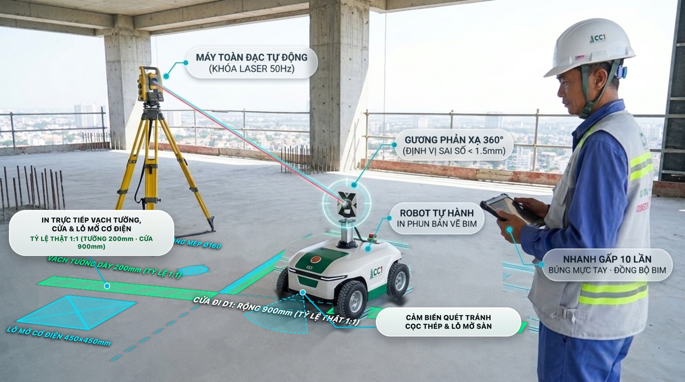

---

#### 12. Checkpoint 2.3 — Máy Xúc Dẫn Đường 3D & Bán Tự Hành (3D Machine Guidance AI)
- **File:** [`12_GD2_CP3_May_Xuc_Dan_Duong_3D_Machine_Guidance.jpg`](./12_GD2_CP3_May_Xuc_Dan_Duong_3D_Machine_Guidance.jpg)
- **Quy trình:** Gắn cảm biến góc nghiêng và định vị vệ tinh RTK-GNSS lên máy xúc, máy ủi của CC1. Màn hình 3D trong cabin hiển thị bản đồ cao độ TIN surface thời gian thực (vùng đỏ cần múc đi, vùng xám/xanh đã đạt cốt thiết kế) và tự động khóa thủy lực chống đào lố (over-digging), tiết kiệm 20–30% nhiên liệu và bê tông bù.

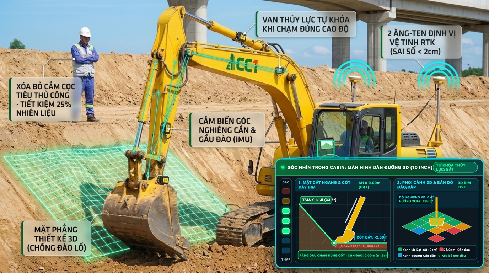

---

#### 13. Checkpoint 2.4 — Thực Tế Tăng Cường AR Đối Chiếu Thiết Kế & Nghiệm Thu Cơ Điện (AR Mobile BIM Inspection)
- **File:** [`13_GD2_CP4_AR_Mobile_BIM_Doi_Chieu_Nghiem_Thu_MEP.jpg`](./13_GD2_CP4_AR_Mobile_BIM_Doi_Chieu_Nghiem_Thu_MEP.jpg)
- **Quy trình:** Kỹ sư CC1 dùng máy tính bảng chuyên dụng có cảm biến LiDAR giơ lên quét trần dầm bê tông thô. Ứng dụng AR chồng khớp tỷ lệ 1:1 mô hình 3D BIM (ống cứu hỏa đỏ, ống nước xanh, ống gió xanh lá, máng cáp vàng) lên hiện trạng thực tế để phát hiện xung đột (clash) và lỗ mở xuyên dầm lệch trước khi đóng trần.

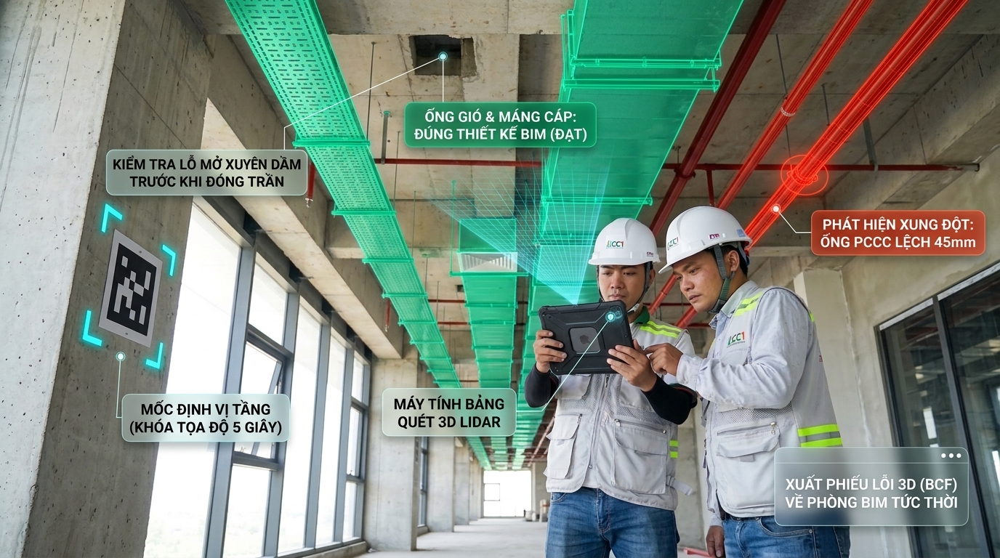

---

### PHẦN IV — GIAI ĐOẠN 3 (NĂM THỨ BA): CÔNG TRƯỜNG TỰ TRỊ & CỘNG TÁC NGƯỜI - MÁY (CYBER-PHYSICAL AI)

#### 14. Checkpoint 3.1 — Robot Bốn Chân Tuần Đêm & Quét 3D (Autonomous Night LiDAR Robot Patrol)
- **File:** [`14_GD3_CP1_Robot_Bon_Chan_Tuan_Dem_Quet_3D_LiDAR.jpg`](./14_GD3_CP1_Robot_Bon_Chan_Tuan_Dem_Quet_3D_LiDAR.jpg)
- **Quy trình:** Vào ban đêm khi công nhân đã rút khỏi công trường, robot bốn chân mang logo CC1 gắn cụm quét 3D LiDAR xoay và camera nhiệt tự động đi tuần tra qua cầu thang, địa hình gồ ghề để dựng Bản sao số (Digital Twin), gửi trực tiếp về tablet của kỹ sư trực đêm nhằm phát hiện sớm sai lệch kết cấu, sụt lún hoặc nguy cơ cháy nổ ngầm.

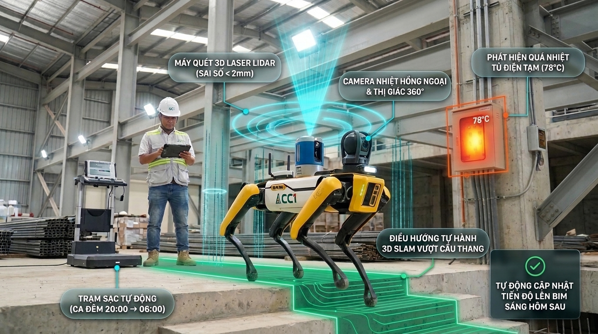

---

#### 15. Checkpoint 3.2 — Công Nhân Đeo Khung Xương Cơ Học Trợ Lực (Industrial Exoskeleton Wearable)
- **File:** [`15_GD3_CP2_Cong_Nhan_Khung_Xuong_Tro_Luc_Exoskeleton.jpg`](./15_GD3_CP2_Cong_Nhan_Khung_Xuong_Tro_Luc_Exoskeleton.jpg)
- **Quy trình:** Trang bị bộ khung xương cơ học trợ lực (Exoskeleton) cho công nhân CC1 trong các công việc nâng lắp cấu kiện MEP nặng, buộc thép và khoan trần, giúp giảm 70% tải trọng lên cột sống, tăng 200% năng suất lao động và bảo vệ sức khỏe cơ xương khớp.

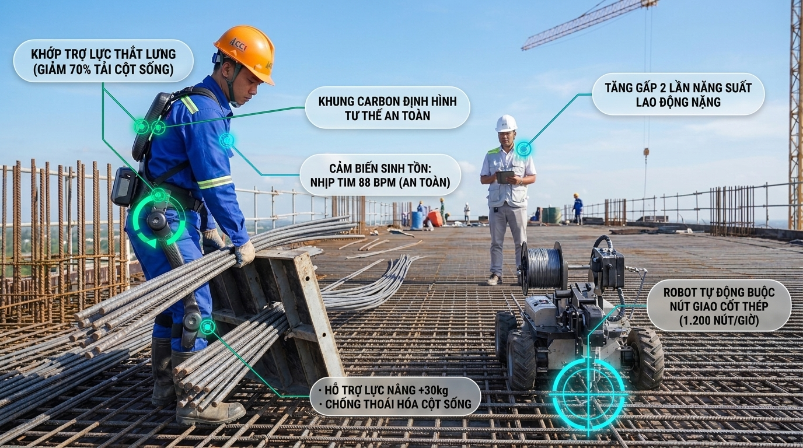

---

#### 16. Checkpoint 3.3 — Máy Công Trình Tự Hành Hoàn Toàn (Fully Autonomous Heavy Machinery)
- **File:** [`16_GD3_CP3_May_Cong_Trinh_Tu_Hanh_Hoan_Toan.jpg`](./16_GD3_CP3_May_Cong_Trinh_Tu_Hanh_Hoan_Toan.jpg)
- **Quy trình:** Dàn xe lu, máy xúc, xe ủi tự hành hoàn toàn không người lái trong cabin (No Operator) vận hành tại các đại dự án cao tốc, san lấp và đắp đập của CC1 dựa trên AI, cụm LiDAR 360 độ, radar quét vật cản và định vị RTK.

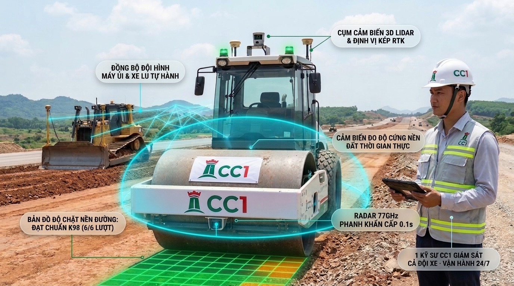

---

#### 17. Checkpoint 3.4 — Cẩu Tháp Tự Hành AI (Autonomous AI Tower Crane)
- **File:** [`17_GD3_CP4_Cau_Thap_Tu_Hanh_AI_Tower_Crane.jpg`](./17_GD3_CP4_Cau_Thap_Tu_Hanh_AI_Tower_Crane.jpg)
- **Quy trình:** Cẩu tháp tích hợp cảm biến LiDAR, camera AI và cảm biến gió tự động tính toán quỹ đạo bay 3D tối ưu để cẩu các cấu kiện bê tông đúc sẵn (Precast) từ bãi tập kết lên tầng cao, tự động né tránh giàn giáo và triệt tiêu điểm mù.

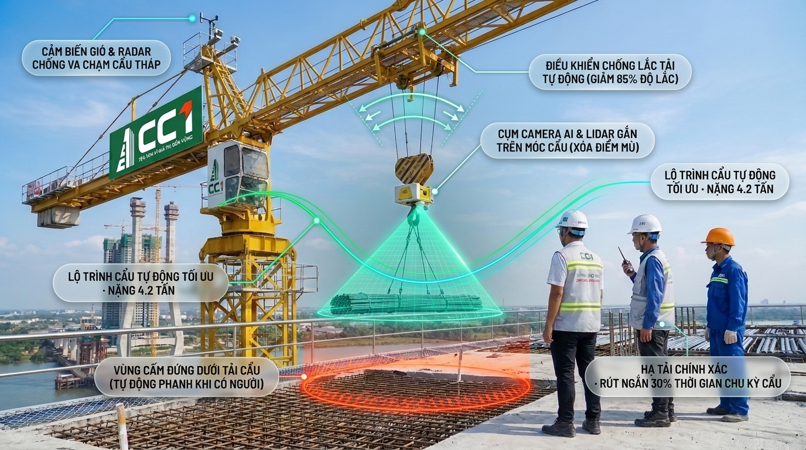

---

#### 18. Checkpoint 3.5 — Hệ Thống Điều Phối Đa Tác Tử AI (Real-time Site OS & Multi-Agent Command Center)
- **File:** [`18_GD3_CP5_He_Dieu_Hanh_Da_Tac_Tu_Multi_Agent_Site_OS.jpg`](./18_GD3_CP5_He_Dieu_Hanh_Da_Tac_Tu_Multi_Agent_Site_OS.jpg)
- **Quy trình:** Trung tâm chỉ huy công trường CC1 vận hành thông qua bàn sa bàn Digital Twin 3D Hologram và Hệ điều hành Tự trị (Site OS) với 4 AI Agent chuyên biệt (**Schedule Agent**, **Supply Chain Agent**, **Cost & Legal Agent**, **Safety & Robotics Agent**) tự động đàm phán, tính lại đường găng, điều phối xe bồn bê tông và khóa/mở hạn mức hợp đồng theo thời gian thực.

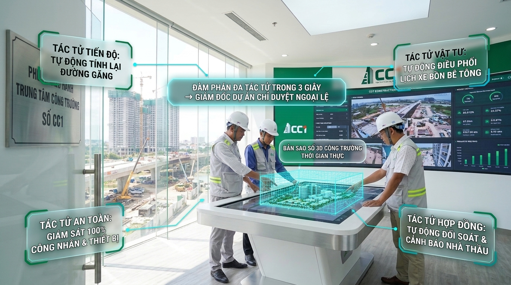

---

### PHẦN V — TẦM NHÌN ĐỘT PHÁ 2030 (MỞ RỘNG TỪ BÀI PHÂN TÍCH CHIẾN LƯỢC)

#### 19. Tầm Nhìn 2030 (Checkpoint Mở Rộng 1) — Nhà Máy Vi Mô Container Ngay Dưới Chân Công Trường (On-Site Robotic Micro-Factories)
- **File:** [`19_Vision2030_CP1_Nha_May_Vi_Mo_Container_OnSite.jpg`](./19_Vision2030_CP1_Nha_May_Vi_Mo_Container_OnSite.jpg)
- **Quy trình:** Hạ các container 40 feet chứa cánh tay robot hàn, cắt laser ngay dưới chân tòa nhà CC1. Đầu vào nhận ống thép thô; bên trong tự động cắt uốn hàn thành cụm mô-đun MEP khớp từng milimet với dữ liệu quét As-built LiDAR của tầng 20 vừa đổ bê tông hôm qua; đầu ra gắn chip UWB để Cẩu tháp tự hành ngoắc cáp cẩu thẳng lên tầng 20 lắp ghép.

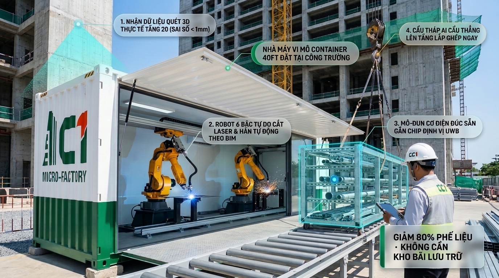

---

#### 20. Tầm Nhìn 2030 (Checkpoint Mở Rộng 2) — Kỷ Nguyên "Zero-UI" (Kính Bảo Hộ HUD + Tai Nghe Truyền Xương) & Thanh Toán Tức Thời Bằng Hợp Đồng Thông Minh Vật Lý
- **File:** [`20_Vision2030_CP2_Zero_UI_Smart_Contract_Payment.jpg`](./20_Vision2030_CP2_Zero_UI_Smart_Contract_Payment.jpg)
- **Quy trình:**
  - **Zero-UI:** Công nhân chỉ đeo kính bảo hộ siêu nhẹ tích hợp camera micro-AI + HUD và tai nghe truyền xương; hỏi trực tiếp bằng giọng nói địa phương, Edge AI chiếu laser đúng vị trí lắp ổ cắm trên tường tránh ống nước âm tường và tự động chụp nghiệm thu ẩn (hidden work inspection).
  - **Real-time Parametric Payment (17h00 -> 17h02):** 17h00 Camera 360 & LiDAR xác nhận hoàn thành 450m² vách (sai số `< 2mm`, 0 lỗi an toàn) -> 17h01 ERP/Smart Contract kích hoạt lệnh giải ngân -> 17h02 tiền công ting-ting thẳng về tài khoản nhà thầu phụ/ví công nhân, giúp tổng thầu giảm 10–15% đơn giá thầu nhờ xóa bỏ "chi phí rủi ro nợ đọng vốn".

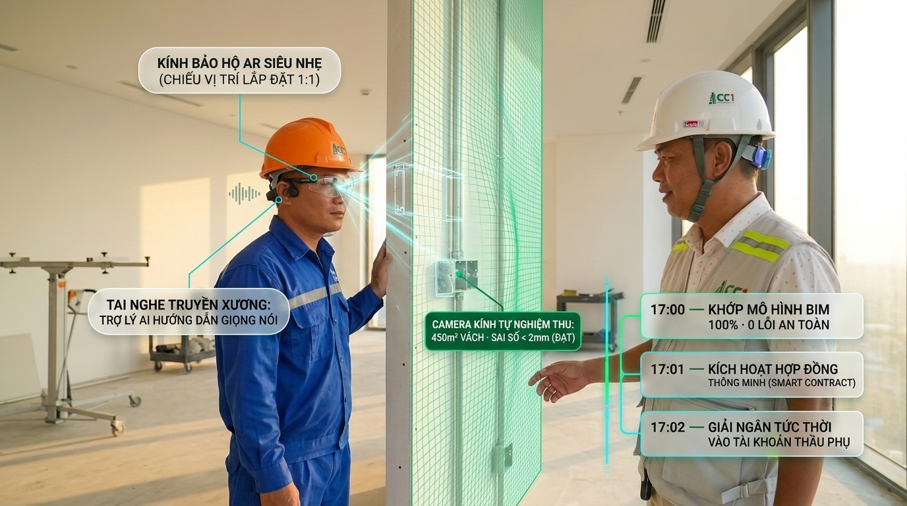
