# PHẦN VII — LÕI VẬN HÀNH AI CHO TOÀN BỘ DỰ ÁN CÔNG TRƯỜNG SỐ

> Chương bổ sung cho bộ hồ sơ Công trường số CC1. Áp dụng cho mọi dự án của tập đoàn: công trường khép kín (điểm chạm 1.1–4.2) và công trường tuyến (L1–L8).
> Gộp từ 3 bản brainstorm ngày 31/10/2026 trong `plans/reports/advisory-261031-0821-*.md`.
> Nhãn: **[F]** nguồn đã kiểm · **[V]** số do nhà cung cấp tự công bố · **[S]** đại lý hoặc trang tổng hợp · **[I]** đề xuất/ước lượng của nhóm tư vấn.
> Tên thiết bị, phần mềm, mô hình cụ thể cho từng khối: VII.18.
> Trạng thái: trang web đăng bản tóm tắt; bản đầy đủ ở file này.

---

## VII.1. Kết luận

- **Không tự huấn luyện LLM từ đầu.** Tài sản lõi của CC1 là ontology, đồ thị tri thức, nền dữ liệu và bộ đề kiểm thử. Mô hình ngôn ngữ là linh kiện thay được mỗi 6–12 tháng. **[I]**
- **Không tự chế thiết bị đo.** Mỗi phép đo dùng sản phẩm thương mại đã kiểm định. CC1 tự làm phần nối dữ liệu, đối chiếu và cảnh báo.
- **Giá trị riêng của CC1 nằm ở chuỗi khối lượng:** thiết kế → dự toán → nhập về → thi công → nghiệm thu → thanh toán, nối bằng một ontology chung cho cả tập đoàn.

Quyết định của CC1 (31/10/2026):

| Vấn đề | Chốt |
|---|---|
| Phương án | **B theo cổng** (chốt 31/10/2026): xem `plans/261031-0940-ai-core-plan-a-b/plan.md` |
| Quy mô | Toàn tập đoàn, dưới 30 dự án đang thi công; nạp 10–15 dự án mỗi quý, phủ hết trong khoảng 6–9 tháng |
| Hạ tầng | Mua cụm suy luận ngay; thuê GPU trong nước 3 tháng đầu; đặt mua cụm huấn luyện tại cổng tháng 3–4; đặt máy tại trung tâm dữ liệu thuê (Viettel IDC hoặc FPT) |
| Đội ngũ | 18–22 người + 10–15 người gán nhãn; kỹ sư QS của từng dự án kiêm nhiệm xác nhận ánh xạ BOQ |
| Đo đạc | Dùng thiết bị và phần mềm thương mại đã kiểm định thay vì tự chế; khảo sát và lấy báo giá cả danh sách cùng lúc |
| Dự án mẫu đợt 1 | 1 dự án khép kín có BIM + 1 dự án tuyến (chưa gắn tên) |

## VII.2. Vì sao không tự huấn luyện mô hình từ đầu

| Lựa chọn | Cần gì | Có đáng không |
|---|---|---|
| Huấn luyện từ đầu | Hàng nghìn tỷ token, hàng chục đến hàng trăm nghìn giờ GPU, đội nghiên cứu riêng | Không. Rào cản chính là dữ liệu: tiếng Việt ngành xây dựng chỉ cỡ vài trăm triệu token, mô hình mở miễn phí học trên hàng chục nghìn tỷ token **[I]** |
| Huấn luyện tiếp trên kho ngành | 0,5–2 tỷ token sạch, vài trăm giờ GPU H100 cho mô hình 30B **[I]** | Chỉ khi bộ đề kiểm thử cho thấy hổng thuật ngữ rõ rệt |
| Tinh chỉnh hẹp (LoRA) | Vài nghìn mẫu do kỹ sư gán nhãn | Có, cho tác vụ hẹp: trích biên bản, BOQ, nhật ký; gọi công cụ đúng định dạng |
| RAG + công cụ + ontology | Nền dữ liệu, chỉ mục, phân quyền | Bắt buộc, làm trước tiên |

Ngành xây dựng đòi số liệu chính xác và truy được nguồn: khối lượng, dòng BOQ, điều khoản TCVN, lý trình. Vì vậy:

- **Sự thật** lấy từ hệ thống gốc: ERP, BIM, BOQ, hồ sơ có trích dẫn, thiết bị đo, bộ giải tối ưu.
- **Mô hình** chỉ lo ngôn ngữ, trích xuất, định dạng và gọi công cụ.

Thang quyết định (mỗi bậc chỉ mở khi bộ đề chứng minh bậc trước chưa đủ):

1. Prompt + RAG + công cụ.
2. Tinh chỉnh LoRA cho tác vụ hẹp.
3. Huấn luyện tiếp trên kho ngành.

## VII.3. Kiến trúc 5 tầng

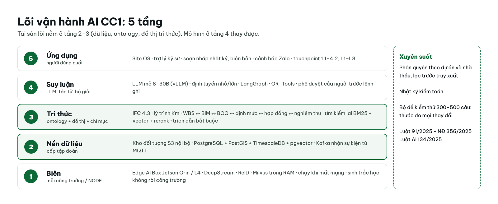

| Tầng | Vai trò | Công nghệ đề xuất | Liên hệ hồ sơ hiện có |
|---|---|---|---|
| 1. Biên | Thiết bị thu tại công trường (camera, drone, trạm cân, cổng LiDAR, chip UWB, GNSS); thị giác máy; chạy khi mất mạng | DeepStream, YOLO, ReID, MQTT, Milvus/FAISS trong RAM | Edge AI Box Jetson AGX Orin 64GB / L4 |
| 2. Nền dữ liệu | Lưu mọi sự kiện, hồ sơ, mô hình 3D | Kho đối tượng S3 nội bộ (Garage hoặc Ceph); PostgreSQL + PostGIS + TimescaleDB; Kafka nhận từ MQTT | Mới |
| 3. Tri thức | Ontology, đồ thị, chỉ mục hồ sơ | Neo4j hoặc Apache AGE; pgvector hoặc Qdrant; tìm kiếm lai BM25 + vector + rerank | Mới |
| 4. Suy luận | LLM, tác tử, bộ giải | vLLM/SGLang, định tuyến mô hình nhỏ/lớn, LangGraph, OR-Tools | Site OS 3.5, Command Node 2× L40S |
| 5. Ứng dụng | Người dùng cuối và thiết bị tại công trường | Phần mềm: Site OS, trợ lý kỹ sư, soạn nháp nhật ký/biên bản, cảnh báo Zalo. Thiết bị: máy tính bảng, màn hình tại cổng, cổng xoay/barie, loa và đèn cảnh báo, vòng tay rung | Điểm chạm 1.1–4.2, L1–L8 |

Xuyên suốt:

- phân quyền theo dự án và nhà thầu, lọc trước khi truy xuất;
- nhật ký kiểm toán;
- phê duyệt của người trước mọi lệnh ghi.

Hai kho vector tách biệt:

- **Milvus/FAISS ở biên:** vector khuôn mặt, dáng đi, trang phục trong ca; sống ngắn, nằm tại công trường.
- **pgvector/Qdrant ở tập đoàn:** vector hồ sơ, tiêu chuẩn, nhật ký.

### Mô hình

| Vai trò | Loại | Ghi chú |
|---|---|---|
| Trả lời, tác tử | LLM mở 8–30B, ưu tiên dạng MoE, xử lý tốt tiếng Việt | Chọn bằng bộ đề của CC1, không bằng bảng xếp hạng quảng cáo |
| Tác vụ khó, ít gặp | LLM mở lớn hơn, hoặc API thương mại cho dữ liệu không nhạy cảm | Định tuyến theo độ khó và độ nhạy dữ liệu |
| Embedding | Đa ngôn ngữ (ứng viên Qwen3-Embedding-4B, đối chứng bge-m3), tinh chỉnh trên cặp hỏi–đáp ngành | Cải thiện truy xuất nhiều hơn đổi LLM |
| Đọc scan, bản vẽ | Mô hình thị giác–ngôn ngữ mở (ứng viên PaddleOCR-VL-1.6, Qwen3-VL-8B) | Trích biên bản, bảng |

Tên mô hình cụ thể chỉ chốt lúc triển khai, sau khi chạy bộ đề. Danh sách ứng viên và giấy phép: VII.18.

#### Hình chi tiết: Huấn luyện mô hình ngành CC1

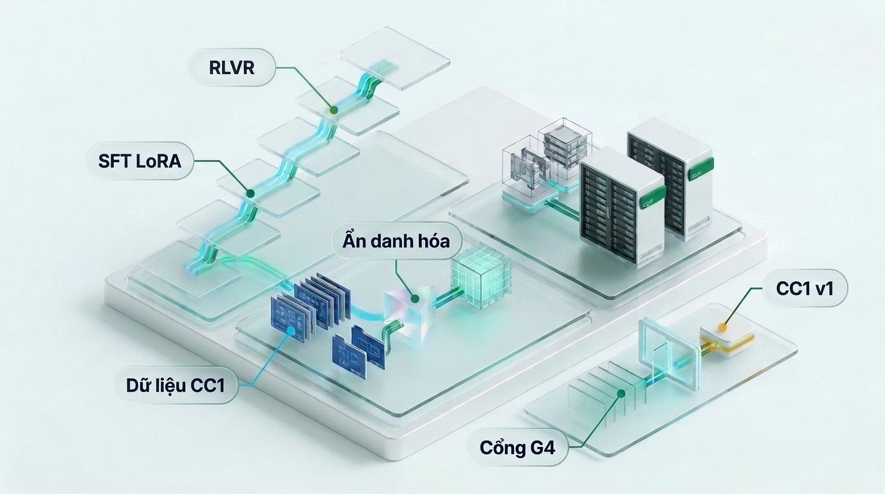

**Bước 1.** Đội 10–15 người gán nhãn; QS kiểm mẫu.

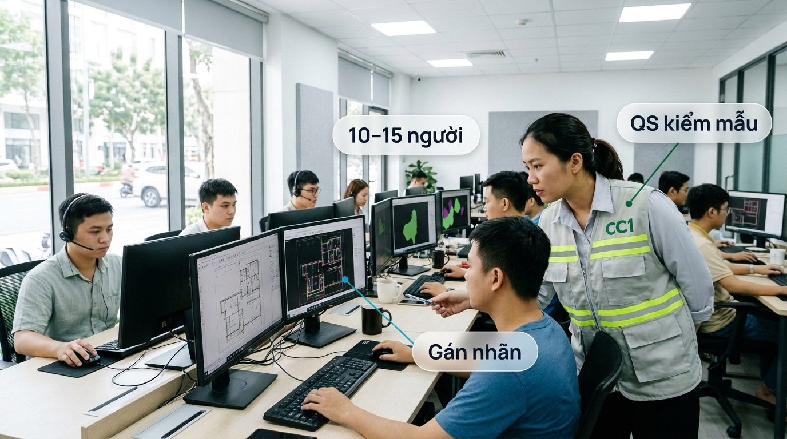

**Bước 2.** Huấn luyện trên cụm CC1; theo dõi sai số giảm qua từng lượt.

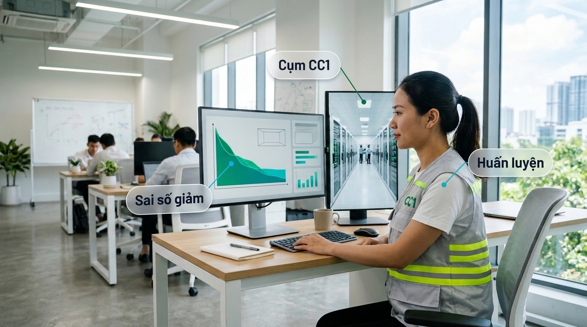

**Bước 3.** Cổng G4: CC1 v1 phải hơn mô hình nền ở mọi nhóm câu, không nhóm nào tụt.

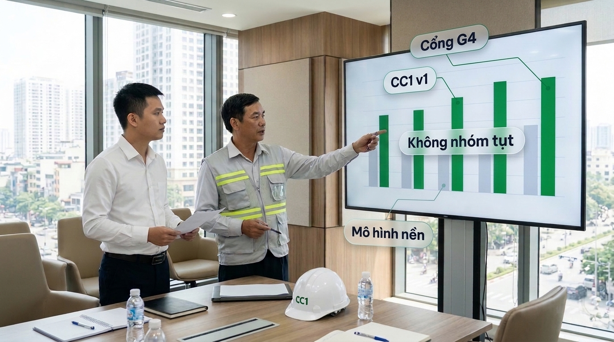

### Bộ đề kiểm thử: làm đầu tiên

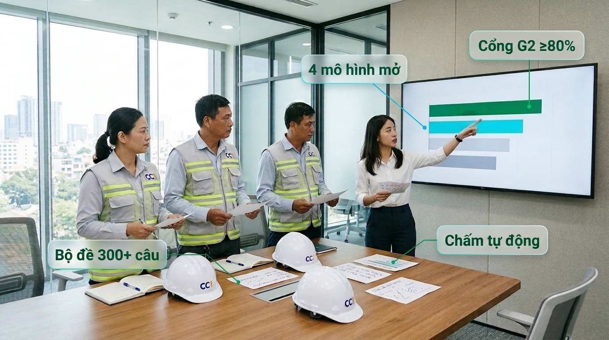

#### Hình chi tiết: Bộ đề và thi đấu mô hình

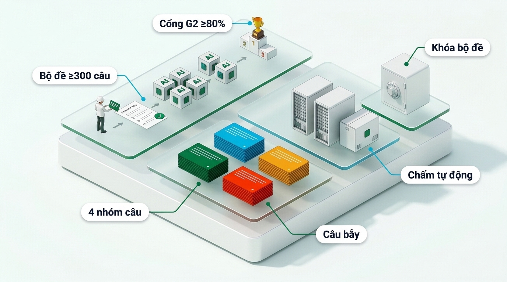

**Bước 1.** Chỉ huy trưởng viết câu hỏi thật từ công trường.

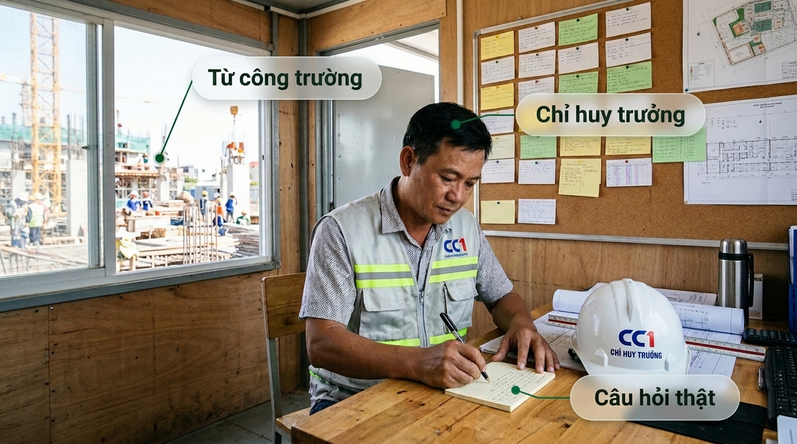

**Bước 2.** QS viết đáp án chuẩn, có trích dẫn tài liệu.

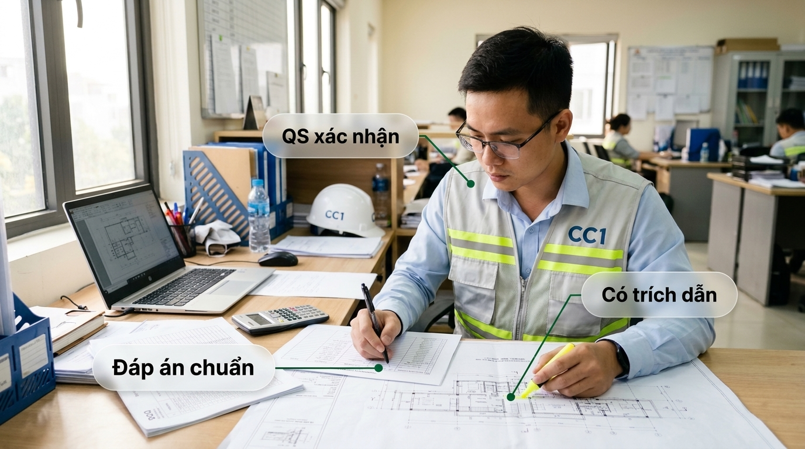

**Bước 3.** Chạy 4 mô hình mở trên GPU thuê; mô hình bịa số ở câu bẫy bị loại.

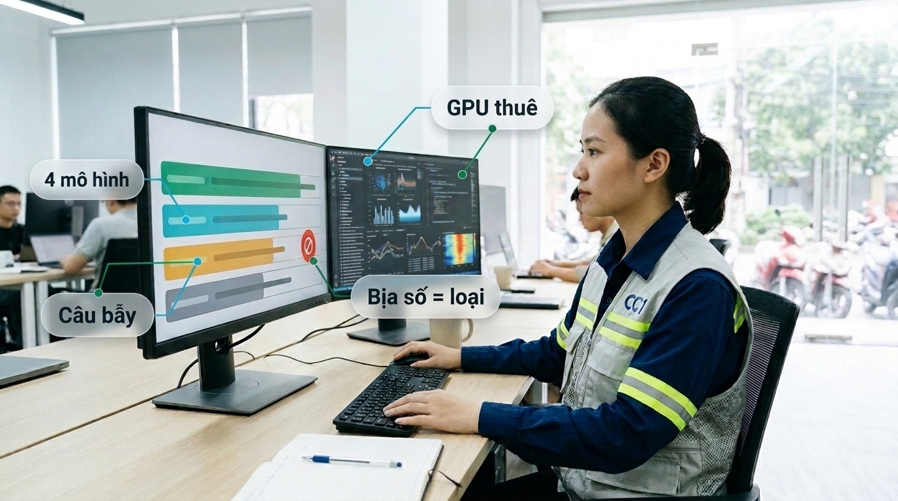

- 300–500 câu hỏi thật do chỉ huy trưởng, QS, giám sát viết, kèm đáp án và tài liệu nguồn.
- Nhóm câu: tra tiêu chuẩn, tra khối lượng, đối chiếu nghiệm thu, an toàn, hợp đồng, công trường tuyến, câu bẫy.
- Mỗi dự án nạp vào bổ sung 30–50 câu riêng.
- Mọi thay đổi (mô hình, embedding, tinh chỉnh) chạy lại bộ đề và so điểm.

## VII.4. Ontology

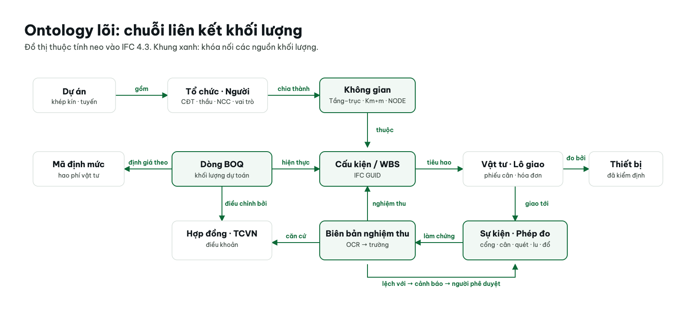

### Cách hiện thực

- Định nghĩa lược đồ một lần (LinkML hoặc SHACL). Từ đó sinh bảng PostgreSQL, ràng buộc đồ thị và JSON Schema cho đường ống OCR.
- Lưu bằng đồ thị thuộc tính (Neo4j hoặc Apache AGE), không dùng RDF/OWL đầy đủ.
- Neo theo chuẩn:
  - IFC 4.3 (ISO 16739) cho cấu kiện, gồm cả đường, cầu;
  - ISO 19650 cho đặt tên tài liệu;
  - bSDD cho thuộc tính;
  - lý trình Km+m và LandXML cho công trường tuyến.

### Lớp chính

| Nhóm | Lớp | Khóa định danh |
|---|---|---|
| Tổ chức | Dự án; Tổ chức (chủ đầu tư, tổng thầu, thầu phụ, nhà cung cấp); Người (vai trò) | Mã dự án; mã số thuế; mã công nhân ẩn danh |
| Không gian | Khép kín: Tầng, Phân khu, Ô lưới · Tuyến: Tuyến, Đoạn (Km đầu, Km cuối), NODE | Lý trình quy về mét; mã tầng–trục |
| Công việc | Hạng mục WBS, Cấu kiện BIM, Dòng BOQ, Mã định mức | IFC GUID; mã định mức |
| Vật tư, thiết bị | Vật tư, Lô giao hàng, Thiết bị, Xe | Mã vật tư; biển số |
| Tài liệu | Bản vẽ, Chỉ dẫn kỹ thuật, Hợp đồng, Điều khoản, Biên bản nghiệm thu, Nhật ký, Hóa đơn, Giấy phép mặt trận | Số hiệu tài liệu |
| Tiêu chuẩn | TCVN, QCVN theo điều khoản | Số hiệu + điều |
| Sự kiện | Qua cổng, Cân, Quét, Đổ bê tông, Lượt lu, Cảnh báo an toàn, Man-down | Mã thiết bị + thời điểm |
| Đo đạc | Phép đo: giá trị, đơn vị, phương pháp, thiết bị, độ bất định | Gắn với sự kiện sinh ra nó |
| Kiểm soát | Chênh lệch, Cảnh báo, Phê duyệt, Thanh toán | Mã cảnh báo |

### Quan hệ chính

| Quan hệ | Từ → Tới | Ví dụ |
|---|---|---|
| thuộc | Cấu kiện → Phân khu / Đoạn Km | Cột C-12 thuộc tầng 9 trục D |
| hiện thực | Dòng BOQ → Cấu kiện | "Bê tông cột M300" → nhóm cột tầng 9 |
| định giá theo | Dòng BOQ → Mã định mức | Hao phí xi măng, cát, đá |
| tiêu hao | Hạng mục → Vật tư (lý thuyết) | Tính từ định mức |
| giao tới | Lô giao hàng → Dự án / Đoạn | Phiếu cân → Km 12+400 |
| đo bởi | Phép đo → Thiết bị | m³ đào đắp → drone LiDAR |
| làm chứng cho | Sự kiện / Phép đo → Biên bản | Ảnh quét + phiếu xe bồn → biên bản đổ bê tông |
| nghiệm thu | Biên bản → Hạng mục (khối lượng) | Biên bản nghiệm thu 120 m³ |
| điều chỉnh bởi | Dòng BOQ → Điều khoản hợp đồng | Đơn giá, phạt giao thiếu |
| yêu cầu | Điều khoản tiêu chuẩn → Hạng mục | Độ chặt nền K98 |
| lệch với | Phép đo ↔ Phép đo | Cân nhập ≠ thể tích quét × tỷ trọng |
| phê duyệt bởi | Cảnh báo / Lệnh tác tử → Người | Giám đốc dự án |

### Câu hỏi kiểm tra ontology

Ontology đạt khi các câu sau trả lời được bằng truy vấn đồ thị, không cần LLM đoán:

1. Đoạn Km 12+400 đến 13+000: thiết kế, nhập, thi công, nghiệm thu, đã trả bao nhiêu m³ cấp phối? Chênh ở khâu nào?
2. Tầng 9: cấu kiện nào đã đổ bê tông mà chưa có biên bản nghiệm thu?
3. Nhà cung cấp nào có tỷ trọng cát lệch dải chuẩn quá 3 lần trong tháng?
4. Hạng mục nào đang thi công nhưng thiếu điều khoản tiêu chuẩn áp dụng?
5. Ai đã phê duyệt lệnh lùi lịch xe bồn hôm qua, dựa trên bằng chứng nào?

## VII.5. Knowledge RAG

#### Hình chi tiết: Trợ lý AI có trích dẫn

**Bước 1.** Chỉ huy trưởng hỏi bằng giọng nói, tiếng Việt, không cần gõ.

**Bước 2.** Câu trả lời đặt cạnh tài liệu gốc, tô sáng đúng đoạn trích.

**Bước 3.** Số liệu lấy thẳng từ ERP qua truy vấn; mô hình không tự đoán số.

### Quy trình

1. **Bóc tách:** OCR và trích bảng (mục VII.6).
2. **Chia đoạn theo cấu trúc:** điều, khoản, mục, dòng BOQ; không chia theo số ký tự.
3. **Gắn nhãn ontology** cho từng đoạn: dự án, hạng mục, Km, mã cấu kiện.
4. **Tìm kiếm lai:**
   - BM25 có tách từ tiếng Việt (underthesea, pyvi) để bắt đúng mã hiệu và số hiệu TCVN;
   - vector đa ngôn ngữ;
   - xếp hạng lại.
5. **GraphRAG:** câu hỏi đi qua nhiều tài liệu thì đi theo chuỗi quan hệ ở VII.4.
6. **Trích dẫn bắt buộc:** không có nguồn thì trả "không tìm thấy". Số liệu lấy qua truy vấn SQL hoặc đồ thị, không để mô hình tự viết.

### Phân quyền tại bước truy xuất

Lọc theo dự án, nhà thầu, vai trò **trước khi** tìm kiếm. Tài liệu dự án A không bao giờ lọt vào câu trả lời cho người dự án B. Mỗi đợt nạp dự án có kiểm thử rò rỉ riêng.

## VII.6. OCR và đọc hồ sơ

#### Hình chi tiết: Đọc hồ sơ OCR và số hóa hồ sơ cũ

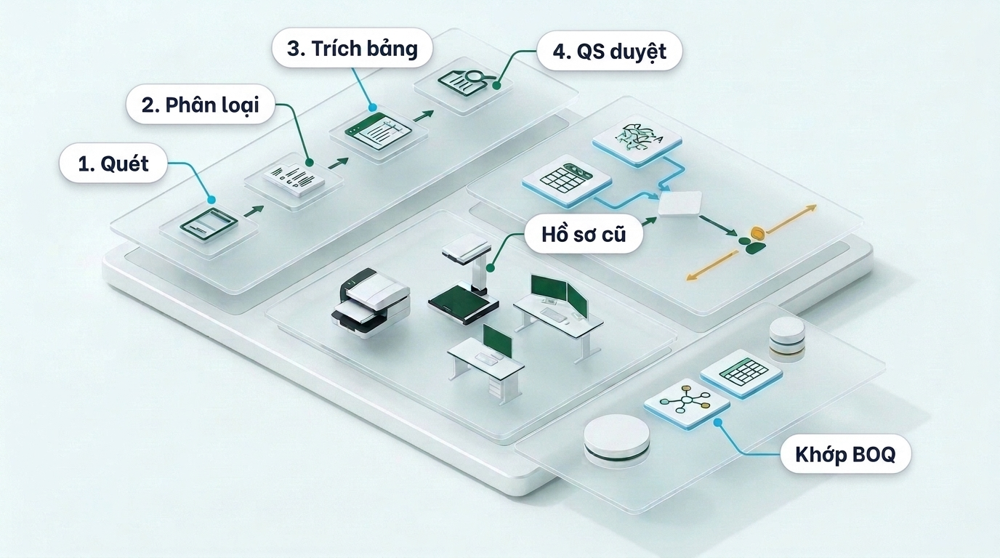

**Bước 1.** Phân loại trang scan theo mẫu: biên bản, phiếu nhập kho, nhật ký.

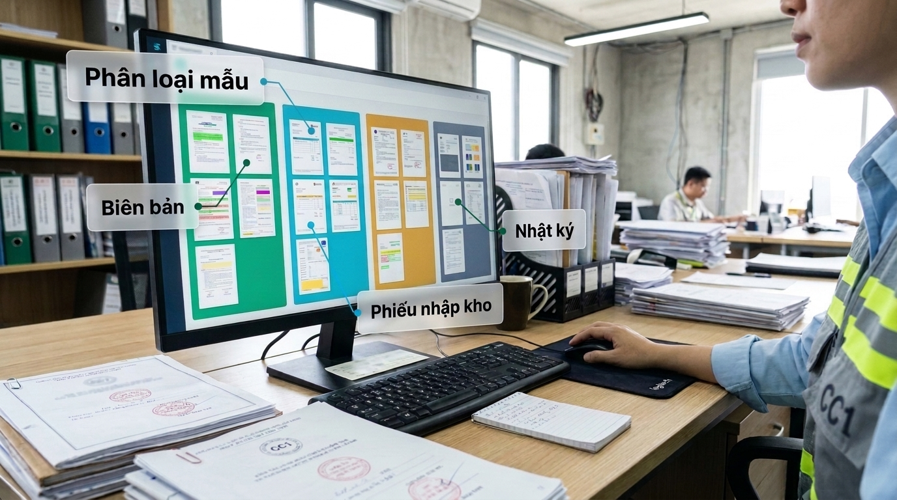

**Bước 2.** Trích từng trường, dấu đỏ, chữ viết tay và bảng khối lượng.

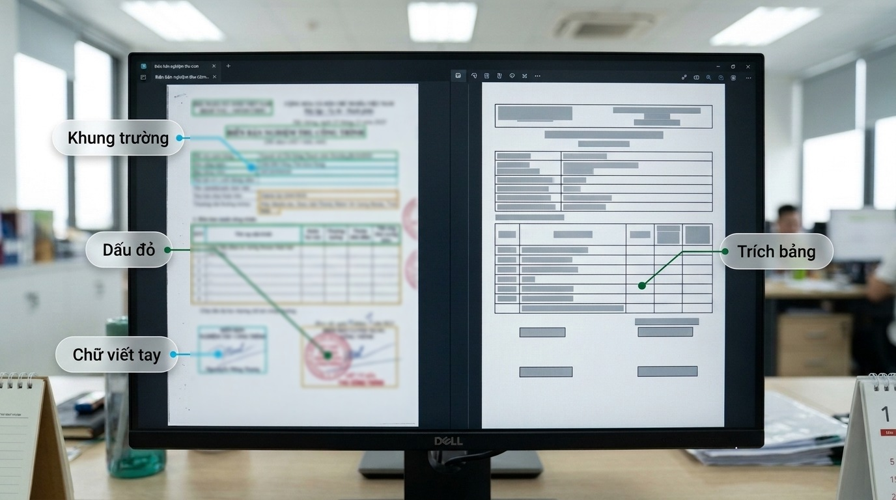

**Bước 3.** Ô có độ tin thấp chuyển cho QS sửa; bản sửa được lưu để mô hình học.

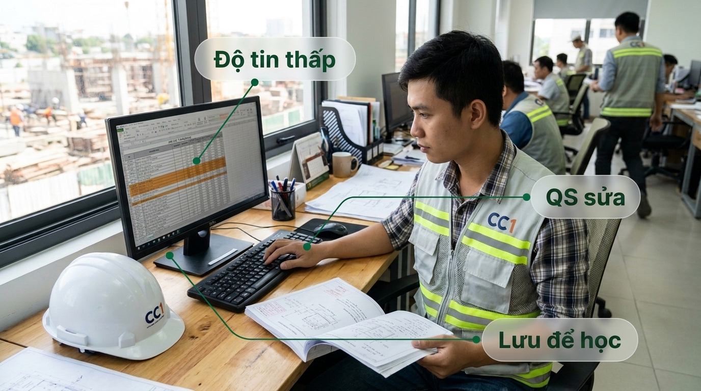

**Bước 4.** Số hóa hồ sơ cũ: gắn mã thùng, quét sách, ưu tiên hồ sơ hoàn công.

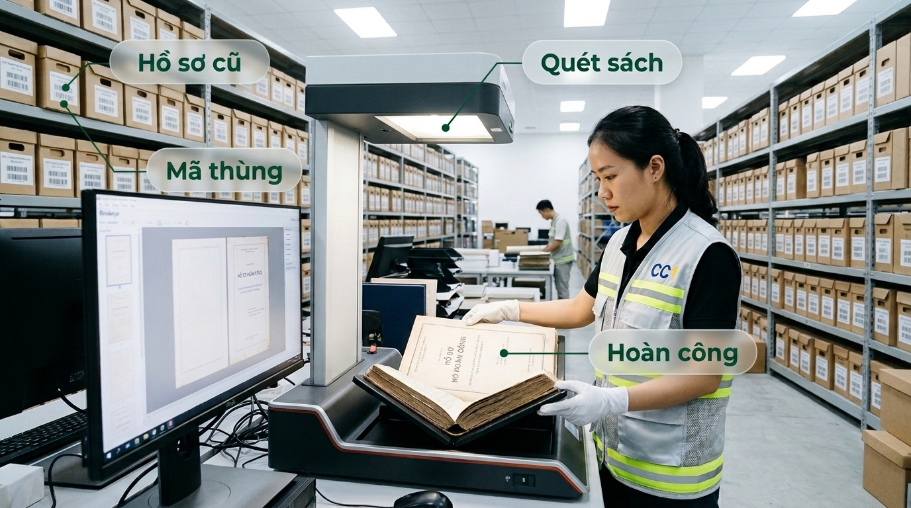

### Nguồn có cấu trúc trước, OCR sau cùng

| Loại tài liệu | Cách đọc |
|---|---|
| Hóa đơn điện tử | Đọc XML gốc, không OCR bản in |
| BOQ, dự toán Excel | Đọc ô trực tiếp |
| Bản vẽ DWG/DXF | Đọc thực thể vector: text, block, layer, kích thước (ezdxf; DWG qua bộ chuyển ODA) |
| Mô hình IFC | Đọc thuộc tính và bộ khối lượng `Qto_*` |
| PDF có lớp chữ | Trích chữ + cấu trúc trang (Docling) |
| Scan: biên bản, nhật ký, phiếu cân giấy | Quy trình dưới đây |
| Bản vẽ scan | Nhận diện ký hiệu + OCR số kích thước; chỉ khi không còn bản vector |

### Quy trình cho tài liệu scan

1. **Tiền xử lý:** chỉnh nghiêng, khử nhiễu, tách dấu đỏ bằng lọc kênh màu để con dấu không đè chữ.
2. **Phân vùng bố cục:** tiêu đề, bảng, đoạn, chữ ký, con dấu (PP-Structure, DocLayout-YOLO, Docling).
3. **Nhận dạng chữ:**
   - trang scan, bảng, con dấu: PaddleOCR-VL-1.6;
   - dòng chữ in: PP-OCRv5 với từ điển tiếng Việt;
   - viết tay, chữ mờ: VietOCR tinh chỉnh trên nhật ký CC1;
   - không dùng PP-OCRv6 (từ điển thiếu dấu tiếng Việt) và Surya, Marker (giấy phép trọng số giới hạn doanh thu). Chi tiết: VII.18.
4. **Cấu trúc bảng:** Table Transformer hoặc PP-Structure.
5. **Trích trường theo lược đồ:** mô hình thị giác–ngôn ngữ đọc ảnh + chữ OCR, trả JSON theo lược đồ sinh từ ontology.
6. **Kiểm tra chéo hai đường:** OCR cổ điển và mô hình thị giác. Khớp thì qua; lệch thì đưa người duyệt.
7. **Hàng chờ duyệt theo độ tin cậy.** Mỗi lần người xác nhận thành mẫu huấn luyện LoRA.

Con dấu và chữ ký chỉ kiểm tra có hay không, đúng vị trí. Không xác thực chữ ký bằng AI.

### Bẫy riêng của hồ sơ Việt Nam

| Bẫy | Cách xử lý |
|---|---|
| File cũ dùng bảng mã TCVN3 (.VnTime) hoặc VNI → chữ rác | Nhận diện bảng mã, chuyển Unicode trước khi nạp |
| Unicode NFC và NFD lẫn lộn → tìm không thấy | Chuẩn hóa NFC toàn bộ |
| Đơn vị viết nhiều kiểu (m³, "khối", chữ hoa, chữ thường) | Bộ chuẩn hóa đơn vị dùng chung |
| Số thập phân dấu phẩy và dấu chấm lẫn nhau | Suy theo ngữ cảnh cột + kiểm tra phạm vi hợp lý |
| Lý trình viết Km12+400, K12+400, Km 12 + 400 | Bộ phân tích lý trình quy về mét |

### Lộ trình theo loại biểu mẫu

| Đợt | Loại | Vì sao |
|---|---|---|
| 1 | Phiếu cân, phiếu giao hàng; hóa đơn điện tử | Số lượng lớn, mẫu đơn giản, nối thẳng vào nguồn khối lượng "nhập về" |
| 2 | Biên bản nghiệm thu công việc; BOQ Excel | Giá trị cao; điểm nghẽn ánh xạ |
| 3 | Nhật ký thi công | Nhiều chữ viết tay, phục vụ tra cứu |
| 4 | Hồ sơ cũ scan, bản vẽ scan | Chỉ khi có yêu cầu cụ thể |

Ngưỡng mở đợt kế (đề xuất khởi đầu, đặt lại sau 200 trang đầu mỗi loại) **[I]**:

| Chỉ số | Ngưỡng |
|---|---|
| Độ chính xác theo trường sau duyệt | 100% (người duyệt chịu trách nhiệm số cuối) |
| Độ chính xác tự động, chữ in | ≥ 95% |
| Độ chính xác tự động, viết tay | ≥ 85% |
| Tỷ lệ đi thẳng không cần duyệt | ≥ 60% |
| Thời gian duyệt trung bình | < 30 giây / trang |

## VII.7. Đọc và phân tích khối lượng vật tư

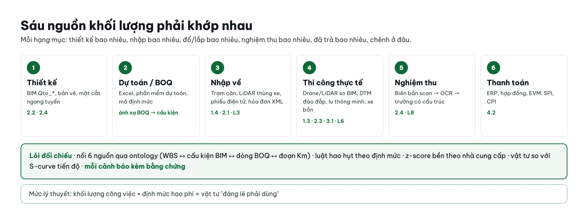

#### Hình chi tiết: Ontology và sáu nguồn khối lượng

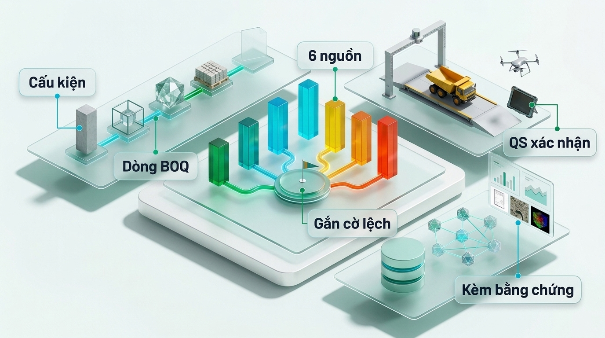

**Bước 1.** Xe vật tư rời qua cân và cổng quét thùng; tỷ trọng lệch dải chuẩn thì gắn cờ.

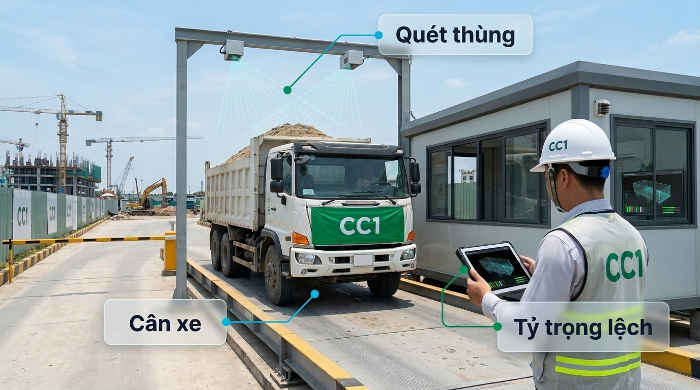

**Bước 2.** Drone RTK đo thể tích đống vật liệu, so với sổ kho.

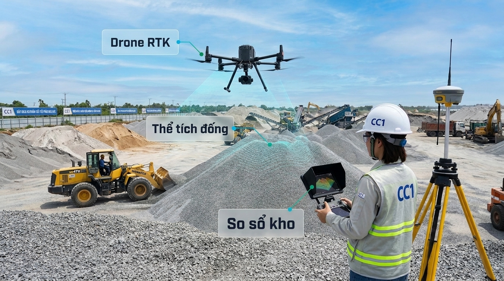

**Bước 3.** Phiếu xe bồn so với thể tích cấu kiện trong BIM để tính hao hụt bê tông.

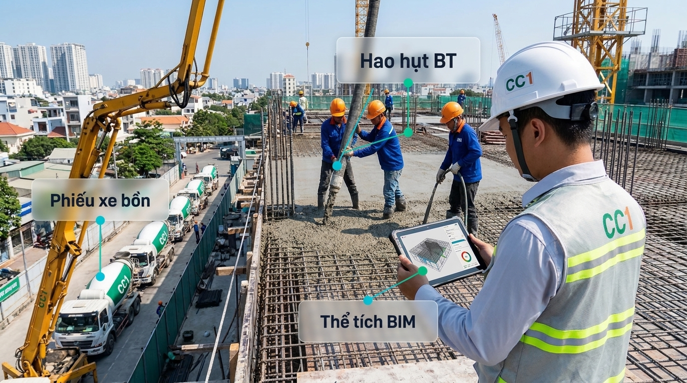

**Bước 4.** Cảnh báo chênh lệch kèm phiếu cân, ảnh hiện trạng và dòng BOQ liên quan.

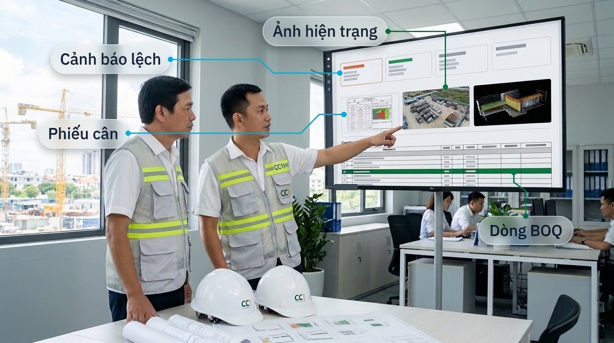

### Sáu nguồn khối lượng

| # | Nguồn | Lấy từ | Điểm chạm |
|---|---|---|---|
| 1 | Thiết kế | BIM (`Qto_*`), bản vẽ, mặt cắt ngang tuyến | 2.2, 2.4 |
| 2 | Dự toán / BOQ | Excel, phần mềm dự toán, mã định mức | — |
| 3 | Nhập về | Trạm cân, quét LiDAR thùng xe, phiếu điện tử, hóa đơn điện tử | 1.4, 2.1, L3 |
| 4 | Thi công thực tế | Drone/LiDAR so BIM, máy xúc dẫn đường, lu thông minh, số xe bồn | 1.3, 2.3, 3.1, L6 |
| 5 | Nghiệm thu | Biên bản (OCR) | 2.4, L8 |
| 6 | Thanh toán | ERP, hợp đồng | 4.2 |

Mức lý thuyết: khối lượng công việc × định mức hao phí = vật tư "đáng lẽ phải dùng".

### Thứ tự tin cậy khi các nguồn lệch

1. Thiết bị đã kiểm định, cho đúng đại lượng của nó (cân cho tấn, LiDAR cho m³).
2. Đo đạc độc lập (drone, máy quét).
3. Chứng từ (phiếu, hóa đơn).
4. Biên bản nghiệm thu.

Thanh toán vẫn theo biên bản nghiệm thu đúng quy trình hợp đồng. Lõi AI gắn cờ chênh lệch kèm bằng chứng, không tự sửa số trên biên bản.

### Ánh xạ dòng BOQ về cấu kiện

1. Chuẩn hóa chữ: NFC, tách đơn vị, tách quy cách ("bê tông cột M300 đá 1x2").
2. Máy gợi ý 3 mã định mức và nhóm cấu kiện cho mỗi dòng, bằng:
   - luật (từ khóa, đơn vị phải khớp);
   - độ tương đồng embedding;
   - LLM xác minh.
3. **Kỹ sư QS của dự án** (kiêm nhiệm) xác nhận. Xác nhận được lưu để lần sau tự động.
4. Liên kết dòng BOQ với nhóm cấu kiện BIM (theo loại, tầng, trục) hoặc với đoạn lý trình.

LLM chỉ gợi ý và xếp hạng, không tự quyết mã định mức.

### Thuật toán đo khối lượng thực tế

| Bài toán | Thuật toán | Đầu ra |
|---|---|---|
| Đào đắp nền đường | Hiệu hai mô hình địa hình (TIN–TIN); đối chiếu phương pháp mặt cắt trung bình theo lý trình | m³ đào/đắp theo đoạn Km |
| Tiến độ kết cấu | Định vị RTK, ghép đám mây điểm (ICP), lọc mặt đất (CSF), khoảng cách đám mây–mô hình BIM (C2M) | % hoàn thành từng cấu kiện, bản đồ lệch |
| Thể tích thùng xe | Quét thùng rỗng và đầy, lấy hiệu bản đồ độ cao rồi tích phân | m³ thực chở |
| Gian lận vật tư rời | Tỷ trọng = khối lượng cân / thể tích quét, so dải chuẩn | Cờ: cát ướt, chở thiếu, độn tạp chất |
| Bãi tập kết | Thể tích đống từ drone so sổ kho | Tồn kho thực |
| Bê tông | Phiếu xe bồn so thể tích cấu kiện BIM | Hao hụt bê tông |
| Thép | Cân nhập so bảng thống kê thép + định mức hao hụt | Hao hụt thép |

### Phát hiện bất thường

- **Luật cứng:** chênh vượt định mức hao hụt → cảnh báo ngay.
- **Thống kê:** z-score bền (median, MAD) theo vật tư, dự án, nhà cung cấp.
- **Theo thời gian:** vật tư tăng mà đường cong tiến độ (S-curve) đứng → nghi thất thoát.
- **Giá trị thu được (EVM):** khối lượng thực tế × đơn giá → SPI, CPI theo gói thầu.

Mỗi cảnh báo kèm bằng chứng: phiếu cân, ảnh, đoạn point cloud, dòng BOQ. Không có bằng chứng thì không cảnh báo.

## VII.8. Thiết bị đo: dùng sản phẩm thị trường

Khảo sát và lấy báo giá **cả danh sách cùng lúc**. Đây là danh sách để khảo sát, chưa so giá, chưa đánh giá tại Việt Nam:

| Phép đo | Nhóm sản phẩm cần khảo sát |
|---|---|
| Cân xe | Đầu cân, cầu cân đã kiểm định đo lường (Mettler Toledo và hãng tương đương) |
| Thể tích thùng xe | Máy quét thể tích tải (ví dụ Loadscan) |
| Drone đo vẽ | DJI Matrice + LiDAR Zenmuse; xử lý bằng DJI Terra hoặc Pix4D |
| Quét và so BIM | Leica, Trimble, Faro |
| Bóc khối lượng bản vẽ | Autodesk Takeoff, CostX, Bluebeam |
| Dẫn hướng máy | Trimble Earthworks, Leica iCON, Topcon |
| Lu thông minh | Hệ thống của hãng lu (Bomag, Hamm, Caterpillar) |
| Độ chín bê tông | Giatec SmartRock, Converge |
| Định vị trong nhà (UWB) | Pozyx, Sewio và hãng tương đương |
| Robot in sàn | Dusty Robotics, HP SitePrint |
| Robot tuần tra | Boston Dynamics Spot hoặc nền tảng bốn chân tương đương |

Tiêu chí chấm khi khảo sát:

1. Có kiểm định, chứng nhận dùng được tại Việt Nam.
2. Có đại lý, bảo hành, kỹ thuật tại Việt Nam.
3. **Xuất dữ liệu mở** (API, định dạng chuẩn như IFC, LAS/E57, LandXML, CSV), không khóa dữ liệu trong phần mềm hãng.
4. Giá mua, giá thuê bao hằng năm.
5. Có dự án tham chiếu cùng loại (khép kín hoặc tuyến).

Tiêu chí 3 là điều kiện loại: không xuất dữ liệu mở thì không nối được vào lõi.

Model cụ thể, thông số và giá niêm yết tham khảo cho từng nhóm: VII.18 mục 6–10.

## VII.9. Thuật toán trong proposal và độ chín

Độ chín: **Phổ biến** (đã đại trà, mua được) · **Thí điểm** (có dự án thật, chưa đại trà) · **Nghiên cứu** (rủi ro cao tại công trường Việt Nam). **[I]**

### Công trường khép kín

| ĐC | Thuật toán chính | Độ chín | Ghi chú |
|---|---|---|---|
| 1.1 | Nhận diện khuôn mặt (ArcFace) + chống giả mạo; phát hiện PPE (YOLO) | Phổ biến | Cần đồng ý theo Luật 91/2025 |
| 1.2 | Phát hiện đối tượng + tư thế + bám vết (ByteTrack); lọc báo giả theo thời gian | Phổ biến | Báo giả là vấn đề chính; tinh chỉnh theo từng công trường |
| 1.3 | Dựng 3D từ ảnh (COLMAP, OpenDroneMap), RTK, so BIM | Phổ biến | Cần BIM sạch, đúng tọa độ |
| 1.4 | Nhận dạng biển số Việt Nam 1 dòng và 2 dòng | Phổ biến | Biển bẩn, bùn: đặt camera đúng góc |
| 1.5 | ReID ngoại hình, dáng đi, khung xương 3D, UWB, hợp nhất bằng lọc Kalman + ghép Hungarian | Nghiên cứu → thí điểm | Xem VII.10: UWB là nguồn chính |
| 2.1 | Thể tích LiDAR + cân + tỷ trọng | Thí điểm | Hiệu chuẩn theo loại thùng xe |
| 2.2 | Robot in sàn định vị bằng máy toàn đạc | Thí điểm, có sản phẩm thương mại | Mua |
| 2.3 | Dẫn hướng máy xúc GNSS RTK + IMU | Phổ biến | Mua bộ của hãng |
| 2.4 | AR: SLAM LiDAR, đăng ký mô hình BIM | Thí điểm | Sai số đăng ký là rủi ro chính |
| 3.1 | Robot bốn chân: SLAM LiDAR (FAST-LIO, LIO-SAM), ảnh nhiệt | Thí điểm | Mua nền tảng; CC1 làm phân tích |
| 3.2 | Khung xương trợ lực | Thí điểm | Không phải bài toán AI |
| 3.3 | Máy tự hành: lập đường phủ kín, tránh va chạm nhiều xe | Nghiên cứu tại Việt Nam | Hoãn đến khi có đối tác hãng máy |
| 3.4 | Chống lắc tải (input shaping, MPC), phát hiện người dưới tải | Thí điểm | Phát hiện người làm được sớm; điều khiển cẩu qua hãng cẩu |
| 3.5 | Tác tử LLM + đường găng (CPM) + bộ giải lập lịch (OR-Tools CP-SAT/MILP) | Thí điểm | Bộ giải quyết định; LLM diễn giải và đề xuất |
| 4.1–4.2 | Nhà máy vi mô, hợp đồng thông minh | Tầm nhìn | Ngoài lõi năm 1–2 |

### Công trường tuyến

| ĐC | Thuật toán chính | Độ chín | Ghi chú |
|---|---|---|---|
| L1 | Phát hiện biển báo, rào chắn; đối chiếu danh mục QCVN 41:2024 | Thí điểm | Danh mục số hóa là phần chính |
| L2 | Hàng rào định vị theo đoạn Km; điểm danh QR/NFC | Phổ biến | Không cần AI |
| L3 | Geofence (điểm trong đa giác), phiếu điện tử | Phổ biến | Không cần AI |
| L4 | Bám vết radar + thời gian tới va chạm (TTC) | Thí điểm | Báo giả do xe máy lách là rủi ro lớn |
| L5 | Tham chiếu tuyến tính: chiếu GPS lên tim tuyến → lý trình + độ lệch | Phổ biến | Xương sống dữ liệu tuyến |
| L6 | Lu thông minh (chỉ số CMV), dải nhiệt thảm nhựa | Phổ biến ở nước ngoài | Dữ liệu từ thiết bị hãng |
| L7 | Phát hiện bất động/ngã từ gia tốc kế, LoRa/4G | Phổ biến | Không cần AI nặng |
| L8 | Phương pháp độ chín bê tông (Nurse-Saul, ASTM C1074); kiểm soát hình học đốt dầm | Phổ biến | Hiệu chuẩn theo cấp phối thật |

Ba chỗ cần thận trọng khi trình bày: **1.5** (ReID trên đồng phục), **3.3** (máy tự hành), **L4** (báo giả do xe máy).

## VII.10. Định danh công nhân: UWB là nguồn chính

### Vì sao không dựa vào thị giác

- Công nhân mặc cùng đồng phục, cùng mũ, cùng áo phản quang. Đặc trưng ngoại hình, đầu vào chính của ReID, gần như giống nhau.
- Dáng đi đổi khi mang vác, leo giàn giáo, đi trên sàn không phẳng.

### Thiết kế

| Lớp | Công nghệ | Vai trò |
|---|---|---|
| Định danh tại cổng | Khuôn mặt + chống giả mạo; thẻ cho người không đồng ý sinh trắc | Xác nhận đầu ca, ghép với chip UWB trên mũ |
| Vị trí trong ca, khép kín | UWB: chip trên mũ, trạm neo; sai số hãng công bố cỡ vài chục cm **[V]** | Nguồn định danh và vị trí chính |
| Vị trí trong ca, tuyến | Thẻ GNSS + LoRa/4G (L7) | UWB không phủ được hàng chục km |
| Thị giác | Bám vết trong từng camera; số lớn in trên mũ/áo đọc bằng OCR | Bổ trợ: phát hiện người không mang chip |
| Phát hiện tráo mũ | Vị trí chip lệch vệt người trên camera; khuôn mặt tại cổng khác chủ chip | Gắn cờ cho người kiểm tra |

### Nghĩa vụ dữ liệu sinh trắc

Theo Luật 91/2025/QH15 và NĐ 356/2025/NĐ-CP **[F]**, khuôn mặt và dáng đi là dữ liệu cá nhân nhạy cảm:

- Đồng ý rõ ràng; có đường thay thế không sinh trắc.
- Đánh giá tác động xử lý dữ liệu cá nhân trước khi triển khai.
- Mẫu sinh trắc nằm tại Edge AI Box; xóa khi hết hợp đồng lao động.
- Chỉ dùng cho an toàn và chấm công; không chấm điểm hành vi cá nhân.
- **Không tự động xử phạt.** Mọi cờ phải có người xem bằng chứng trước.

Luật Trí tuệ nhân tạo 134/2025/QH15, hiệu lực 1/3/2026 **[F]**: rà nghĩa vụ phân loại rủi ro cho hệ thống nhận diện sinh trắc trước khi triển khai.

Chỉ số đo:

- tỷ lệ giờ công gán đúng người;
- sai số UWB đo tại công trường thật;
- tỷ lệ cờ sai. Đây là chỉ số quyết định công nhân có tin hệ thống hay không.

## VII.11. Phần cứng và hạ tầng

Đã chốt phương án B (31/10/2026): mua cụm suy luận 2 node 8× GPU 96 GB ngay; thuê GPU trong nước 3 tháng đầu; sau cổng G2 (M3–M4) mua cụm huấn luyện 2 node Blackwell 8 GPU; máy đặt tại trung tâm dữ liệu thuê. Bảng dưới là cấu hình phương án A, giữ để so sánh. Chi tiết B: [giai đoạn 2](./plans/261031-0940-ai-core-plan-a-b/phase-02-inference-cluster-datacenter.md), [giai đoạn 6](./plans/261031-0940-ai-core-plan-a-b/phase-06-procurement-gate-training-cluster.md).

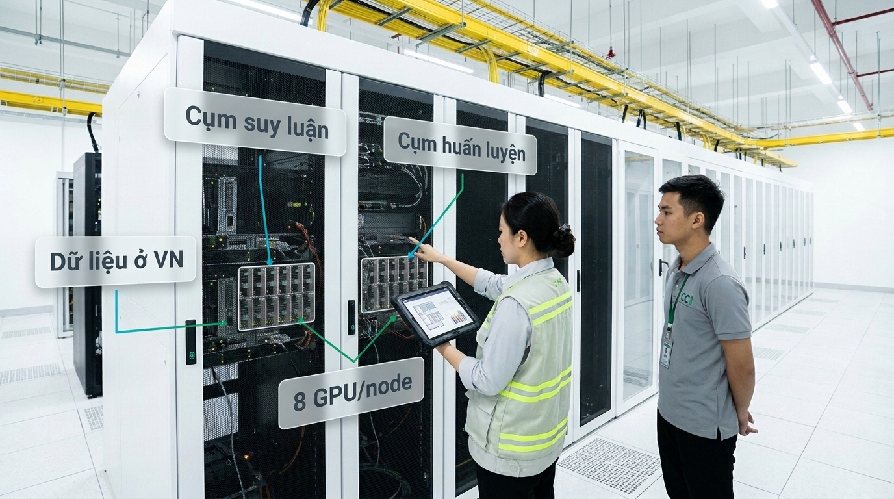

#### Hình chi tiết: Cụm GPU tại trung tâm dữ liệu thuê

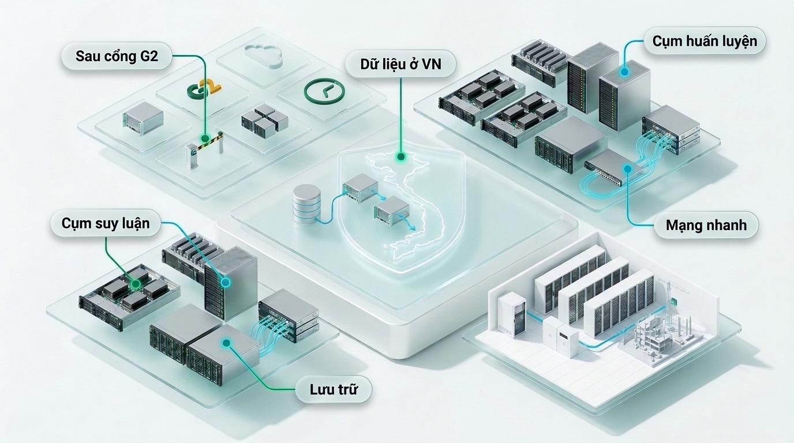

**Bước 1.** Nhận máy, lắp vào tủ, kiểm đúng cấu hình đặt hàng.

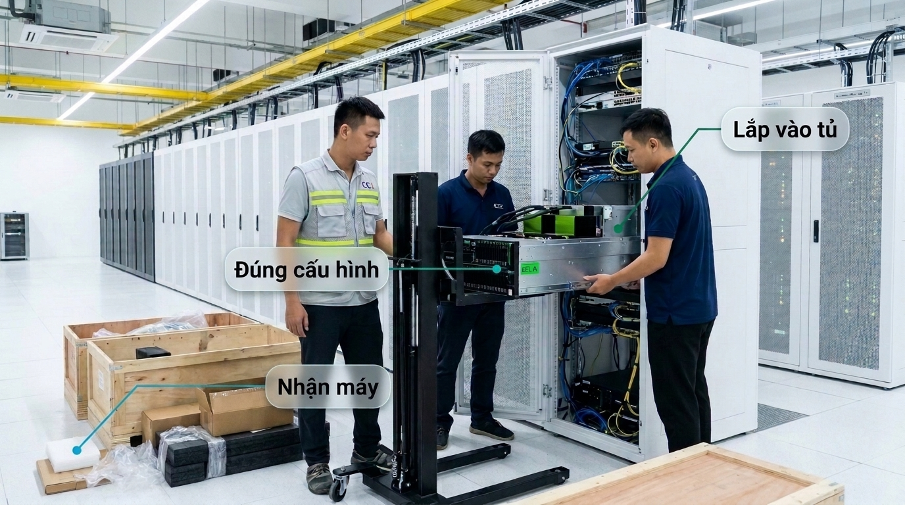

**Bước 2.** Chạy lại một lượt huấn luyện tham chiếu; kết quả phải khớp lượt chạy trên GPU thuê thì mới nghiệm thu cụm.

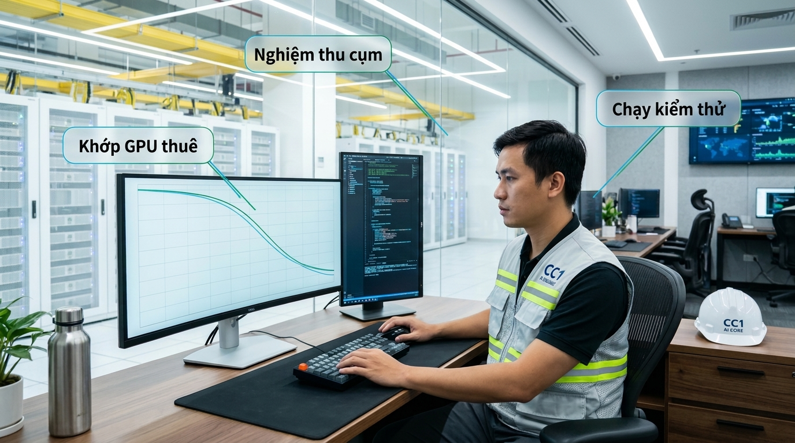

**Bước 3.** Giám sát 24/7 tải GPU, độ trễ và lỗi; cảnh báo khi có sự cố.

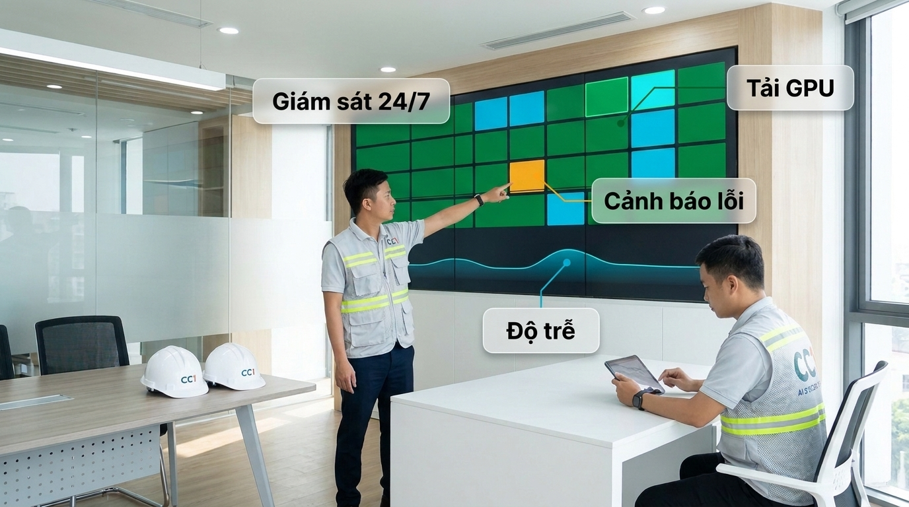

| Tầng | Cấu hình tham khảo | Số lượng |
|---|---|---|
| Biên, mỗi công trường hoặc NODE | Jetson AGX Orin 64GB hoặc server 2U + L4 24GB, NVMe 4TB, UPS | 1 bộ |
| Biên tuyến | Hộp cảm biến năng lượng mặt trời, 4G + Starlink | Theo số đoạn Km |
| Suy luận tập đoàn | 4 GPU loại 48GB (L40S hoặc tương đương), LLM 8–30B lượng tử hóa | 1 cụm; nhân đôi khi tải tăng |
| Huấn luyện | Thuê theo giờ node 8× H100/H200 | Không mua (phương án A) |
| Lưu trữ | Kho đối tượng vài trăm TB | Tăng theo số dự án |
| Mạng | Chỉ đẩy siêu dữ liệu (metadata) lên tập đoàn, dưới 2 Mbps / công trường | — |

Ứng viên GPU, vỏ máy và điều kiện chỗ đặt cho phương án B: VII.18 mục 11.

GPU trong nước:

- FPT AI Factory: H100/H200, giá niêm yết H100 từ khoảng 2,5 USD/giờ **[V]**.
- Viettel Cloud AI-Native: H200 tại trung tâm dữ liệu Hòa Lạc **[F]**.

## VII.12. Chi phí 3 năm (ước lượng thô)

**Đã chốt phương án B theo cổng (31/10/2026): năm 1 khoảng 55–90 tỷ, 3 năm khoảng 105–180 tỷ.** Bảng chi phí B và ngân sách từng giai đoạn: `plans/261031-0940-ai-core-plan-a-b/options-a-b-analysis.md` và `plans/261031-0940-ai-core-plan-a-b/plan.md`. Bảng dưới là phương án A, giữ để so sánh.

**Ước lượng cấp độ, sai số có thể ±50%. Phải có báo giá OEM, bảng lương và báo giá phần mềm trước khi trình.** **[I]** Tỷ giá tạm: 1 USD ≈ 26.000 đồng.

Chưa gồm thiết bị điểm chạm tại công trường (bảng riêng trong hồ sơ kỹ thuật) và giấy phép thiết bị đo ở VII.8.

| Hạng mục | Năm 1 | Năm 2 | Năm 3 | Cơ sở |
|---|---|---|---|---|
| Đội lõi 8–9 người | 4,5–7,5 tỷ | 4,5–7,5 tỷ | 4,5–7,5 tỷ | 40–70 triệu đồng / người / tháng, gồm chi phí đi kèm |
| Cụm suy luận nội bộ | 1,5–2,5 tỷ | 0–2,5 tỷ | Bảo trì | Cần báo giá OEM |
| Lưu trữ | 0,5–1,5 tỷ | 0,3–1 tỷ | 0,3–1 tỷ | Theo số dự án đã nạp |
| Thuê GPU huấn luyện | < 0,3 tỷ | < 0,5 tỷ | < 0,5 tỷ | Một lần LoRA trên 8 H100 × 3 ngày ≈ 1.500 USD |
| API thương mại (dữ liệu không nhạy cảm) | 0,1–0,3 tỷ | 0,2–0,5 tỷ | 0,2–0,5 tỷ | Theo lượng dùng |
| Pháp lý dữ liệu, AI; kiểm thử bảo mật | 0,3–0,6 tỷ | 0,2–0,4 tỷ | 0,2–0,4 tỷ | Tư vấn độc lập |
| **Cộng (làm tròn)** | **7–13 tỷ** | **5–12 tỷ** | **5–10 tỷ** | |

- Con người chiếm khoảng 60–80%. GPU không phải khoản lớn.
- Huấn luyện mô hình chỉ vài nghìn USD mỗi lần. Tiền nên dồn vào dữ liệu và đội.

## VII.13. Đội ngũ và nạp dự án theo đợt

Phương án B: đội 18–22 người cộng 10–15 người gán nhãn, nạp 10–15 dự án mỗi quý ([giai đoạn 1](./plans/261031-0940-ai-core-plan-a-b/phase-01-team-hiring.md)). Bảng vai trò dưới đây là đội lõi phương án A, giữ để so sánh; quy trình nạp một dự án dùng chung cho cả hai.

| Vai trò | Số người |
|---|---|
| Kỹ sư dữ liệu | 2 |
| Kỹ sư ML / LLM | 2 |
| Kỹ sư tri thức ngành (kỹ sư xây dựng) | 2 |
| MLOps / hạ tầng | 1 |
| Quản lý sản phẩm | 1 |
| Bảo mật, pháp chế (kiêm nhiệm) | 0,5 |

Kỹ sư xây dựng trong đội là điều kiện tiên quyết. Thiếu họ, ontology và bộ đề sai từ gốc.

### Nạp một dự án (khoảng 2 tuần công đội lõi) **[I]**

| Bước | Ai làm | Công |
|---|---|---|
| 1. Thu hồ sơ, BIM, BOQ; kiểm bảng mã TCVN3/VNI | Kỹ sư dữ liệu | 2–3 ngày |
| 2. Gắn dự án vào ontology: phân khu hoặc đoạn Km, WBS | Kỹ sư tri thức + chỉ huy trưởng | 2–3 ngày |
| 3. Ánh xạ BOQ: máy gợi ý, QS dự án xác nhận | QS dự án + kỹ sư tri thức | 2–4 ngày cho BOQ cỡ 2.000 dòng |
| 4. Nối điểm chạm đang chạy: cổng, cân, camera, drone | Kỹ sư dữ liệu | 1–2 ngày |
| 5. Bổ sung 30–50 câu bộ đề riêng | Chỉ huy trưởng, QS | 1 ngày |
| 6. Chạy bộ đề, kiểm thử rò rỉ, bàn giao | Đội lõi | 1–2 ngày |

Phương án A nạp 3–5 dự án mỗi quý; phương án B, với đội lớn hơn, nạp 10–15 dự án mỗi quý.

### Tiêu chí chọn 2 dự án mẫu đợt 1

| Tiêu chí | Dự án khép kín | Dự án tuyến |
|---|---|---|
| Dữ liệu số | Có BIM (IFC xuất được), BOQ Excel | Có tim tuyến (LandXML), BOQ Excel |
| Giai đoạn | Đang thi công phần thân, còn ít nhất 12 tháng thi công | Đang thi công nền đường hoặc cầu, còn ít nhất 12 tháng thi công |
| Điểm chạm | Có thể lắp 1.1–1.4 trong quý đầu | Có thể lắp L1–L3, L8 trong quý đầu |
| Con người | Chỉ huy trưởng và QS sẵn sàng viết bộ đề | Như bên cạnh |

## VII.14. Lộ trình gắn giai đoạn đã công bố

Lộ trình theo phương án B, 11 giai đoạn, M0 = tháng phê duyệt. Chi tiết từng giai đoạn: `plans/261031-0940-ai-core-plan-a-b/plan.md`.

| Mốc | Lõi AI làm gì | Điểm chạm | Cổng |
|---|---|---|---|
| M0–M1 | Phê duyệt, ban chỉ đạo, đánh giá tác động dữ liệu; tuyển trưởng nhóm; báo giá chỗ đặt và máy | — | G1: ngân sách duyệt, có trưởng nhóm |
| M0–M4 | Cụm suy luận; ontology v0; 2 dự án mẫu; bộ đề 300 câu; thi đấu mô hình trên GPU thuê; SFT v1 | Chuẩn bị 1.1–1.4, L1–L3 | G2 (M3–M4): bộ đề ≥ 80%, ≥ 50 nghìn mẫu, ≥ 10 người → mua cụm huấn luyện |
| M1–M9 | OCR, ánh xạ BOQ, đối chiếu 6 nguồn; nạp 10–15 dự án mỗi quý, phủ dưới 30 dự án; tác tử chỉ đọc | 1.1–1.5, L1–L3, L8 | G3 (M8): 3 tháng chỉ đọc không sự cố → tác tử ghi có duyệt |
| M4–M12 | Cụm huấn luyện; DPO, RLVR, chưng cất, CPT; số hóa hồ sơ cũ | 2.1–2.4, L4–L7 | G4 (M10): mô hình ngành CC1 v1 thắng mô hình nền; G5 (M12): đánh giá năm 1 |
| Năm 2–3 | Vận hành, KPI; Site OS đa tác tử + bộ giải tối ưu; thay GPU năm 3 | 3.1–3.5 | Theo hồ sơ giai đoạn 3 |

#### Hình chi tiết: Tác tử AI trong Site OS

**Bước 1.** Giai đoạn chỉ đọc: tác tử soạn nháp nhật ký, kỹ sư sửa.

**Bước 2.** Sau cổng G3: tác tử đề xuất lệnh, người có quyền bấm duyệt mới tạo phiếu.

**Bước 3.** Nhật ký kiểm toán ghi ai duyệt, lúc nào, dựa trên bằng chứng nào.

## VII.15. Rủi ro chính

| Rủi ro | Cách chặn |
|---|---|
| Mô hình bịa số liệu | Số liệu chỉ qua truy vấn; trích dẫn bắt buộc; bộ đề có câu bẫy |
| Hồ sơ scan kém | Bắt đầu từ dự án đang chạy có hồ sơ số; số hóa dự án cũ theo yêu cầu |
| Rò rỉ giữa dự án, nhà thầu | Lọc quyền trước truy xuất; kiểm thử rò rỉ mỗi đợt nạp |
| Khóa vào hãng thiết bị hoặc mô hình | Bắt buộc xuất dữ liệu mở; giao diện mô hình chuẩn; bộ đề làm thước đo khi đổi |
| Mua GPU trước khi có tải thật | Thuê trước; mua cụm huấn luyện chỉ khi qua cổng G2 |
| Công nhân không tin hệ thống | Không tự động xử phạt; theo dõi tỷ lệ cờ sai |

## VII.16. Nguồn đã kiểm (31/10/2026)

- Luật Trí tuệ nhân tạo 134/2025/QH15, hiệu lực 1/3/2026: [thuvienphapluat.vn](https://thuvienphapluat.vn/van-ban/Cong-nghe-thong-tin/Luat-Tri-tue-nhan-tao-2025-so-134-2025-QH15-679013.aspx), [vneconomy.vn](https://vneconomy.vn/luat-tri-tue-nhan-tao-se-co-hieu-luc-tu-ngay-132026.htm)
- Viettel Cloud AI-Native, H200 tại Hòa Lạc: [vnexpress.net](https://vnexpress.net/viettel-cloud-ai-native-tich-hop-chip-nvidia-h200-5103394.html)
- FPT AI Factory, giá H100: [factory.fpt.ai](https://factory.fpt.ai/ai-insights/h100-cost), [amcompute.com](https://www.amcompute.com/gpu-cloud-prices/h100)
- Gợi ý mô hình mở cho tiếng Việt (trang nhà cung cấp, bằng chứng yếu): [siliconflow.com](https://www.siliconflow.com/articles/best-open-source-llm-for-vietnamese)
- Luật 91/2025/QH15, NĐ 356/2025/NĐ-CP: xem PHẦN VI, mục VI.5.
- PaddleOCR 3.7.0, PaddleOCR-VL-1.6, Apache-2.0: [github.com/PaddlePaddle/PaddleOCR](https://github.com/PaddlePaddle/PaddleOCR), [huggingface.co](https://huggingface.co/PaddlePaddle/PaddleOCR-VL-1.6)
- PP-OCRv6 thiếu dấu tiếng Việt: [issue #18254](https://github.com/PaddlePaddle/PaddleOCR/issues/18254)
- Qwen3.6-27B, Apache-2.0, 262.144 token: [huggingface.co](https://huggingface.co/Qwen/Qwen3.6-27B)
- Surya, giấy phép trọng số: [github.com/datalab-to/surya](https://github.com/datalab-to/surya)
- MinIO bản cộng đồng đóng kho mã 25/04/2026: [github.com/minio/minio](https://github.com/minio/minio)
- Ricoh fi-8190: [pfu.ricoh.com](https://www.pfu.ricoh.com/global/scanners/fi/fi8190/); giá: [cdw.com](https://www.cdw.com/product/ricoh-fi-8190-document-scanner-desktop-gigabit-lan-usb-3.2-gen-1/6984541)
- Ricoh fi-8950: [pfu.ricoh.com](https://www.pfu.ricoh.com/global/scanners/fi/fi8950/)
- NVIDIA RTX PRO 6000 Blackwell Server Edition: [nvidia.com](https://www.nvidia.com/en-us/data-center/rtx-pro-6000-blackwell-server-edition/)
- NVIDIA DGX B200, công suất node: [docs.nvidia.com](https://docs.nvidia.com/dgx/dgxb200-user-guide/introduction-to-dgxb200.html)
- Jetson AGX Orin, DeepStream: [marketplace.nvidia.com](https://marketplace.nvidia.com/en-us/enterprise/robotics-edge/jetson-agx-orin-developer-kit/), [docs.nvidia.com](https://docs.nvidia.com/deepstream/text/DS_Performance)
- DJI Matrice 4E: [enterprise.dji.com](https://enterprise.dji.com/matrice-4-series/specs); Zenmuse L3: [enterprise.dji.com](https://enterprise.dji.com/zenmuse-l3/specs)
- VNGEONET, phí thuê bao RTK: [gddt.vngeonet.vn](https://gddt.vngeonet.vn/)
- Nghị định 288/2025/NĐ-CP về tàu bay không người lái: [thuvienphapluat.vn](https://thuvienphapluat.vn/phap-luat-nha-dat/toan-van-nghi-dinh-2882025ndcp-quy-dinh-ve-quan-ly-tau-bay-khong-nguoi-lai-va-phuong-tien-bay-khac--11079.html)
- Sewio, độ chính xác UWB: [docs.sewio.net](https://docs.sewio.net/docs/faq-system-14221353.html)
- Suprema FaceStation F2: [docs.supremainc.com](https://docs.supremainc.com/en/device/facestation_f2/product-specifications)
- Viettel IDC, gói chỗ đặt: [viettel-idc.com.vn](https://viettel-idc.com.vn/dich-vu/viettel-colocation.html)
- Toàn bộ bảng nghiên cứu kèm URL từng dòng: [r1.txt](./plans/reports/grok-261031-1534-spec/r1.txt) (máy quét, camera, biên, UWB, cổng), [r2.txt](./plans/reports/grok-261031-1534-spec/r2.txt) (thiết bị đo, máy chủ GPU), [r3.txt](./plans/reports/grok-261031-1534-spec/r3.txt) (phần mềm, mô hình, giấy phép)

## VII.17. Việc còn mở

1. Gắn tên 2 dự án mẫu đợt 1 theo tiêu chí VII.13.
2. Lấy báo giá cả danh sách VII.8; thay số ước lượng ở VII.12 bằng báo giá thật.
3. Rà nghĩa vụ theo Luật Trí tuệ nhân tạo 134/2025/QH15 cho 1.5 và 3.5.
4. Báo giá tại Việt Nam cho các dòng VII.18 còn "chưa xác minh": camera Hanwha/Axis, hộp Jetson công nghiệp, neo và thẻ Sewio, cổng xoay, ANPR, máy chủ 8 GPU.
5. Đo tỷ lệ lỗi ký tự trên 200 trang hồ sơ CC1 cho PaddleOCR-VL-1.6, PP-OCRv5 và VietOCR; đo số trang/giờ của PaddleOCR-VL-1.6 trên đúng GPU của cụm.
6. Hỏi từng trung tâm dữ liệu (Viettel IDC, FPT, VNPT, CMC) công suất tủ liên tục theo kW và cách làm mát. Một node 8 GPU cần khoảng 6,5–14 kW, gói công bố chỉ tới 1.500 W; số "3–6 tỷ chỗ đặt" của giai đoạn 2 chưa kiểm cho tủ mật độ cao.

## VII.18. Đặc tả chi tiết từng thành phần

Bảng dưới gọi tên cụ thể thiết bị, phần mềm và mô hình cho từng khối của lõi. Đây là **danh sách ứng viên để lấy báo giá và đưa vào vòng thi đấu bộ đề**, chưa phải quyết định mua. Mô hình chỉ chốt sau khi chạy bộ đề (VII.3). Giá là giá niêm yết công khai ở nước ngoài, ghi kèm ngày và nguồn; chưa gồm thuế nhập khẩu, VAT, vận chuyển, lắp đặt; không thay số ngân sách ở VII.12. Đối chiếu ngày 31/10/2026.

### Trả lời nhanh: OCR dùng gì

| Câu hỏi | Trả lời |
|---|---|
| Chụp tại hiện trường bằng gì? | Máy tính bảng công nghiệp Samsung Galaxy Tab Active5 Pro (QS, giám sát) và điện thoại Galaxy XCover7 Pro (tổ trưởng). App CC1 dùng bộ chụp tài liệu sẵn của hệ điều hành (VisionKit trên iOS, ML Kit Document Scanner trên Android) để cắt trang, kéo phẳng ngay trên máy. Ảnh gửi về cụm trong nước, không qua dịch vụ OCR đám mây nước ngoài. |
| Máy scan nào? | Ricoh fi-8190 tại mỗi ban chỉ huy (90 trang/phút, khay 100 tờ). Ricoh fi-8950 tại trụ sở để quét tập trung hồ sơ A3/A4. CZUR ET24 Pro cho sổ nhật ký, hợp đồng đóng cuốn. Colortrac SmartLF Scan 36 cho bản vẽ rời khổ A0. |
| Back end xử lý thế nào? | App hoặc máy scan đẩy file lên API nội bộ (FastAPI) → file vào kho đối tượng trong nước → hàng đợi việc → máy chủ GPU chạy mô hình OCR qua vLLM → kết quả JSON được kiểm theo lược đồ → ô có độ tin thấp vào màn hình duyệt (Label Studio) cho QS → bản đã duyệt ghi vào PostgreSQL và nối vào ontology, BOQ. Toàn bộ chạy trên cụm suy luận đặt tại trung tâm dữ liệu thuê trong nước. |
| Mô hình nào? | Docling cho PDF đã có lớp chữ. PaddleOCR-VL-1.6 (0,9 tỷ tham số) cho trang scan, bảng, con dấu. PP-OCRv5 với từ điển tiếng Việt cho dòng chữ in. VietOCR cho chữ viết tay. Qwen3-VL-8B để trích trường ra JSON khi biểu mẫu khó. |
| Huấn luyện hay dùng lại? | Dùng lại mô hình mở, không huấn luyện từ đầu. Bước đầu chạy nguyên bản và đo tỷ lệ lỗi ký tự trên 200 trang hồ sơ CC1. Chỉ tinh chỉnh chỗ lỗi cao: VietOCR với khoảng 2.000–5.000 dòng viết tay đã cắt; LoRA trích trường với khoảng 1.000–5.000 trang đã gán ô **[I]**. Mỗi lần QS sửa một ô thành một mẫu huấn luyện. |

Nhãn trong mục này: **[F]** đã mở trang gốc kiểm tra · **[V]** số nhà sản xuất tự công bố · **[S]** đại lý hoặc trang tổng hợp · **[I]** suy luận của nhóm tư vấn.

### 1. Thu nhận hồ sơ: máy quét và thiết bị chụp

| Thiết bị | Đặt ở đâu | Thông số chính | Giá tham khảo | Ghi chú |
|---|---|---|---|---|
| Ricoh fi-8190 | Mỗi ban chỉ huy | 90 trang/phút, 180 mặt/phút, khay 100 tờ, tới 13.000 tờ/ngày, USB + mạng LAN **[F]** | 1.784 USD (CDW, 24/10/2026) **[S]** | Rẻ hơn: Canon DR-S150, 45 trang/phút, từ 967 USD **[V]** |
| Ricoh fi-8950 | Trụ sở, quét tập trung | 150 trang/phút, khổ A3, khay 750 tờ, tới 130.000 tờ/ngày **[V]** | 13.260 USD (CDW, 29/10/2026) **[S]** | Rẻ hơn: Canon DR-G2140, 140 trang/phút, khoảng 7.806 USD **[S]** |
| CZUR ET24 Pro | Trụ sở hoặc luân chuyển | Máy quét sách 24 MP, tới A3, khoảng 1–1,5 giây/trang **[S]** | khoảng 615 USD (10/2026) **[S]** | Cho sổ, hợp đồng đóng cuốn. Không đạt chuẩn ảnh lưu trữ |
| Zeutschel OS Q2 | Trụ sở, chỉ khi cần ảnh chuẩn lưu trữ | Khổ A2, tới 600 ppi, sách dày tới 150 mm **[V]** | chưa xác minh | Chỉ mua nếu số hóa hồ sơ cũ cần chuẩn lưu trữ |
| Colortrac SmartLF Scan 36 | Trụ sở | Bản vẽ rời rộng 914 mm (A0), 600 dpi, khoảng 7 kg **[S]** | 2.390 EUR chưa VAT (Áo, 10/2026) **[S]** | Không quét được tập đóng gáy |
| Samsung Galaxy Tab Active5 Pro 5G | QS, giám sát | 10,1 inch, IP68, MIL-STD-810H, 5G **[S]** | khoảng 1.044 USD (29/10/2026) **[S]** | Chụp biên bản, xem trợ lý, nhận cảnh báo |
| Samsung Galaxy XCover7 Pro | Tổ trưởng | IP68, MIL-STD-810H, pin tháo được **[S]** | khoảng 600 USD (08/2026) **[S]** | Chụp phiếu và ảnh hiện trường |

### 2. OCR và trích trường: phần mềm, mô hình

| Việc | Phần mềm / mô hình | Giấy phép | Dùng nguyên hay tinh chỉnh |
|---|---|---|---|
| PDF đã có lớp chữ | Docling | MIT **[F]** | Dùng nguyên, chạy trên CPU |
| Trang scan, bảng, con dấu | PaddleOCR-VL-1.6, 0,9 tỷ tham số, trong bộ PaddleOCR 3.7.0 (06/2026) | Apache-2.0 **[F]** | Dùng nguyên. LoRA chỉ khi lỗi trên 200 trang CC1 còn cao |
| Tọa độ ô bảng | PP-StructureV3 (trong PaddleOCR) | Apache-2.0 | Dùng nguyên |
| Dòng chữ in tiếng Việt | PP-OCRv5 với từ điển `vi_dict.txt` | Apache-2.0 | Có model tiếng Việt sẵn hay phải huấn luyện đầu nhận dạng: chưa xác minh. Nếu phải huấn luyện: 300–1.000 trang mỗi loại phiếu **[I]** |
| Chữ viết tay (nhật ký) | VietOCR | Apache-2.0 | Tinh chỉnh với 2.000–5.000 dòng viết tay CC1 (khoảng 200–500 trang) **[I]** |
| Trích trường ra JSON theo lược đồ | Qwen3-VL-8B-Instruct | Apache-2.0 **[S]** | Dùng nguyên; LoRA khi JSON sai, 1.000–5.000 trang đã gán ô **[I]** |

Không chọn:

- **PP-OCRv6:** từ điển nhận dạng thiếu toàn bộ nguyên âm có dấu tiếng Việt (U+1EA0–U+1EF9); nhà phát triển hẹn sửa ở bản sau ([issue #18254](https://github.com/PaddlePaddle/PaddleOCR/issues/18254)) **[F]**.
- **Surya, Marker:** trọng số mô hình miễn phí chỉ cho tổ chức dưới 5 triệu USD vốn hoặc doanh thu; CC1 phải mua giấy phép thương mại **[F]**.
- **MinerU:** điều khoản giấy phép gắn với doanh thu, cần pháp chế đọc trước khi dùng **[S]**.

Chưa có số đo công khai nào về độ chính xác dấu tiếng Việt trên biên bản, nhật ký, phiếu cân. Thứ tự đo trên 200 trang CC1: PaddleOCR-VL-1.6, PP-OCRv5 với từ điển tiếng Việt, VietOCR đã tinh chỉnh. Tốc độ (trang/giờ) của PaddleOCR-VL-1.6 cũng phải đo trên đúng GPU của cụm trước khi cam kết thời gian số hóa.

### 3. Back end OCR

| Khâu | Phần mềm | Chạy ở đâu |
|---|---|---|
| Nhận file | FastAPI (MIT) | Cụm suy luận |
| Kho file | Garage (AGPL-3.0) hoặc Ceph. Không dùng MinIO bản cộng đồng: kho mã đã đóng, chỉ đọc từ 25/04/2026 **[F]** | Trung tâm dữ liệu trong nước |
| Hàng đợi, việc dài có bước người duyệt | Temporal (MIT); hoặc hàng đợi ngay trong PostgreSQL khi tải nhỏ | Cụm suy luận |
| Máy chạy mô hình | vLLM (Apache-2.0) phục vụ PaddleOCR-VL-1.6; lô lớn chạy ban đêm | 1 GPU của cụm suy luận |
| Kiểm kết quả | JSON Schema sinh từ ontology + Pydantic; sai lược đồ thì không ghi | Cùng API |
| Màn hình duyệt và gán nhãn | Label Studio (Apache-2.0) | Cụm suy luận |
| Ghi nghiệp vụ | PostgreSQL + PostGIS + TimescaleDB | Cụm suy luận |

### 4. Trợ lý hỏi đáp có trích dẫn (RAG)

| Khối | Ứng viên | Giấy phép | Dùng nguyên hay tinh chỉnh |
|---|---|---|---|
| Mô hình trả lời | Qwen3.6-27B (đọc được cả ảnh, ngữ cảnh 262.144 token) **[F]**; Gemma 4 31B và 26B A4B **[V]** | Qwen: Apache-2.0 **[F]**; Gemma 4: Apache-2.0 **[S]** | Thi đấu trên bộ đề; bên thắng được tinh chỉnh LoRA (VII.3, giai đoạn 7) |
| Embedding | Qwen3-Embedding-4B; bge-m3 làm phương án đối chứng | Apache-2.0 / MIT | Dùng nguyên, rồi tinh chỉnh trên 20–50 nghìn cặp hỏi–đoạn hồ sơ **[I]** |
| Xếp hạng lại | Qwen3-Reranker-0.6B; lên 4B nếu bộ đề không tăng | Apache-2.0 | Dùng nguyên |
| Tách từ tiếng Việt cho tìm từ khóa | underthesea | Apache-2.0 | Dùng nguyên |
| Kho vector | pgvector trong PostgreSQL; Qdrant khi lọc nặng | PostgreSQL License / Apache-2.0 | Dưới 30 dự án chưa cần kho vector riêng **[I]** |
| Tìm từ khóa (mã định mức, số hiệu TCVN) | OpenSearch | Apache-2.0 | Dùng nguyên |
| Phục vụ mô hình | vLLM; SGLang nếu đo được nhanh hơn trên đúng GPU | Apache-2.0 | Dùng nguyên |
| Kênh người dùng | Web nội bộ + Zalo OA | — | Mô hình chạy ở cụm, không cài lên điện thoại |

Đường truy xuất tự viết: lọc quyền → tìm từ khóa + vector → xếp hạng lại → trả lời kèm trích dẫn. Số liệu khối lượng, chi phí luôn lấy qua truy vấn ERP, không để mô hình tự sinh.

### 5. Ontology và đồ thị

| Khối | Ứng viên | Ghi chú |
|---|---|---|
| Lược đồ | LinkML | Viết lược đồ CC1 một lần, sinh JSON Schema cho OCR và API |
| Đồ thị | Apache AGE trên PostgreSQL | Cùng máy chủ với hồ sơ và vector. Neo4j Community (GPLv3) là phương án thay |
| Đọc BIM IFC 4.3 | IfcOpenShell (LGPL-3.0) | Lấy GUID và cấu kiện vào đồ thị |
| Đọc tuyến LandXML | Bộ đọc tự viết | Chỉ cần lý trình Km+m |
| Bản vẽ DWG | ODA File Converter sang DXF, rồi ezdxf | Hoặc yêu cầu đơn vị thiết kế nộp DXF/IFC |
| Ánh xạ BOQ sang mã định mức | Tra mã đã biết → tìm từ khóa + embedding → QS xác nhận | Không tinh chỉnh LLM cho tới khi có 5–20 nghìn dòng QS đã chốt **[I]** |

### 6. Thiết bị đo khối lượng

| Thiết bị | Vai trò | Thông số chính | Giá tham khảo | Ghi chú |
|---|---|---|---|---|
| DJI Matrice 4E | Ảnh RTK mặt bằng, đống vật liệu, đắp | 1.219 g, bay 49 phút, RTK 1 cm + 1 ppm ngang **[F]** | 5.189–5.499 USD (10/2026) **[S]** | Dưới 2 kg nhưng vẫn cần giấy phép bay theo Nghị định 288/2025/NĐ-CP |
| DJI Matrice 400 + Zenmuse L2 hoặc L3 | LiDAR hành lang tuyến, taluy, cầu có cây | M400 IP55, tải tới 2,1 kg; L3 tới 16 xung, 3–4 cm @120 m **[V]** | M400 10.450 USD; L2 khoảng 14.400 USD; L3 17.400 USD **[S]** | Chỉ cho dự án tuyến, không mua cho mọi công trường |
| DJI Terra / PIX4Dmatic / Agisoft Metashape | Ghép ảnh, đám mây điểm, tính thể tích | — | Terra từ 1.680 USD/năm **[S]**; PIX4Dmatic 2.290–4.990 USD/năm **[V]**; Metashape Pro khoảng 3.499 USD một lần **[S]** | WebODM tự chạy nếu không muốn ảnh rời khỏi máy chủ CC1 |
| Leica BLK360 G2 | Quét trong nhà, MEP, so lệch BIM | 4 mm @10 m, 680.000 điểm/giây, 0,85 kg **[S]** | khoảng 28.700 USD (10/2026) **[S]** | — |
| Leica RTC360 | Kết cấu, nhà cao, cầu | Tới 130 m, 2 triệu điểm/giây **[V]** | từ 82.936 USD (shop Leica) **[V]** | FARO Focus Premium là phương án thay |
| Emesent Hovermap ST-X | Hầm, gầm cầu, chỗ người không đứng được | SLAM, IP65, ±10–15 mm **[V]** | chưa xác minh | — |
| Loadscan | Thể tích thùng xe tại cổng | LiDAR, hãng công bố ±1%; có chứng nhận đo lường ở Úc, New Zealand, Mỹ **[V]** | chưa xác minh | Tại Việt Nam dùng để giám sát; số tấn vẫn lấy từ cân đã kiểm định |
| Cân xe công trường | Số tấn vật tư rời | Cân đã kiểm định đo lường | chưa xác minh | Tỷ trọng = tấn cân / m³ quét |
| VNGEONET | Hiệu chỉnh RTK cho drone, rover, máy thi công | Mạng trạm CORS quốc gia | 750.000 VND/máy thu/tháng; 6.750.000 VND/máy thu/năm **[F]** | Thuê bao trước, chỉ mua trạm base riêng ở vùng mất sóng |
| CloudCompare, PDAL, Open3D | So lệch đám mây điểm với BIM tự động | Mã mở | 0 | Nối vào kho đối tượng, không khóa hãng |

### 7. Dẫn hướng máy và bê tông

| Thiết bị | Vai trò | Giá tham khảo | Ghi chú |
|---|---|---|---|
| Trimble Earthworks / Leica MC1 / Topcon MC-Max | Dẫn hướng 3D máy đào, ủi, san, lu theo mặt thiết kế | khoảng 45.000–80.000 USD/máy 3D **[S]**; Topcon kit máy đào 29.750 GBP **[S]** | Chỉ cho dự án tuyến mẫu; điều kiện là xuất được tệp hoàn công về lõi |
| Giatec SmartRock | Nhiệt độ, độ chín, ước cường độ bê tông | chưa xác minh | Không dây, gắn vào thép trước khi đổ |
| Command Center | Cùng việc, có dây | từ 49 USD/cảm biến **[V]** | Cường độ cho nghiệm thu vẫn theo phòng thí nghiệm; cảm biến dùng để quyết định thời điểm tháo ván khuôn |

### 8. Camera và máy tính biên

| Thiết bị | Vai trò | Thông số chính | Giá tham khảo |
|---|---|---|---|
| Hanwha PNV-A9081R | Camera cố định: cổng, hàng rào, sàn | 4K 30 fps, AI phân loại người/mặt/xe/biển số trên máy, ONVIF **[V]** | chưa xác minh |
| Axis Q1656-DLE | Vành đai ban đêm | Camera + radar, giảm báo động giả **[V]** | chưa xác minh |
| Axis Q6358-LE | PTZ trên nóc lán, bãi rộng | 4K, zoom quang 31×, tự bám mục tiêu **[V]** | chưa xác minh |
| Trailer camera năng lượng mặt trời 4G | Điểm nóng trên tuyến: bãi máy, nút giao | Pin mặt trời + ắc quy, không cần kéo điện **[S]** | 18.500–22.000 USD chưa gồm camera (08/2026) **[S]** |
| NVIDIA Jetson AGX Orin 64GB, hộp công nghiệp (Aetina, Advantech) | Máy biên tại lán: bảo hộ lao động, người lạ, biển số | 275 TOPS; khoảng 4 luồng 1080p30 với mô hình phát hiện người PeopleNet **[I]** | Bộ phát triển 3.499 USD **[V]**; hộp công nghiệp chưa xác minh |
| Jetson Thor T5000 | Bãi đúc, trạm trộn, nhiều camera một chỗ | 128 GB; khoảng 11 luồng cùng giả định **[I]** | chưa xác minh |

Điều kiện chọn camera: luồng RTSP nội bộ, tắt dịch vụ đám mây của hãng, vector khuôn mặt chỉ nằm ở biên. Dòng camera phổ thông có cloud hãng bắt buộc không đưa vào hệ mới.

### 9. Định vị công nhân

| Thiết bị | Vai trò | Thông số chính | Giá tham khảo |
|---|---|---|---|
| Sewio RTLS: trạm neo + thẻ Leonardo | Vị trí trong công trường khép kín, sàn, hầm | Tối thiểu 4 neo mỗi vùng, tầm 15–50 m; môi trường công nghiệp khoảng dưới 1 m, khoảng 30 cm ở độ tin cậy cao **[V]** | chưa xác minh |
| Litum (thẻ gắn mũ) | Có mặt trong hầm, báo sự cố | Neo khoảng mỗi 100 m dọc hầm **[V]** | chưa xác minh |
| Blackline G7c | Người làm việc đơn độc trên tuyến: ngã, bất động, SOS | 4G, GNSS sai số 5 m, cập nhật mặc định 5 phút, IP67 **[V]** | chưa xác minh |

Số neo phỏng tính cho sàn kín khoảng 3.000 m²: khoảng 16 neo **[I]**. Thép và bê tông làm giảm độ chính xác so với số hãng công bố; phải đo tại công trường mẫu.

### 10. Cổng: khuôn mặt, cổng xoay, biển số

| Thiết bị | Vai trò | Thông số chính | Giá tham khảo |
|---|---|---|---|
| Suprema FaceStation F2 | Cổng người chính, đối soát thầu phụ | 50.000 mặt, IP65, −20 đến 50°C **[V]** | 62.000.000 VND (cửa hàng Việt Nam, không ghi ngày) **[S]** |
| ZKTeco SpeedFace-V5L | Cổng phụ, chấm công ca | 6.000–10.000 người (hai đại lý ghi khác nhau) **[S]** | 6,6–10,7 triệu VND **[S]** |
| Cổng xoay có cổng Wiegand | Làn người sau máy nhận mặt | — | chưa xác minh |
| Camera ANPR chuyên dụng | Biển số xe tải tại cổng vật tư | — | chưa xác minh |

### 11. Hạ tầng GPU, chỗ đặt, lưu trữ

| Khối | Ứng viên | Thông số chính | Giá tham khảo |
|---|---|---|---|
| Cụm suy luận: 2 node × 8 GPU 96 GB | NVIDIA RTX PRO 6000 Blackwell Server Edition trong vỏ Supermicro 8 GPU | 96 GB GDDR7/GPU, tối đa 600 W/GPU **[F]** | chưa xác minh |
| Phương án thay cho cụm suy luận | NVIDIA H200 NVL | 141 GB HBM3e/GPU **[V]** | chưa xác minh |
| Cụm huấn luyện sau cổng G2 | 8× B200 làm mát gió (Dell PowerEdge XE9780, Lenovo SR680a V3) | DGX B200 tham chiếu: tối đa 14,3 kW/node **[V]** | Liên hệ hãng |
| Thuê GPU 3 tháng đầu | FPT AI Factory, Viettel | H100/H200, dữ liệu ở Việt Nam | VII.11 |
| Chỗ đặt máy | Viettel IDC, FPT, VNPT, CMC | 1 node 8 GPU tiêu thụ khoảng 6,5–14 kW **[S]/[V]** | Gói công bố của Viettel IDC chỉ tới 1.500 W/10U **[V]**; giá tủ mật độ cao chưa xác minh |
| Kho đối tượng | Garage hoặc Ceph, ổ NVMe | — | — |

### 12. Huấn luyện

| Khối | Ứng viên | Giấy phép |
|---|---|---|
| SFT LoRA, DPO, GRPO | TRL | Apache-2.0 **[S]** |
| Tiết kiệm bộ nhớ khi thử | Unsloth (chỉ thư viện lõi) | Lõi Apache-2.0; bản Studio AGPL-3.0 **[S]** |
| Giao diện theo dõi chạy | LlamaFactory | Apache-2.0 **[S]** |
| Học tăng cường nhiều node | verl | Apache-2.0 **[S]** |
| Xóa dữ liệu cá nhân trước khi huấn luyện | Presidio + mẫu nhận dạng tự viết (CCCD, mã số thuế, biển số) | MIT **[S]** |

Số mẫu theo từng bước giữ như [giai đoạn 7](./plans/261031-0940-ai-core-plan-a-b/phase-07-model-training-program.md).

### 13. Tác tử

| Khối | Ứng viên | Ghi chú |
|---|---|---|
| Khung tác tử | Thư viện LangGraph (MIT) | Không dùng LangGraph Agent Server: giấy phép Elastic 2.0 **[S]** |
| Công cụ | API FastAPI với danh sách công cụ cố định; đọc ERP qua truy vấn đã viết sẵn | Mô hình không được tự sinh số liệu |
| Phê duyệt | Temporal hoặc bảng phê duyệt trên PostgreSQL | Mọi lệnh ghi chờ người có quyền |
| Nhật ký kiểm toán | Bảng chỉ thêm, không sửa, trên PostgreSQL | — |
| Tinh chỉnh gọi công cụ | LoRA, 5–20 nghìn mẫu **[I]** | Sau cổng G3 |

### 14. Đánh giá, vận hành, phân quyền

| Khối | Ứng viên | Ghi chú |
|---|---|---|
| Chấm bộ đề | lm-evaluation-harness, promptfoo | Thêm tác vụ CC1, không sửa công cụ |
| Đo chất lượng truy xuất | RAGAS, DeepEval | Không thay người chấm |
| Dấu vết LLM | Langfuse tự host hoặc MLflow | Arize Phoenix không chọn: giấy phép Elastic 2.0 **[S]** |
| Theo dõi máy, GPU | Prometheus + Grafana + NVIDIA DCGM | — |
| Đăng nhập | Keycloak | Một nơi cấp tài khoản |
| Quyền theo dự án, nhà thầu | Open Policy Agent | Lọc trước truy xuất và trước khi gọi công cụ |

### Bộ thiết bị mẫu cho một công trường **[I]**

| Hạng mục | Công trường khép kín khoảng 1 ha | Đoạn tuyến khoảng 10 km |
|---|---|---|
| Máy quét fi-8190 | 1 | 1 tại lán |
| Máy tính bảng / điện thoại công nghiệp | 4 máy tính bảng | 2 máy tính bảng |
| Camera cố định AI | 8 | 4–6 trong lán và bãi |
| PTZ | 1 | — |
| Trailer camera năng lượng mặt trời | — | 2–4 tại nút, bãi máy |
| Máy biên Jetson AGX Orin 64GB | 1 | 1 tại lán |
| Máy nhận mặt + cổng xoay | 2 làn | 2 làn tại lán |
| Làn ANPR + barie | 1 | 1 |
| UWB | khoảng 16 neo + thẻ theo đầu người | Không dùng |
| Thiết bị cho người làm việc đơn độc | — | khoảng 15 |
| Thuê bao VNGEONET | 1 | 1–2 |

Máy quét A3, máy quét sách, máy quét bản vẽ, drone LiDAR và máy quét laser đặt ở trụ sở hoặc luân chuyển, không nhân theo công trường.
