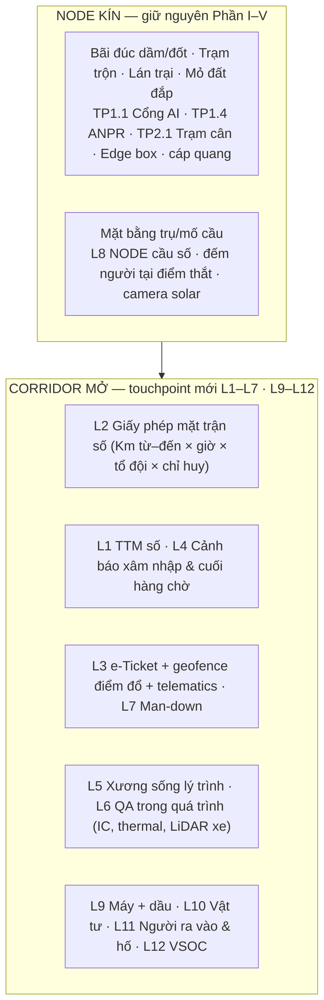

# PHẦN VI — CÔNG TRƯỜNG TUYẾN (CAO TỐC · CẦU · ĐƯỜNG): MÔ HÌNH "NODE + CORRIDOR"

> Chương bổ sung cho bộ hồ sơ Công trường số doanh nghiệp. Áp dụng cho dự án **mở, dạng tuyến**: cao tốc, cầu vượt, cầu sông, mở rộng đường đang khai thác.
> Cơ sở nghiên cứu và nguồn: [`plans/reports/research-261029-2130-open-linear-site-management-synthesis.md`](./plans/reports/research-261029-2130-open-linear-site-management-synthesis.md) (4 nhánh nghiên cứu, mọi số liệu có nhãn bằng chứng).
> Nhãn: **[F]** nguồn đã kiểm · **[V]** số do nhà cung cấp tự công bố · **[I]** đề xuất/suy luận của nhóm nghiên cứu.

---

## VI.1. Vì sao cần chương riêng

Toàn bộ 20 checkpoint Phần I–V được thiết kế cho **công trường kín**: có hàng rào, một cổng, một phòng chỉ huy, lưới điện và cáp quang. Công trường tuyến khác ở 3 điểm:

1. **Không có điểm thắt (choke point).** Hàng chục km nền đường, người và xe vào ra ở hàng chục vị trí; mặt trận thi công dịch chuyển hằng ngày.
2. **Có giao thông công cộng chạy sát vùng thi công.** Mở rộng cao tốc Nội Bài–Lào Cai: **31 vụ va chạm/TNGT, 6 bị thương, 1 tử vong sau ~3 tháng thi công** [F]. Nạn nhân chính là người lái xe, không chỉ công nhân → trách nhiệm của nhà thầu là hai chiều.
3. **Đơn vị không gian là lý trình (Km+m), không phải tầng.** Tiến độ, khối lượng, nghiệm thu, tranh chấp đều nói bằng "đoạn Km… đến Km…, lớp…".

**Nguyên tắc thiết kế của chương này:** một dự án tuyến = **chuỗi NODE kín nhỏ** (bãi đúc dầm/đốt, trạm trộn BT/BTN, lán trại, kho, mỏ đất đắp, mặt bằng trụ/mố cầu, bến sà lan) **nối bằng một CORRIDOR mở**. Tại NODE, các touchpoint Phần I–V **giữ nguyên**. Trên CORRIDOR, áp dụng 12 touchpoint mới **L1–L12** dưới đây.

---

## VI.2. Xương sống hạ tầng cho corridor (bổ sung "Site Backbone")

| Lớp | Công trường kín (Phần I) | Công trường tuyến |
|---|---|---|
| Mạng | Vòng cáp quang + Mesh Wi-Fi | Cáp quang/LAN **chỉ tại NODE**; corridor: router 4G dual-SIM công nghiệp + **ứng dụng offline-first** (ghi đệm, đồng bộ khi có sóng); Starlink tại mặt bằng cố định (thương mại tại VN từ 13/8/2026 [F]) |
| Điện | Lưới điện công trường | Skid **solar + ắc quy + máy phát** cho từng cụm thiết bị; thiết bị đeo/cầm tay dùng pin |
| Xử lý | 1 Edge AI Box trong container chỉ huy | Edge tại NODE lớn (trạm trộn/lán trại); thiết bị corridor xử lý tại chỗ (camera AI có chip), gửi sự kiện thay vì video |
| Định vị | Trạm base RTK trên nóc BCH | **VNGEONET NRTK** (mạng CORS quốc gia, 65 trạm [F]) qua 4G; base UHF dự phòng ở đoạn đèo/mất sóng |
| Khóa dữ liệu | Tầng / zone / mã cấu kiện BIM | **(tuyến, Km từ–đến, offset, lớp, mã kết cấu)** — LandXML/CSV làm nguồn chuẩn, xuất IFC 4.3 khi chủ đầu tư yêu cầu |

> Kiểm tra bắt buộc trước khi báo giá hạ tầng: **đo sóng (drive test) theo từng km**. Con số phủ sóng 4G "99,8%" của VN tính theo **dân số**, không theo km tuyến [F].

---

## VI.3. Ma trận áp dụng 16 touchpoint hiện có

| TP | Tại NODE | Trên CORRIDOR | Thay bằng |
|---|---|---|---|
| 1.1 Cổng AI Face ID + PPE | Giữ | Thay | L2 (điểm danh tại mặt trận bằng thẻ QR/NFC) |
| 1.2 CCTV AI cố định | Giữ | Thay | L4 (camera AI gắn xe/trailer, cảnh báo tại chỗ) |
| 1.3 Drone vs BIM 4D theo tầng | Giữ | Sửa | % theo đoạn lý trình × lớp (L5); bay theo khối 2–5 km có giấy phép NĐ 288/2025 |
| 1.4 Smart Gate ANPR | Giữ | Thay | L3 (geofence điểm đổ + e-Ticket + định danh trên máy) |
| 1.5 3D Re-ID + UWB | Giữ tại điểm thắt | Bỏ | GNSS tag tổ trưởng / người làm đơn độc (L7) |
| 2.1 Trạm cân AI + LiDAR | Giữ (cổng trạm trộn, mỏ) | Sửa | Cân tại nguồn → e-Ticket → đối soát tại điểm đổ (L3) |
| 2.2 Robot in bản vẽ | Giữ (mặt cầu, bãi) | Thay | Máy dẫn đường GNSS + cắm mốc bằng rover |
| 2.3 Máy xúc 3D RTK | Giữ | Sửa | Hiệu chỉnh RTK qua VRS/NRTK quốc gia |
| 2.4 iPad AR MEP | Giữ | Bỏ | — |
| 3.1 Robot Spot tuần đêm | Giữ | Thay | LiDAR gắn xe bán tải (L6) |
| 3.2 Exoskeleton | Giữ | Giữ | — |
| 3.3 Máy tự hành hoàn toàn | — | Hoãn | Chưa có tiền lệ trên đường đang khai thác |
| 3.4 Cẩu tháp AI | Giữ | — | Xe lao dầm: touchpoint riêng nếu cần |
| 3.5 Site OS | Giữ | Sửa | Khóa lý trình + 3 đối tượng mới: giấy phép mặt trận, phương án TTM sống, sổ xâm nhập |
| 4.1–4.2 Tầm nhìn 2030 | Giữ | Sửa | Nghiệm thu/thanh toán theo đoạn lý trình × lớp |

---

## VI.4. Tám touchpoint mới cho công trường tuyến

### L1 — TTM số & kiểm tra tuân thủ tổ chức giao thông hằng ngày *(Năm 1 · ưu tiên cao nhất)*
1. **Quy trình:** (a) Phương án đảm bảo giao thông đã được cấp phép (TT 41/2024/TT-BGTVT) được số hóa thành "bản đồ TTM" theo lý trình: vị trí côn, rào, biển, đèn, người điều tiết, tốc độ hạn chế. (b) Đầu mỗi ca và mỗi lần chuyển vùng chặn, chỉ huy mặt trận đi checklist trên app, chụp ảnh có tọa độ + lý trình từng hạng mục. (c) Hệ thống so ảnh/ vị trí với phương án; thiếu/sai → không cho mở ca (khóa giấy phép L2). (d) Ban chỉ huy và CĐT xem tình trạng tuân thủ theo km.
2. **Hệ thống xử lý:** đối chiếu checklist với phương án; nhận diện ảnh (biển, đèn, rào có mặt/đúng loại theo QCVN 41:2024) [I]; nhật ký bất biến làm bằng chứng khi thanh tra hoặc có tai nạn.
3. **Thiết bị:** điện thoại/tablet IP67 cho chỉ huy mặt trận; tem QR trên từng biển/rào di động (đếm và truy vết tài sản TTM).
4. **Hạ tầng:** offline-first; đồng bộ khi có sóng.
5. **Vì sao trước:** lỗi đang xảy ra ở VN là **lỗi cơ bản** — văn bản Cục Đường bộ VN 2026 thừa nhận biển, rào tạm "chưa bảo đảm theo quy định" [F]. Rẻ nhất, bảo vệ về pháp lý.

### L2 — Giấy phép mặt trận số & Chỉ huy mặt trận *(Năm 1)*
1. **Quy trình:** mỗi ngày, mỗi mặt trận có **một giấy phép số**: đoạn Km từ–đến × khung giờ × danh sách tổ đội × 1 chỉ huy chịu trách nhiệm. Đầu ca, chỉ huy quét thẻ nhân viên (QR/NFC) của từng công nhân tại buổi giao ca; hệ thống kiểm chứng chỉ, khám sức khỏe, hạn huấn luyện từ sổ đăng ký trung tâm. Khi nhiều tổ dùng chung một đoạn chặn: một **điều phối viên đoạn** giữ giấy phép, chỉ đóng khi mọi tổ xác nhận rút xong. Sơ tán: mỗi chỉ huy báo quân số tổ mình.
2. **Mô hình tham chiếu:** đường sắt UK — thẻ Sentinel + COSS (người chịu trách nhiệm tổ, đi cùng tổ từ vào đến ra) + Protection Controller [F].
3. **Hệ thống xử lý:** sổ đăng ký công nhân/thầu phụ; geofence đoạn được phép; cảnh báo vào sớm/ra muộn/ra ngoài đoạn.
4. **Thiết bị:** thẻ QR/NFC; tablet tổ trưởng làm kiosk khi mất sóng.
5. **Hạ tầng:** offline-first; đối soát sau.

### L3 — e-Ticket vật tư + geofence điểm đổ + telematics hỗn hợp *(Năm 1)*
1. **Quy trình:** cân **một lần tại nguồn** (trạm trộn/mỏ — giữ TP2.1) → phát phiếu điện tử mang khối lượng, mác, giờ xuất → xe vào vùng geofence của điểm đổ tự ghi giờ đến/đổ/rời → kỹ sư nhận ký số trên app (không đứng trên làn xe nhận phiếu giấy) → đối soát phiếu với khối lượng nghiệm thu theo đoạn lý trình.
2. **Bằng chứng:** Georgia DOT bắt buộc e-Ticket từ 2021, tiết kiệm ~1 giờ/ngày rải, tới 15.000 phiếu/dự án BTN; lý do số 1 của các DOT là an toàn người nhận phiếu [F]. Nhiều DOT **bỏ** GPS bám xe liên tục, chuyển sang geofence tại nguồn + điểm đổ [F].
3. **Máy móc:** nhận dữ liệu chuẩn ISO 15143-3 (vị trí, giờ máy, nhiên liệu) từ máy có hỗ trợ; gắn GPS + cảm biến nhiên liệu cho máy cũ/máy thuê; định danh người lái trên máy.
4. **Hạ tầng:** API với trạm trộn của nhà cung cấp; QR in trên phiếu giấy làm dự phòng.

### L4 — Cảnh báo xâm nhập di động & cảnh báo cuối hàng chờ *(Năm 2)*
1. **Quy trình:** tại điểm thu hẹp làn (ví dụ 4→2 làn) và vùng chặn ban đêm: camera AI gắn xe/trailer nhìn ngược dòng xe; cọc tiêu báo va; còi + đèn chớp tại chỗ + thiết bị rung đeo người; biển radar hiển thị tốc độ; cảnh báo cuối hàng chờ đặt trước điểm thu hẹp.
2. **Vì sao cảnh báo phải tại chỗ:** xe 80–100 km/h đi 250 m trong 9–11 giây; mục tiêu thời gian phản ứng của công nhân ≤ 6 giây (Oregon DOT) [F] → báo về Zalo Ban chỉ huy là quá chậm.
3. **Bằng chứng:** cảnh báo cuối hàng chờ Texas **ước tính −44% va chạm** (mẫu nhỏ) [F]; NEXCO Nhật bán camera AI di động từ 5/2026, phát hiện ~250 m, kém hơn ban đêm/mưa [F]. Báo động xâm nhập **chưa có số giảm tai nạn đáng tin**; nhiều DOT bỏ vì báo giả → **ghi log báo giả bắt buộc trong 3 tháng đầu** trước khi nhân rộng.
4. **Dữ liệu:** mọi lần xâm nhập/near-miss vào **sổ xâm nhập** (lý trình, giờ, đoạn video) trong Site OS. Phạt nguội là việc của CSGT/chủ đầu tư; doanh nghiệp cung cấp dữ liệu.

### L5 — Xương sống dữ liệu lý trình & tiến độ thời gian–lý trình *(Năm 2)*
1. **Quy trình:** tuyến thiết kế (alignment) nạp một lần (LandXML/CSV); mọi dữ liệu (phiếu, ảnh, kết quả thí nghiệm, máy, sự cố) gắn (Km, offset, lớp). Tiến độ hiển thị dạng **biểu đồ thời gian–lý trình**: mỗi tổ là một đường dốc, giao cắt = xung đột; bản đồ nhiệt "đoạn nào đã đủ mặt bằng nhưng không có máy".
2. **Định dạng:** Nhật (MLIT) giao nộp mô hình đường bằng J-LandXML, chưa bắt buộc IFC [F] → doanh nghiệp dùng LandXML/lý trình trước, IFC 4.3 là đích xuất theo QĐ 258/QĐ-TTg khi CĐT yêu cầu.
3. **Lưu ý:** không hứa ROI — chưa có số đo độc lập cho phương pháp này.

### L6 — QA trong quá trình thi công *(Năm 2)*
1. **Quy trình:** lu thông minh (IC: GNSS + độ cứng trên từng vệt lu) cho nền/móng/BTN; thanh đo nhiệt trên máy rải BTN (nhiệt theo lý trình); LiDAR gắn xe cho nghiệm thu bề mặt từng lớp; drone cho khối lượng đào đắp.
2. **Bằng chứng:** nhiệt độ thảm BTN biến thiên giảm >50% sau khi dùng thermal (TxDOT US 82) [F]; lu IC đắt hơn 3–5% hoặc retrofit $50–75k, hoàn vốn "2–3 dự án" (FHWA, định tính) [F]; LiDAR xe $3.800 vs $7.800/dặm so với ảnh hàng không (PennDOT 2015) [F]; Nhật i-Construction: đắp đê 213 → 142 công (−33%) [F].
3. **Nguyên tắc:** dữ liệu IC dùng để **sàng lọc điểm yếu**; khoan lõi/đo nhân vẫn là nghiệm thu cho đến khi hiệu chỉnh tương quan tại chỗ và CĐT chấp nhận.

### L7 — Man-down & người làm đơn độc *(Năm 2)*
1. **Quy trình:** tổ trưởng và người làm đơn độc/ban đêm đeo thẻ GNSS: không cử động 180 giây → rung → báo trung tâm; nút SOS; hẹn giờ check-in chạy **phía máy chủ** để mất sóng vẫn báo.
2. **Bằng chứng:** Tarmac UK, Network Rail [F, nguồn cũ]; nghiên cứu MoDOT 2026: GNSS ổn định hơn BLE, BLE "sai số lớn ở vùng nông thôn" [F].
3. **Chỉ theo dõi trong ca** (xem VI.5).

### L8 — NODE cầu số *(Năm 1–2, tại bãi đúc và trụ cầu)*
1. **Quy trình:** đo hình học từng đốt dầm đúc so với đường cong đúc (sai 1 phần mm tại bãi → lệch hàng mét cuối nhịp [F]); cảm biến maturity/nhiệt trong mỗi đợt đổ trụ, dầm, mặt cầu → quyết định tháo ván khuôn/căng kéo theo cường độ thực (Idaho: rút 5–10 ngày [V]).
2. **Vì sao quan trọng với doanh nghiệp:** danh mục doanh nghiệp nặng về cầu (XL03 Hậu Giang–Cà Mau: 12 km + **24 cầu** [F]; cầu Cát Lái, Long Hưng) → đây là nơi "digital twin" có giá trị cao nhất.

### Hoãn (chưa có ROI tại VN)
Máy rải cọc tiêu tự động, cổng chặn làn tự động (SwiftGate), xe đệm va tự hành (~US$450k/xe [F]), V2X, edge compute di động theo mặt trận.

---

## VI.5. Điều kiện bắt buộc về dữ liệu cá nhân (Luật 91/2025/QH15 + NĐ 356/2025/NĐ-CP)

Face ID (TP1.1), vector dáng đi (TP1.5) và thẻ GNSS (L2, L7) xử lý dữ liệu sinh trắc/vị trí. Các touchpoint **được giữ**, kèm điều kiện triển khai:

1. **Rà soát pháp lý trước khi triển khai** (luật sư/DPO), gồm đánh giá tác động xử lý dữ liệu; xác nhận vector dáng đi có thuộc dữ liệu sinh trắc theo danh mục của NĐ 356/2025 hay không.
2. **Chỉ theo dõi trong ca làm việc** — thiết bị tự ngắt ngoài ca; không theo dõi ngoài phạm vi giấy phép mặt trận.
3. **Đồng ý bằng văn bản** của người lao động và thông báo mục đích; thầu phụ ký cam kết tương đương.
4. **Corridor ưu tiên thẻ QR/NFC thay Face ID**; sinh trắc chỉ ở NODE có cổng.
5. **Quy trình sự cố dữ liệu**: thông báo chủ thể trong 72 giờ đối với dữ liệu vị trí/sinh trắc (theo EY) [F]; lưu trữ tối thiểu, xóa theo thời hạn.

---

## VI.6. Demo: Cao tốc TP.HCM – Đà Lạt (hành lang Dầu Giây – Liên Khương)

**Hiện trạng tuyến (đã kiểm, 10/2026):**
- **Dầu Giây – Tân Phú** (~60 km, Đồng Nai): khởi công 19/8/2025, dự kiến cơ bản hoàn thành 2026, khai thác 2027. Kiểm tra hiện trường 9/10/2026: **mới đạt ~5,2% giá trị hợp đồng** dù đã bàn giao 92% mặt bằng; mặt bằng bàn giao **xen kẽ**, di dời hạ tầng kỹ thuật, vào mùa mưa, chuyển mục đích sử dụng rừng chưa xong; Cục Đường bộ nêu **một số vị trí đã đủ điều kiện (đào đắp, cầu vượt ngang) nhưng chưa quyết liệt thi công** [F — VnExpress].
- **Tân Phú – Bảo Lộc** (~66 km: ~12 km Đồng Nai + ~54 km Lâm Đồng, PPP): đã chọn nhà đầu tư; mục tiêu khởi công đầu 2026 — **chưa xác nhận đã khởi công** [nguồn thứ cấp].
- **Bảo Lộc – Liên Khương:** chưa có thông tin khởi công đáng tin. **Liên Khương – Prenn:** đã khai thác.
- **Vai trò doanh nghiệp trên tuyến: chưa tìm thấy** → đây là **demo năng lực**, không phải pilot trên gói thầu doanh nghiệp đang thi công.

**Vì sao tuyến này là demo tốt:** gom đủ mọi đặc thù công trường tuyến trong một hành lang — đồng bằng (Dầu Giây), xuyên rừng, đèo Bảo Lộc (mất sóng, GNSS kém ở mái taluy đào sâu, sạt lở mùa mưa), nút giao nối đường đang khai thác (cao tốc TP.HCM–Long Thành–Dầu Giây, QL20). Và bài toán thật đang diễn ra: **"5,2% sau hơn một năm — chậm ở đâu, đoạn nào?"**

**Kịch bản demo (6 tháng, khớp chiến lược PoC đã chốt):**

| Tháng | Nội dung | Touchpoint |
|---|---|---|
| 1 | Đo sóng theo km toàn hành lang; nạp tuyến thiết kế; dựng biểu đồ thời gian–lý trình từ dữ liệu công khai + khảo sát | L5, VI.2 |
| 2 | Bản đồ nhiệt "đoạn đã đủ mặt bằng × có/không có máy × lớp đang thi công" → trả lời trực tiếp nhận xét của Cục Đường bộ | L5 + L3 (telematics) |
| 3–4 | Một đoạn mẫu 5 km: giấy phép mặt trận số, e-Ticket đất đắp/BTN, TTM số tại nút giao Dầu Giây | L1, L2, L3 |
| 5 | Một trụ/mố cầu vượt ngang: cảm biến maturity + đếm người tại điểm thắt | L8 |
| 6 | Báo cáo trước/sau cho Ban lãnh đạo doanh nghiệp | — |

**KPI demo:** tỷ lệ km "đủ mặt bằng nhưng không thi công" (giảm); số lỗi TTM/tuần; thời gian điểm danh đầu ca; chênh lệch khối lượng phiếu vs nghiệm thu; số sự cố xâm nhập được ghi nhận.

**Điều kiện cần doanh nghiệp xác nhận:** quyền tiếp cận một đoạn tuyến (qua nhà đầu tư/chủ đầu tư hoặc liên danh); nếu không có, demo chạy trên dữ liệu công khai + mô phỏng cho tháng 1–2 và chuyển tháng 3–5 sang một gói doanh nghiệp đang thi công.

---

## VI.7. An ninh tuyến xa đô thị: người ra vào · vật tư · máy móc

> Nguồn: [`researcher-261029-2250-remote-site-security-world-tech.md`](./plans/reports/researcher-261029-2250-remote-site-security-world-tech.md) (25 thực tiễn thế giới) · [`researcher-261029-2250-remote-site-security-vietnam-context.md`](./plans/reports/researcher-261029-2250-remote-site-security-vietnam-context.md) (14 vụ việc VN 2022–2026 + 14 văn bản pháp lý).

### VI.7.1. Thực tế ở Việt Nam (báo chí 2022–2026)
- **Mất cắp là chuyện thường xuyên, quy mô nhỏ–vừa, nhắm vào thứ bán được phế liệu:** cáp đồng chiếu sáng, thép, lưới B40, dây thép gai, trụ hộ lan, tấm chống lóa, hộp đen/bảng điều khiển máy xúc. Ví dụ: Vĩnh Hảo–Phan Thiết ~1,5 tỷ (2/2024); Biên Hòa–Vũng Tàu mất cáp + hộp trụ đèn ~277 triệu, **lần thứ 3** trên tuyến (8/2026); cao tốc Bắc–Nam Ninh Thuận: **chính lao động làm thuê** trộm >16 tấn sắt (2022) [F — nguồn báo trong báo cáo VN].
- **Thủ phạm** = thanh niên địa phương + đầu mối thu mua phế liệu + nội gián. **Thời điểm nguy hiểm** = giai đoạn mặt đường gần xong → trước bàn giao; **vị trí nguy hiểm** = gần nút giao, đầu cầu, lối tiếp cận đường dân sinh [I từ mẫu 8 vụ].
- **Người dân vào công trường:** xe máy/xe đạp chui rào vào cao tốc sắp xong (Biên Hòa–Vũng Tàu 11/2025, Vạn Ninh–Cam Lộ 7/2025, Hữu Nghị–Chi Lăng 9/2026) [F].
- **Rủi ro chết người cao nhất: hố/ao nước do thi công.** 3 vụ trẻ em chết đuối (Quảng Bình 2/2022, Bình Định 5/2022, Phú Thọ 5/2026) ở hố nhà thầu đào hoặc bãi chưa san lấp; 2 vụ được nêu rõ "không rào, không biển" [F]. Nepal: 542 người chết đuối trong 3 năm (59% trẻ em) ở hố công trình bỏ ngỏ [F].
- **Cách làm hiện nay** = bảo vệ + rào + công văn gửi UBND/công an; công an xử lý **sau khi mất**. Không tìm thấy tuyến nào dùng camera/AI/drone cho an ninh **giai đoạn thi công** [F, "không tìm thấy" ≠ không có].

### VI.7.2. Thế giới làm gì có bằng chứng
| Mối đe dọa | Thực tiễn | Bằng chứng | Mức tin |
|---|---|---|---|
| Máy móc | UK: **sổ đăng ký máy + đánh dấu ẩn + khóa máy + tracker + đơn vị cảnh sát chuyên trách + ưu đãi bảo hiểm** (CESAR/PANIU/Thatcham) | Trộm giảm >60% từ 2007; thu hồi 28% (có đăng ký) vs 8% (không); ~12,5% giảm phí bảo hiểm ở mức 3 sao | Hiệp hội/OEM + phát ngôn cảnh sát [F/V] |
| Cáp, vật tư | Network Rail: **đánh dấu pháp y** + cảm biến rung/cắt cáp + CCTV + kiểm tra điểm thu mua phế liệu + luật thu mua phế liệu | Sự cố giảm 67%; thiệt hại £18,3m → £12,8m — **có yếu tố luật mới và cảnh sát, không tách riêng được phần công nghệ** | Nhà vận hành [F] |
| Xâm nhập tuyến dài | Cảm biến sợi quang (DAS) trên ống khí 145 km (TQ): 96 cảnh báo/2 tháng, 90% xác minh đúng | **Cần cáp quang chôn sẵn** — không có trong giai đoạn đắp nền | Vendor [V] |
| Phản ứng nhanh | Drone-in-a-box: cảnh sát Mỹ phóng < 60 giây | Không có số liệu nào cho công trường | Vendor [V] |
| Robot tuần tra | Knightscope "vô hiệu" trên địa hình gồ ghề; Spot dùng chụp tiến độ | Không có số an ninh | [F] |
| Nhiên liệu | Cảm biến tiếp cận bồn + mức dầu + đồng hồ lưu lượng | Chỉ case vendor | [V] |

**Kết luận:** chưa có công nghệ nào có số đo độc lập trước/sau. Thứ chạy được là **hệ thống**: phát hiện + bằng chứng + người phản ứng + đối tác (công an, bảo hiểm, đầu mối phế liệu) — không phải một thiết bị đơn lẻ.

### VI.7.3. Bốn touchpoint an ninh mới (L9–L12)

#### L9 — Máy móc & nhiên liệu: sổ đăng ký + tracker kép + khóa máy *(Năm 1)*
1. **Quy trình:** mỗi máy (kể cả máy thuê) vào sổ đăng ký doanh nghiệp: số khung, ảnh, đánh dấu ẩn, chủ sở hữu → chia sẻ với công an tỉnh. Gắn **2 đường định vị độc lập**: telematics ISO 15143-3 của hãng + **tracker ẩn** chạy pin, đa mạng. **"Im lặng = báo động"**: thiết bị mất tín hiệu ngoài giờ → cảnh báo (chống phá sóng). Ngoài giờ ca: máy nằm trong vùng đỗ geofence, nổ máy/di chuyển → báo + khóa khởi động tại bãi.
2. **Nhiên liệu:** cảm biến tiếp cận bồn + cảm biến mức dầu + đồng hồ lưu lượng trên xe bồn; AI đối soát lít cấp ↔ giờ máy ↔ khối lượng làm (L3) → phát hiện "đổ khống". **Đo mức hao hụt nền 1 tháng trước khi đặt mục tiêu.**
3. **AI:** phát hiện bất thường (máy chạy ngoài ca, tiêu hao lệch so với máy cùng loại).
4. **Pháp lý:** tự gắn GPS lên máy của mình không thấy bị cấm; **không** thiết kế "dừng máy từ xa" khi máy đang trên đường công cộng — chỉ khóa khởi động tại bãi [I]. Thiết bị giám sát hành trình chỉ bắt buộc cho 4 nhóm xe (NĐ 151/2024) [F thứ cấp].
5. **Bảo hiểm:** xin báo giá phí/khấu trừ có–không có hệ thống từ nhà bảo hiểm của doanh nghiệp.

#### L10 — Vật tư & tài sản tuyến: đánh dấu + cảm biến rẻ + đếm tồn tại NODE *(Năm 1)*
1. **Tại NODE (kho, bãi thép, bãi cuộn cáp):** đếm/đối soát vật tư vào–ra theo e-Ticket (L3); camera phát hiện người ban đêm; **ghi nhận nội gián** (khớp ca làm, giấy phép mặt trận L2 với giờ vật tư biến mất).
2. **Trên CORRIDOR (cáp chiếu sáng, lưới B40, thép gai, hộ lan):** cảm biến rung/cắt mạch giá rẻ trên đường cáp và hàng rào → LoRa **≤ 25 mW** (mức miễn giấy phép tần số theo TT 08/2021/TT-BTTTT; 25–306 mW phải xin phép) [F] hoặc NB-IoT/LTE-M qua nhà mạng nơi có sóng; Starlink tại mặt bằng cố định.
3. **Đánh dấu pháp y** cuộn cáp/bó thép (mã riêng) + biển cảnh báo "tài sản đã đánh dấu" — cần nhà cung cấp tại VN và phối hợp công an kiểm tra điểm thu mua [I].
4. **Bản đồ rủi ro theo lý trình (AI):** sổ sự cố × giai đoạn thi công (gần bàn giao) × khoảng cách tới đường dân sinh/nút giao → tuần tra dồn vào đoạn nguy cơ cao.

#### L11 — Người ra vào & hố nguy hiểm *(Năm 1 — an toàn tính mạng, ưu tiên trước mọi công nghệ khác)*
1. **Sổ hố/ao (GNSS):** mọi hố đào, hố thoát nước, ao lấy đất, hố móng đều được ghi tọa độ, độ sâu, có nước hay không, người chịu trách nhiệm; chụp ảnh rào + biển mỗi tuần; **quy tắc trước mùa mưa: lấp, tháo nước hoặc rào kín**. Đây là biện pháp có bằng chứng (vật lý), công nghệ chỉ là lớp bổ sung.
2. **Lối tiếp cận dân sinh:** đếm và đóng lối tạm; camera AI **phát hiện người/xe ẩn danh** (không nhận diện khuôn mặt) tại lối vào và quanh hố có nước gần khu dân cư → còi/đèn tại chỗ + báo chốt bảo vệ gần nhất.
3. **Giai đoạn mặt đường xong – trước bàn giao:** tăng chốt ở nút giao/đầu cầu, dải bê tông chặn lối, phối hợp CSGT/công an xã (như Biên Hòa–Vũng Tàu, Hữu Nghị–Chi Lăng) [F].
4. **Pháp lý:** QCVN 18:2021/BXD bắt buộc rào chắn + cảnh báo + người kiểm soát ra vào tại vùng nguy hiểm → công nghệ **không thay** người bảo vệ, chỉ giảm số chốt và chỉ đường cho tuần tra [F thứ cấp].

#### L12 — Trung tâm giám sát an ninh từ xa (VSOC) + tháp camera solar + drone xác minh *(Năm 2)*
1. **Tháp camera solar (nhiệt + thường + AI)** tại NODE và điểm nóng corridor (nút giao, bãi máy đỗ đêm, kho dầu); cảnh báo đi qua **người xác minh tại VSOC** trước khi điều bảo vệ → giảm báo giả.
2. **Đầu ra = gói bằng chứng** (clip + giờ + lý trình + ảnh) gửi công an xã trong vài phút, thay vì công văn sau khi mất.
3. **Drone:** chỉ dùng **xác minh khi cảm biến mặt đất báo**, bay trong tầm nhìn, có người điều khiển, xin phép theo đợt/khu vực (NĐ 288/2025: mỗi hoạt động bay 1 phép; bay ngoài tầm nhìn cần bằng hạng B; chưa thấy tiền lệ dân sự tuần tra tự động hằng đêm — chỉ CSGT) [F thứ cấp]. **Drone dock tự động: HOÃN** đến khi BQP xác nhận được cấp phép định kỳ.
4. **Camera nơi công cộng:** được ghi hình không cần đồng ý vì an ninh trật tự **nhưng phải có biển thông báo**, dùng đúng mục đích, xóa khi hết cần (Điều 32 Luật 91/2025/QH15) [F]; che vùng nhìn vào nhà dân.
5. **Robot:** robot bốn chân/robot tuần tra **không dùng trên corridor** (địa hình, pin); nếu có, chỉ tại bãi đúc/trạm trộn (TP3.1).
6. **Hoãn:** cảm biến sợi quang DAS (chỉ khả thi nếu kéo sớm ống cáp ITS và chừa 1 sợi), hàng rào ảo cho gia súc, IoT vệ tinh (giá/khả dụng tại VN chưa rõ).

### VI.7.4. Bổ sung cho demo TP.HCM – Đà Lạt
- Tháng 1: thu số liệu mất mát/hao hụt **nội bộ** (loại, giá trị, giờ) để dựng mô hình đe dọa thật thay vì số báo chí; lập sổ hố/ao toàn đoạn mẫu.
- Tháng 3–4: L9 (máy + dầu) + L11 (hố + lối dân sinh) trên đoạn mẫu 5 km; L10 cảm biến trên đường cáp chiếu sáng/hàng rào gần nút giao Dầu Giây.
- **KPI bổ sung:** số hố có nước chưa rào (về 0); lít dầu hao hụt/100 giờ máy; số cảnh báo/km/đêm và tỷ lệ xác minh đúng; thời gian từ phát hiện đến gói bằng chứng gửi công an.
- **Kiểm tra trước:** đoạn gần sân bay Liên Khương có nằm trong vùng hạn chế bay không; phủ sóng NB-IoT/LTE-M theo km.

---

## VI.8. Giới hạn bằng chứng

- Báo động xâm nhập và camera AI: **chưa có số giảm tai nạn** đáng tin → trình bày là "giảm thời gian phản ứng", không hứa "giảm X% tai nạn".
- Phần lớn bằng chứng từ Mỹ/UK/Nhật; chưa tìm thấy nhà thầu đường VN/Đông Nam Á nào theo dõi công nhân thời gian thực trên tuyến.
- GNSS dưới gầm cầu/mái taluy đào: chưa có số liệu → thử thực địa 1 tuần ở đèo Bảo Lộc trước khi cam kết L7.
- Văn bản pháp luật VN đọc qua bản sao thứ cấp; không thay ý kiến pháp lý.

**Nguồn chính:** [VnExpress — Dầu Giây–Tân Phú 5,2%](https://vnexpress.net/cao-toc-dau-giay-tan-phu-thi-cong-moi-dat-5-2-sau-hon-mot-nam-5137744.html) · [VnEconomy — Dầu Giây–Tân Phú 60 km](https://vneconomy.vn/cao-toc-dau-giay-tan-phu-gan-9-000-ty-dong-du-kien-hoan-thanh-nam-2026.htm) · [Nhà Đầu Tư — Tân Phú–Bảo Lộc](https://nhadautu.vn/son-hai-trung-thau-du-an-cao-toc-tan-phu--bao-loc-hon-14000-ty-d101412.html) · [Báo Lào Cai — Nội Bài–Lào Cai](https://baolaocai.vn/dam-bao-an-toan-giao-thong-tren-cao-toc-noi-bai-lao-cai-nhung-van-de-dat-ra-post895729.html) · toàn bộ nguồn còn lại trong báo cáo tổng hợp.
