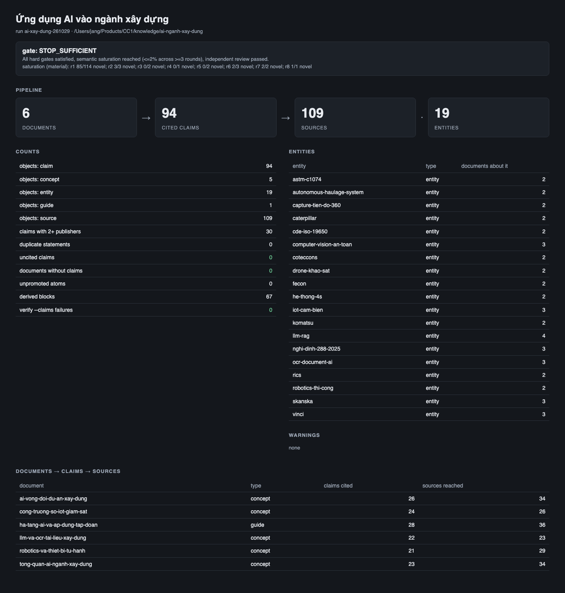

# Ứng dụng AI vào ngành xây dựng — knowledge pack có nguồn kiểm chứng

Bộ tri thức về ứng dụng AI trong ngành xây dựng, viết cho lãnh đạo kỹ thuật và kỹ sư của tập đoàn xây dựng Việt Nam.
Mỗi fact trong tài liệu được neo vào một claim, và mỗi claim giữ quote nguyên văn từ trang nguồn kèm URL và sha256 của
bản đã freeze. Pack được dựng bằng [design-os-knowledge-builder](https://github.com/jangtrinh/design-os-knowledge-builder)
theo chuẩn UKMC.v2.

*English summary: a source-verified knowledge pack (Vietnamese) on AI in construction — robotics, autonomous
equipment, IoT, LLM/OCR, digital construction sites, and enterprise AI infrastructure. 6 documents, 94 claims with
verbatim quotes, 109 sources. Stopping gate: `STOP_SUFFICIENT`, independent review passed.*



## Tài liệu

| Tài liệu | Trả lời câu hỏi |
|---|---|
| [tong-quan-ai-nganh-xay-dung](ai-nganh-xay-dung/tong-quan-ai-nganh-xay-dung.md) | AI có đáng đầu tư vào ngành xây dựng không: mức áp dụng, năng suất, ROI hai phía, khoảng trống Việt Nam |
| [robotics-va-thiet-bi-tu-hanh](ai-nganh-xay-dung/robotics-va-thiet-bi-tu-hanh.md) | Robot, xe/máy tự hành, drone nào đã dùng thật |
| [llm-va-ocr-tai-lieu-xay-dung](ai-nganh-xay-dung/llm-va-ocr-tai-lieu-xay-dung.md) | LLM và OCR xử lý hồ sơ, bản vẽ, hợp đồng tới đâu |
| [cong-truong-so-iot-giam-sat](ai-nganh-xay-dung/cong-truong-so-iot-giam-sat.md) | Công trường số gồm gì: IoT, camera AI an toàn, capture tiến độ, digital twin |
| [ai-vong-doi-du-an-xay-dung](ai-nganh-xay-dung/ai-vong-doi-du-an-xay-dung.md) | AI áp vào khâu nào của vòng đời dự án: thiết kế, tiến độ, QC, CDE |
| [ha-tang-ai-va-ap-dung-tap-doan](ai-nganh-xay-dung/ha-tang-ai-va-ap-dung-tap-doan.md) | Tập đoàn cần hạ tầng gì; Skanska, VINCI, Bouygues, Coteccons, FECON làm thế nào |

Mỗi tài liệu có bốn mục: Purpose, When to Use / When NOT, Core Knowledge Content, Failure Modes.

## Những điểm đáng đọc trước

- **Mức áp dụng AI khác nhau tùy cách đo.** Eurostat: 10,79% doanh nghiệp xây dựng EU dùng AI. APM: 75% chuyên gia dự án
  nói tổ chức của họ dùng AI. RICS: dưới 1% nhúng AI toàn tổ chức. Ba số đo ba thứ khác nhau; không lấy trung bình.
- **Thiết bị tự hành chạy production thật mới chỉ ở vận tải mỏ và mỏ đá.** Máy xây dựng tự hành còn ở mức thương mại sơ khởi.
- **LLM trong các hệ thống có bằng chứng chỉ trích xuất metadata trong phạm vi giới hạn**, không "đọc hiểu" spec.
- **Phần lớn số hiệu quả là do vendor tự công bố**; tài liệu ghi rõ "theo <vendor>" ở từng chỗ.
- **Việt Nam chưa có case production đo được bằng số liệu.** Pack có khung pháp lý Nghị định 288/2025/NĐ-CP, chuyển đổi số
  của Coteccons, câu giới thiệu của FECON, và một nghiên cứu học thuật Việt Nam về phát hiện mũ bảo hộ.

## Cách pack được kiểm

| Kiểm tra | Kết quả |
|---|---|
| `verify --claims` (anchor trong tài liệu khớp link `cites`, quote khớp bản freeze) | 232 anchor, 0 lỗi |
| Stopping gate | `STOP_SUFFICIENT`: 5/5 required claims, 89 nguồn độc lập, bão hòa 6 vòng (delta cuối 0,79%) |
| Review độc lập (runtime khác bên viết) | Grok 4.7, chỉ đọc: passed, 0 lỗi chặn, 8 góp ý nhỏ (sửa 7 sau review, chưa review lại; 1 giữ theo quyết định của chủ pack) |

Chi tiết quy trình, quyết định và giới hạn: [process/hand-over.md](process/hand-over.md), [process/plan.md](process/plan.md),
báo cáo review: [process/independent-review-grok.txt](process/independent-review-grok.txt).

## Bản sao nguồn không có trong repo

Repo **không** chứa 111 bản sao toàn văn trang nguồn (`_evidence/<run>/sources/`), vì đó là nội dung có bản quyền của
báo chí, vendor và cơ quan nhà nước. Mỗi claim vẫn giữ quote ngắn (tối đa 40 từ), URL và sha256 của bản đã freeze ngày
29/10/2026. Vì vậy `verify --claims` chạy trên bản clone sẽ báo thiếu file capture cho tới khi bạn freeze lại nguồn:

```bash
python3 -m knowledge_builder.cli ingest --freeze <url> --root ai-nganh-xay-dung --run ai-xay-dung-261029 --stem <stem>
```

URL của từng nguồn nằm trong `ai-nganh-xay-dung/sources/*.md`. Trang web có thể đã đổi từ ngày freeze, nên sha256 của bản
freeze mới có thể khác bản gốc.

## Giấy phép

Source-available theo [PolyForm Shield 1.0.0](LICENSE): được dùng và sửa, kể cả trong công việc có thu phí; không được bán
lại hay làm sản phẩm cạnh tranh. Các quote trích dẫn trong `claims/` và `_evidence/` thuộc bản quyền của publisher gốc ghi
trong từng source.
