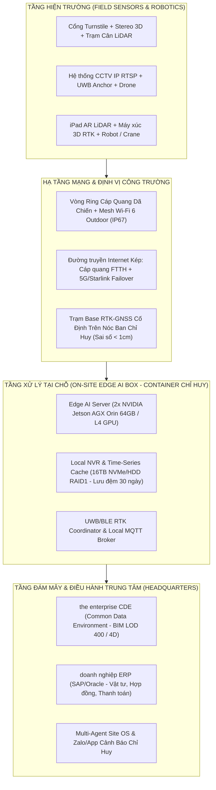
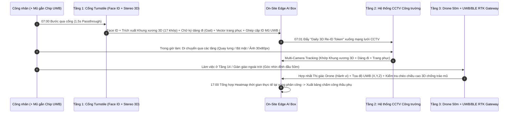

# Hồ Sơ Kiến Trúc Kỹ Thuật Chi Tiết Từng Điểm Tiếp Xúc (Touchpoints) — Công Trường Số doanh nghiệp

> **Tài liệu Đặc tả Kỹ thuật & Vận hành (Technical & Operational Blueprint)**  
> Phục vụ trình Hội đồng Kỹ thuật, Ban Quản lý Dự án, Ban CNTT và Ban Tổng Giám đốc **một tập đoàn xây dựng Việt Nam (bối cảnh giả định)**.  
> Mỗi Touchpoint được bóc tách chi tiết theo **4 chiều**:  
> 1. **Quy trình vận hành từng bước (Step-by-Step Operational Flow)**  
> 2. **Hệ thống xử lý cái gì (AI Pipeline, Thuật toán & Luồng dữ liệu)**  
> 3. **Danh mục thiết bị phần cứng (Hardware BOM & Thông số công nghiệp)**  
> 4. **Hạ tầng kỹ thuật tại công trường (Network, Edge Compute, Power, RTK/Cloud)**

---

## Kiến Trúc Hạ Tầng Nền Tảng Dùng Chung Toàn Công Trường (Core Site Infrastructure)

Trước khi đi vào từng Touchpoint, toàn bộ công trường dùng chung một **"Xương sống Hạ tầng Công trường Số" (Site Backbone)** để tránh đầu tư chồng chéo:

---

## PHẦN I — GIAI ĐOẠN 1 (NĂM 1): SỐ HÓA "TAI MẮT" & AN NINH HIỆN TRƯỜNG

---

### Touchpoint 1.1: Cổng Kiểm Soát AI & Kiểm Tra Đồ Bảo Hộ (AI Access Control & PPE Safety Check)
*Hình minh họa:* [`01_GD1_CP1_Cong_Kiem_Soat_AI_PPE.jpg`](./01_GD1_CP1_Cong_Kiem_Soat_AI_PPE.jpg)

#### 1. Quy trình vận hành từng bước (Step-by-Step)
1. **Bước 1 (Tiếp cận - 0.0s):** Công nhân hoặc thầu phụ bước vào làn phân luồng inox dẫn vào cổng xoay (Turnstile). Cảm biến tiệm cận hồng ngoại (IR Sensor) phát hiện người đứng trước vạch quét và kích hoạt cụm camera.
2. **Bước 2 (Quét kép Khuôn mặt + PPE - 0.3s → 1.0s):**
   - Camera nhận diện khuôn mặt tầm mắt chụp ảnh RGB + Hồng ngoại (chống giả mạo bằng ảnh/điện thoại).
   - Camera góc rộng phía trên quét toàn thân từ đỉnh đầu xuống chân.
3. **Bước 3 (Phán quyết tại chỗ - 1.0s → 1.5s):**
   - **Trường hợp ĐẠT 100%:** Khuôn mặt khớp hồ sơ nhân sự đang còn hạn hợp đồng/bảo hiểm an toàn lao động **VÀ** có đội mũ bảo hộ đúng quy cách + mặc áo phản quang -> Màn hình LED hiện `"HỢP LỆ (GRANTED)"`, còi bíp xanh, chốt từ Turnstile mở trong 3 giây cho 1 người đi qua.
   - **Trường hợp KHÔNG ĐẠT:** Thiếu mũ/áo hoặc thẻ nhân sự hết hạn -> Cổng giữ khóa cứng, loa phát giọng nói tiếng Việt chỉ rõ lỗi (*"Vui lòng đội mũ bảo hộ và cài quai trước khi vào công trường"*), đồng thời chụp ảnh log lỗi gửi cho cán bộ HSE (An toàn lao động) tại cổng.
4. **Bước 4 (Chốt quân số thời gian thực):** Ngay khi trục xoay Turnstile quay đủ 1 vòng (xác nhận vật lý có người đã bước qua), hệ thống cộng `+1` vào bảng quân số trực tuyến theo từng Nhà thầu phụ / Tổ đội.

#### 2. Hệ thống xử lý cái gì (AI & Software Pipeline)
- **Face Recognition & Liveness Detection:** Mô hình `ArcFace / InsightFace (INT8 TensorRT)` trích xuất vector khuôn mặt 512 chiều, kết hợp `3D IR Liveness` chống gian lận chấm công hộ bằng ảnh/video. Đối chiếu cơ sở dữ liệu 5.000 công nhân trong `< 50ms`.
- **PPE Object Detection:** Mô hình `YOLOv10s / RT-DETR` tinh chỉnh riêng cho công trường Việt Nam, nhận diện 4 lớp: `Helmet (Mũ bảo hộ)`, `Chin-strap (Quai mũ)`, `Reflective Vest (Áo phản quang)`, `Safety Shoes (Giày/Ủng bảo hộ)`.
- **Rule Engine & HR Sync:** Kiểm tra chéo trạng thái chứng chỉ an toàn lao động (HSE Certificate) và hợp đồng thầu phụ từ phần mềm HRM/ERP của doanh nghiệp trước khi cấp quyền mở relay cổng.

#### 3. Danh mục thiết bị phần cứng (Hardware BOM)
| Nhóm thiết bị | Thiết bị cụ thể & Thông số công nghiệp | Số lượng / Cổng (3 làn) |
|---|---|---|
| **Cổng cơ khí** | Cổng xoay 3 chấu (Tripod Turnstile) hoặc Full-Height Turnstile Inox SUS304 dày 1.5mm, chuẩn chống bụi/nước `IP65`, motor không chổi than (MCBF > 3 triệu lần đóng mở), tự động sập cần khi mất điện (Fail-safe). | 3 làn (2 vào, 1 ra) |
| **AI Face Terminal** | Thiết bị đầu cuối nhận diện khuôn mặt màn hình 8–10 inch, Camera kép `2MP WDR` (RGB + IR), độ sáng màn hình `> 600 nits` nhìn rõ ngoài nắng, chuẩn `IP66`. | 3 bộ |
| **Camera PPE** | Camera IP Bullet `4MP Starlight WDR 120dB`, ống kính `2.8mm` góc rộng đặt ở độ cao 2.2m nhìn chéo xuống toàn thân. | 3 chiếc |
| **Hiển thị & Cảnh báo** | Bảng LED P4 Outdoor kích thước `1.2m x 0.6m` hiển thị tổng quân số trên công trường + Đèn còi cảnh báo 3 màu (Đỏ/Vàng/Xanh) + Loa phóng thanh IP `15W`. | 1 bộ |

#### 4. Hạ tầng kỹ thuật tại công trường (Infrastructure)
- **Nhà bảo vệ & Mái che cổng:** Khung thép tiền chế có mái tôn chống nắng mưa trực tiếp và tấm chắn sáng nền (backdrop) phía sau lưng công nhân để chống ngược sáng mặt trời lúc 6h30–7h30 sáng.
- **Điện & Dự phòng:** Nguồn `220V AC` qua bộ đổi nguồn `24V DC` công nghiệp + **UPS `2kVA` lưu điện tối thiểu 4 tiếng**; kết nối tín hiệu báo cháy để tự động xả chốt toàn bộ cổng khi có sự cố khẩn cấp.
- **Mạng:** Cáp mạng `Cat6A chống nhiễu (FTP)` luồn ống thép IMC từ cổng về Switch PoE+ tại phòng bảo vệ, kết nối thẳng vào **Edge AI Box** qua mạng nội bộ (hoạt động độc lập 100% ngay cả khi đứt cáp quang Internet).

---

### Touchpoint 1.2: Camera AI Giám Sát Hành Vi & An Toàn Lao Động 24/7 (CCTV AI Vision)
*Hình minh họa:* [`02_GD1_CP2_Camera_AI_Giam_Sat_An_Toan_24_7.jpg`](./02_GD1_CP2_Camera_AI_Giam_Sat_An_Toan_24_7.jpg)

#### 1. Quy trình vận hành từng bước (Step-by-Step)
1. **Bước 1 (Quét luồng video liên tục 24/7):** Các camera PTZ và Bullet lắp trên cẩu tháp, trụ đèn và các tầng đang thi công truyền luồng video RTSP về **Edge AI Box** tại văn phòng Ban chỉ huy.
2. **Bước 2 (Phát hiện hành vi nguy hiểm & Vùng cấm):**
   - AI tự động khoanh vùng đa giác ảo (Virtual Geofence) dưới tầm vươn của cẩu tháp, hố đào sâu, mép sàn chưa có lan can và khu vực giàn giáo trên cao.
   - Phát hiện công nhân tháo mũ bảo hộ, không móc dây an toàn khi đứng trên giàn giáo cao `> 2m`, người nằm bất động/trượt ngã, hoặc có khói/lửa bốc lên.
3. **Bước 3 (Lọc nhiễu chống báo giả - Debounce 3 giây):** Hệ thống theo dõi liên tiếp trong 3 giây (45 frames) để loại bỏ cảnh báo giả (ví dụ công nhân chỉ cúi xuống nhặt đồ hoặc đi ngang qua mép vùng cấm).
4. **Bước 4 (Cảnh báo đa kênh tức thời < 2 giây):**
   - **Tại hiện trường:** Loa IP phóng thanh gắn ngay trên cột camera phát cảnh báo tự động: *"Cảnh báo an toàn! Khu vực sàn tầng 8 trục B-3 có nhân sự chưa móc dây an toàn!"*
   - **Về Ban chỉ huy:** Cắt ảnh (snapshot) khoanh đỏ vị trí vi phạm kèm clip 10 giây đẩy tự động vào nhóm **Zalo / Telegram Ban chỉ huy & HSE** và bật popup đỏ trên màn hình trung tâm.

#### 2. Hệ thống xử lý cái gì (AI & Software Pipeline)
- **Video Decoding & Stream Multiplexing:** Sử dụng `NVIDIA DeepStream SDK` giải mã phần cứng đồng thời 16–32 luồng video `H.265 1080p/4MP @ 15fps` trên 1 Edge AI Box.
- **Multi-Task Safety Vision Models:**
  - `PPE & Harness Detector`: Nhận diện mũ, áo, dây đai an toàn toàn thân (Full-body harness) và móc khóa (Lanyard hook).
  - `Spatial Geofence & Intrusion`: Phép chiếu Homography chuyển tọa độ điểm chân công nhân `(u, v)` trên ảnh 2D sang mặt phẳng sàn công trường `(X, Y)` để kiểm tra xâm nhập vùng nguy hiểm động dưới móc cẩu.
  - `Fall / Immobility & Fire/Smoke Detection`: Phân tích tư thế đổ ngã (Pose angle > 60° nằm sàn quá 10 giây) và phổ màu/chuyển động khói lửa sớm.
- **Alert Deduplication Engine:** Gom nhóm sự kiện theo `Track_ID` và khu vực để không spam tin nhắn Zalo (tối đa 1 cảnh báo / sự kiện / 5 phút cho đến khi cán bộ HSE bấm "Đã xử lý").

#### 3. Danh mục thiết bị phần cứng (Hardware BOM)
| Nhóm thiết bị | Thiết bị cụ thể & Thông số công nghiệp | Số lượng / Công trường tiêu chuẩn |
|---|---|---|
| **Camera AI tầm cao** | Camera IP PTZ Speed Dome `4MP`, Zoom quang học `25x–32x`, hồng ngoại `150m`, chuẩn `IP67 / IK10`, có gạt nước mưa tự động (lắp trên cẩu tháp / trụ cao). | 2 – 4 bộ |
| **Camera khu vực thi công** | Camera IP Bullet `4MP Starlight`, chuẩn `IP67`, hỗ trợ PoE (lắp cố định tại giàn giáo, bãi gia công thép, lối đi chính, di dời linh hoạt theo tầng). | 12 – 24 chiếc |
| **Loa cảnh báo hiện trường** | Loa nén IP Horn Speaker `30W` chuẩn `IP66` tích hợp sẵn bộ giải mã âm thanh SIP/MQTT lắp cùng cụm camera. | 4 – 6 chiếc |
| **Edge AI Box (Dùng chung)** | Máy chủ công nghiệp không quạt (Fanless Rugged IPC) chạy `NVIDIA Jetson AGX Orin 64GB (275 TOPS)` hoặc Server `NVIDIA L4 24GB`, hoạt động ở nhiệt độ `-20°C đến 60°C`. | 1 bộ tại Container Chỉ huy |

#### 4. Hạ tầng kỹ thuật tại công trường (Infrastructure)
- **Truyền dẫn không dây cho Cẩu tháp & Tầng đang lên:** Sử dụng bộ thu phát sóng điểm-nối-điểm **CPE Wireless Bridge 5GHz ngoài trời (băng thông 867Mbps, tầm xa 2–5km)** gắn trên cabin cẩu tháp và các tầng thi công bắn thẳng về ăng-ten trung tâm tại Ban chỉ huy (không cần kéo dây mạng theo từng tầng đang đổ bê tông).
- **Nguồn điện dã chiến:** Hộp tủ điện công trường chống nước `IP65` chứa Switch PoE công nghiệp 4 cổng + ắc quy dự phòng `12V/24V` tại mỗi cụm cột camera.

---

### Touchpoint 1.3: Drone AI Quét 3D & Đối Soát Tiến Độ Tự Động (Point Cloud & BIM 4D)
*Hình minh họa:* [`03_GD1_CP3_Drone_AI_Quet_3D_Doi_Soat_BIM.jpg`](./03_GD1_CP3_Drone_AI_Quet_3D_Doi_Soat_BIM.jpg)

#### 1. Quy trình vận hành từng bước (Step-by-Step)
1. **Bước 1 (Lập lịch & Bay tự động 100%):** Định kỳ mỗi chiều thứ Sáu (hoặc hàng ngày từ trạm sạc tự động Drone-in-a-Box), Drone tự cất cánh theo quỹ đạo bay 3D (3D Waypoints + Oblique Grid) đã lập trình sẵn quanh tòa nhà hoặc dọc tuyến cao tốc.
2. **Bước 2 (Thu thập ảnh RTK & LiDAR):** Drone vừa bay vừa chụp hàng ngàn tấm ảnh độ phân giải cao gắn tọa độ `RTK-GNSS` chính xác đến từng centimet (sai số ngang `< 1.5cm`, đứng `< 2cm`) hoặc quét chùm tia LiDAR xuyên qua bụi/lưới bao che.
3. **Bước 3 (Tái tạo Đám mây điểm 3D - Point Cloud):** Ngay khi Drone hạ cánh vào trạm sạc, dữ liệu được đẩy qua cáp tốc độ cao về Workstation/Cloud để ghép ảnh Photogrammetry / LiDAR thành mô hình thực tế 3D (`LAS/LAZ Point Cloud` + `3D Orthomosaic Map`).
4. **Bước 4 (AI Đối soát tự động với BIM 4D & Lịch Primavera/MS Project):**
   - Hệ thống tự động chồng khớp (ICP Registration) đám mây điểm thực tế lên mô hình thiết kế `BIM 4D (IFC / Revit)`.
   - Tính toán thể tích đất đào đắp, đếm số cột/dầm/sàn đã đổ bê tông và tô màu trực quan trên mô hình: **Màu xanh lá** (Đúng tiến độ), **Màu vàng** (Đang thi công dở dang), **Màu đỏ** (Chậm tiến độ hoặc lệch kích thước/cao độ `> 2cm`).

#### 2. Hệ thống xử lý cái gì (AI & Software Pipeline)
- **3D Reconstruction Engine:** Thuật toán `Structure-from-Motion (SfM) + Multi-View Stereo (MVS)` hoặc `Gaussian Splatting / LiDAR SLAM` tạo đám mây điểm mật độ `200–500 điểm/m²`.
- **Automated BIM-to-PointCloud Alignment:** Thuật toán `RANSAC + Iterative Closest Point (ICP)` tự động căn chỉnh hệ tọa độ VN-2000 của công trường với hệ tọa độ mô hình BIM.
- **3D Semantic Segmentation & Progress AI:** Mô hình `PointNet++ / RandLA-Net` phân loại từng cụm điểm thành: *Đất đào đắp, Cọc/Móng, Cột bê tông, Sàn bê tông, Giàn giáo, Cốt thép chờ*, từ đó tính ra `% hoàn thành thực tế` của từng mã công việc (WBS Code) và xuất báo cáo nghiệm thu khối lượng độc lập.

#### 3. Danh mục thiết bị phần cứng (Hardware BOM)
| Nhóm thiết bị | Thiết bị cụ thể & Thông số công nghiệp | Số lượng / Dự án |
|---|---|---|
| **Drone Công nghiệp** | `DJI Matrice 350 RTK` (hoặc `DJI Dock 2 + Matrice 3D/3TD` cho phương án tự động hóa hoàn toàn không cần phi công), kháng gió `12m/s`, chuẩn `IP55`, cảm biến tránh vật cản 6 hướng. | 1 bộ |
| **Payload Quét 3D** | Cảm biến `Zenmuse L2` (tích hợp LiDAR tầm xa 250m + Camera Mapping 4/3 CMOS 20MP) hoặc `Zenmuse P1` (45MP Full-frame Photogrammetry). | 1 bộ |
| **Mốc khống chế mặt đất** | Bộ mốc trắc đạc cố định (Ground Control Points - GCP) gắn cố định trên công trường. | 6 – 10 mốc |
| **Máy trạm xử lý 3D** | Workstation tại Ban chỉ huy (CPU Intel Core i9 / Xeon, RAM `128GB`, GPU `NVIDIA RTX 4080/4090 16-24GB`, SSD NVMe `4TB`). | 1 bộ |

#### 4. Hạ tầng kỹ thuật tại công trường (Infrastructure)
- **Bãi đáp / Trạm DJI Dock:** Đặt trên nóc container Ban chỉ huy hoặc vị trí thoáng, có kết nối nguồn `220V`, cáp mạng LAN `1Gbps` và kết nối trực tiếp vào **Trạm Base RTK-GNSS cố định của công trường**.
- **Pháp lý bay:** Giấy phép bay (Flight Permit) đăng ký định kỳ theo tọa độ ranh giới dự án của doanh nghiệp và giới hạn trần bay tự động (Geofence trần 80m–120m).

---

### Touchpoint 1.4: Hệ Thống Kiểm Soát Xe & Vật Tư Thông Minh (Smart Gate & AI OCR)
*Hình minh họa:* [`04_GD1_CP4_Smart_Gate_AI_OCR_Kiem_Soat_Xe.jpg`](./04_GD1_CP4_Smart_Gate_AI_OCR_Kiem_Soat_Xe.jpg)

#### 1. Quy trình vận hành từng bước (Step-by-Step)
1. **Bước 1 (Nhận diện xe từ xa 5–10m):** Khi xe bồn bê tông, xe đầu kéo chở thép hoặc xe ben chở đất tiến vào làn cổng xe cơ giới, vòng từ cảm ứng (Loop Detector) chôn dưới đường kích hoạt cụm Camera AI OCR trước và sau.
2. **Bước 2 (Đọc biển số, loại xe & số hiệu bồn):**
   - Trong `0.5 giây`, AI đọc chính xác biển số xe Việt Nam (kể cả biển số bị bùn đất che mờ một phần) + biển số rơ-moóc phía sau + nhận diện loại xe (*Xe bồn bê tông, Xe tải thùng, Xe đầu kéo, Xe đào*).
3. **Bước 3 (Đối chiếu Lệnh điều xe điện tử):**
   - Hệ thống tự động tra cứu biển số với danh sách **Lệnh giao hàng / Lệnh điều xe (Delivery Order)** đã được Phòng Vật tư hoặc Trạm trộn bê tông khai báo trước trên hệ thống doanh nghiệp.
   - **Nếu khớp:** Barrier tự động mở, bảng LED hiển thị `"MỜI XE VÀO - BÊ TÔNG MÁC 400 - ĐỔ SÀN TẦNG 12"`, đồng thời bấm giờ bắt đầu tính **Thời gian lưu xe tại công trường (Turnaround Time)**.
   - **Nếu xe lạ / quá hạn chờ bê tông (> 90 phút từ lúc xuất trạm trộn):** Giữ đóng Barrier, báo động về Chỉ huy vật tư.
4. **Bước 4 (Kiểm tra khi xe ra cổng):** Khi xe rời công trường, camera trên cao chụp lại thùng xe để xác nhận xe đã đổ hết vật tư (tránh gian lận chở ngược vật tư/thép ra khỏi công trường) rồi mới mở Barrier chiều ra.

#### 2. Hệ thống xử lý cái gì (AI & Software Pipeline)
- **Vietnamese ANPR / OCR Engine:** Mô hình `YOLOv8-Plate + VietOCR / PaddleOCR` huấn luyện chuyên biệt cho biển số vàng/trắng Việt Nam (1 dòng và 2 dòng), độ chính xác `> 99.5%` ban ngày và ban đêm.
- **Vehicle Classification & Empty-Bed Check:** Phân loại 8 nhóm phương tiện công trường và kiểm tra trạng thái thùng xe lúc đi ra (`Empty vs Loaded`).
- **Concrete Slump & Aging Timer:** Tự động tính thời gian vận chuyển bê tông thương phẩm từ lúc xuất trạm trộn (`T_batch`) đến lúc vào cổng (`T_gate`) và lúc đổ xong (`T_pour`) để cảnh báo bê tông quá thời gian ninh kết.

#### 3. Danh mục thiết bị phần cứng (Hardware BOM)
| Nhóm thiết bị | Thiết bị cụ thể & Thông số công nghiệp | Số lượng / Cổng xe |
|---|---|---|
| **Barrier tự động** | Barrier công nghiệp tốc độ cao (`1.5–3s`), cần chắn hợp kim nhôm dài `4m–6m` có đèn LED cảnh báo, tích hợp cảm biến radar chống đập vào xe. | 2 bộ (Làn vào / Làn ra) |
| **Camera AI ANPR** | Camera chuyên dụng đọc biển số `4MP Global Shutter`, chống chói đèn pha xe tải tuyệt đối (HLC/WDR 140dB), tích hợp đèn trợ sáng LED/IR xung nhịp. | 4 chiếc (Trước + Sau) |
| **Camera soi thùng xe** | Camera IP `4MP` gắn trên cột cao `4.5m` nhìn thẳng xuống thùng xe chiều vào/ra. | 2 chiếc |
| **Cảm biến & Hiển thị** | Bộ dò vòng từ (Inductive Loop Detector) chôn dưới mặt đường bê tông + Bảng LED ma trận ngoài trời hiển thị biển số & hướng dẫn. | 2 bộ |

#### 4. Hạ tầng kỹ thuật tại công trường (Infrastructure)
- **Mặt bằng cổng xe:** Đổ bê tông cốt thép mặt đường cổng, lắp gờ giảm tốc cách vạch dừng 5m để xe giảm tốc độ xuống `< 15km/h` giúp camera lấy nét tuyệt đối; bố trí cầu rửa xe tự động ngay sau cổng ra.
- **Kết nối:** Cáp quang luồn ống HDPE ngầm kết nối tủ điều khiển cổng xe về **Edge AI Box** và đồng bộ thời gian thực (Realtime Webhook) với phân hệ Logistics/ERP của doanh nghiệp.

---

## PHẦN II — CHUYÊN ĐỀ ĐẶC BIỆT: HỆ THỐNG ĐỊNH DANH SINH TRẮC KHÔNG GIAN 3D & THEO VẾT ĐA TẦNG (3D SPATIAL Re-ID & SENSOR FUSION)

> Giải quyết triệt để **"điểm mù Face ID = 0%"** khi công nhân bước vào công trường (đội mũ sụp, bịt khẩu trang/khăn chống nắng kín mặt, quần áo dính bụi bê tông, đứng cách CCTV 40m chỉ còn `30x80 pixels` hoặc nhìn thẳng từ đỉnh đầu Drone ở độ cao 50m).

---

### Touchpoint 1.5 (Chuyên đề Re-ID): Hệ Thống 3 Tầng Định Danh Không Gian 3D & Hợp Nhất Cảm Biến
*Hình minh họa:*
- [`05_GD1_ReID_Tang1_Passthrough_3D_Skeleton_Gait_Gate.jpg`](./05_GD1_ReID_Tang1_Passthrough_3D_Skeleton_Gait_Gate.jpg)
- [`06_GD1_ReID_Tang2_Multi_Camera_3D_Pose_Tracking.jpg`](./06_GD1_ReID_Tang2_Multi_Camera_3D_Pose_Tracking.jpg)
- [`07_GD1_ReID_Tang3_Drone_50m_UWB_Helmet_Sensor_Fusion.jpg`](./07_GD1_ReID_Tang3_Drone_50m_UWB_Helmet_Sensor_Fusion.jpg)
- [`08_GD1_ReID_Quy_Trinh_4_Buoc_Khep_Kin_07h_17h.jpg`](./08_GD1_ReID_Quy_Trinh_4_Buoc_Khep_Kin_07h_17h.jpg)
- [`09_GD1_ReID_Phu_Luc_Bac_Bo_3D_Avatar_vs_Edge_AI_Box.jpg`](./09_GD1_ReID_Phu_Luc_Bac_Bo_3D_Avatar_vs_Edge_AI_Box.jpg)

#### 1. Quy trình vận hành từng bước (4 Bước Khép Kín 07:00 → 17:00)
1. **Bước 1 — Đăng ký Động học tại Cổng (07:00 sáng, 1.5 giây Passthrough):**
   - Khi công nhân bước tự nhiên qua hành lang cổng xoay (dài 2.2m) và quét Face ID chấm công, 2 camera cảm biến chiều sâu `RGB-D / Stereo` đặt chéo góc dọc hành lang cổng âm thầm quét 45 khung hình 3D liên tiếp mà **không bắt công nhân dừng lại tạo dáng**.
   - Đầu đọc UWB/BLE tầm gần tại cổng đồng thời bắt tín hiệu mã chip gắn trong lòng mũ bảo hộ của người đó (ví dụ `#ID-0842`).
2. **Bước 2 — Khởi tạo & Đồng bộ "Daily 3D Re-ID Token" (07:01 sáng):**
   - Edge AI Box đóng gói một hồ sơ định danh siêu nhẹ cho ca làm việc hôm đó (`< 4KB/người`, nhẹ hơn Avatar 3D tĩnh gấp 1.000 lần) gồm: `Mã nhân viên + ID Mũ UWB + Tỷ lệ khung xương 3D + Chữ ký dáng đi + Vector màu trang phục ca sáng`, sau đó nạp vào bộ nhớ đệm (In-memory Vector DB) của toàn bộ các luồng CCTV và Drone.
3. **Bước 3 — Giám sát Xuyên suốt Đa tầng & Chống Tráo Mũ (Trong giờ làm việc):**
   - **Ở Tầng 2 (CCTV tầm trung):** Khi công nhân đi qua các hành lang, sàn thi công (dù bịt kín mặt, quay lưng, ảnh chỉ `30x80 pixels`), thuật toán `Multi-Camera Person Re-ID` bàn giao mục tiêu từ `CAM 01 -> CAM 04 -> CAM 09` dựa trên tỷ lệ đốt xương bất biến và nhịp bước đi để gắn đúng tên từng người trên màn hình giám sát.
   - **Ở Tầng 3 (Drone 50m & Góc khuất):** Khi nhìn thẳng từ đỉnh đầu xuống (công nhân chỉ là chấm tròn chiếc mũ), hệ thống hợp nhất tọa độ `(X, Y, Z)` của **Chip UWB trong mũ** với **Thị giác máy tính của Drone/CCTV**.
   - **Chốt chặn chống gian lận tráo mũ (Anti-Spoofing):** Nếu công nhân A (cao `1m74`, vai rộng `46cm`, sải bước dài) đưa mũ bảo hộ `#ID-0842` cho công nhân B (cao `1m62`) đội hộ để điểm danh khống, ngay khi người đội mũ đi qua bất kỳ vùng quét camera 3D nào, hệ thống phát hiện độ lệch nhân trắc học (`ΔHeight = 12cm > ngưỡng 3cm`) và lập tức bắn **Báo động Đỏ gian lận tráo mũ** về Ban chỉ huy.
4. **Bước 4 — Nghiệm thu Nhân sự & Chấm công Tự động (17:00 chiều):**
   - Cuối ca, hệ thống tổng hợp **Bản đồ nhiệt thời gian hiện diện thực tế (Work-Zone Presence Heatmap)** của từng công nhân tại đúng khu vực được phân công (ví dụ: Tổ cốt thép 3 phải ở sàn tầng 12 ít nhất 6.5 tiếng/ca), loại bỏ hoàn toàn tình trạng *"quét mặt ở cổng lúc 7h sáng rồi trốn ra quán cà phê hoặc tìm góc khuất ngủ"*, xuất biên bản đối soát nhân công minh bạch để thanh toán cho nhà thầu phụ.

#### 2. Hệ thống xử lý cái gì (AI & Software Pipeline)
- **Tầng 1 — 3D Anthropometrics & Gait Extraction:**
  - `3D Pose Estimation (HRNet-3D / MediaPipeBlazePose-GHUM + Depth Fusion)`: Trích xuất tọa độ không gian 3D `(X, Y, Z)` bằng milimet của 17 khớp xương chính, tính vector tỷ lệ bất biến: `[Chiều cao đỉnh đầu-gót chân, Độ rộng 2 mỏm vai, Chiều dài cột sống C7-Pelvis, Tỷ lệ đùi/cẳng chân]`.
  - `3D Gait Signature (GaitGL / GaitBase)`: Phân tích chuỗi chuyển động 30–45 frames khi bước qua cổng để lấy phổ tần số sải chân, góc lắc vai và nhịp vung tay.
  - `Daily Appearance Embedding (OSNet-AIN / TransReID)`: Trích xuất vector 256 chiều đặc trưng màu quần, loại ủng bảo hộ và vết bạc màu trên áo trong đúng ca làm việc hôm đó.
- **Tầng 2 — Multi-Camera Tracking (MCT):**
  - Thuật toán `ByteTrack / BoT-SORT` kết hợp ma trận khoảng cách `Cosine Distance (Appearance + Gait) + Mahalanobis Distance (3D Skeleton + Spatio-Temporal Topology)` trên cơ sở dữ liệu vector `Milvus / FAISS` chạy trực tiếp trên RAM của Edge AI Box.
- **Tầng 3 — Spatial Sensor Fusion (Vision + UWB/BLE RTK):**
  - Bộ lọc `Extended Kalman Filter (EKF) + Hungarian Matching Algorithm` khớp nối quỹ đạo tọa độ tâm hộp giới hạn thị giác `(X_cam, Y_cam, Z_cam)` từ Drone/CCTV với tọa độ sóng vô tuyến `(X_uwb, Y_uwb, Z_uwb)` từ chip mũ bảo hộ trong thời gian thực (tần số cập nhật `1–5Hz`).

#### 3. Danh mục thiết bị phần cứng (Hardware BOM)
| Nhóm thiết bị | Thiết bị cụ thể & Thông số công nghiệp | Số lượng / Công trường |
|---|---|---|
| **Camera Chiều sâu 3D tại Cổng** | Camera `Intel RealSense D455` hoặc `Orbbec Femto Bolt / Stereolabs ZED 2i` (IP66, Global Shutter Stereo Depth tầm quét 0.5–6m, tích hợp IMU). | 2 chiếc / làn cổng chính |
| **Thẻ Chip Mũ Thông minh** | Tag định vị kép `UWB (IEEE 802.15.4z) + BLE 5.2` siêu mỏng (`< 5mm`, nặng `8g`) dán cố định bên trong vòm mũ bảo hộ, chuẩn `IP67`, tích hợp cảm biến gia tốc (chỉ phát sóng khi mũ chuyển động để tiết kiệm pin **24 tháng**), giá chỉ `~5–8 USD/tag`. | Cấp theo số lượng công nhân |
| **Trạm thu UWB/BLE Anchor** | Trạm thu sóng định vị `Outdoor UWB/BLE AoA Anchor (IP67, cấp nguồn PoE)` lắp tại cổng và các góc sàn tầng đang thi công (mỗi trạm phủ bán kính 40–80m). | 8 – 16 trạm (di dời theo tầng) |
| **On-Site Edge AI Box** | Máy chủ biên công nghiệp `NVIDIA Jetson AGX Orin Industrial 64GB` (hoặc Server Rack ngắn `2U` gắn GPU `NVIDIA L4 24GB`), SSD NVMe `4TB` chạy Docker containers (`DeepStream + Milvus + MQTT + FastAPI`). | 1 bộ tại Container Chỉ huy |

#### 4. Hạ tầng kỹ thuật tại công trường (Infrastructure)
- **Đồng bộ thời gian chính xác (Precision Time Synchronization):** Toàn bộ Camera IP, Stereo 3D Camera và các trạm thu UWB Anchor được đồng bộ qua giao thức **NTP / PTP (IEEE 1588)** từ Edge AI Box với độ lệch `< 10ms` để thuật toán hợp nhất cảm biến (Sensor Fusion) khớp đúng vị trí từng bước chân.
- **Băng thông nội bộ:** Toàn bộ luồng video thô được xử lý và trích xuất vector ngay tại **Edge AI Box ở công trường**; chỉ đẩy các gói tin metadata JSON và ảnh chụp vi phạm (chỉ tốn `< 2Mbps` băng thông Internet) lên Cloud của Tập đoàn.

---

## PHẦN III — GIAI ĐOẠN 2 (NĂM 2): AI TỐI ƯU VẬT TƯ, THIẾT BỊ & TRẮC ĐẠC THÔNG MINH

---

### Touchpoint 2.1: AI Cân & Kiểm Tra Vật Tư Tự Động (AI Weighbridge & 3D LiDAR Cargo Scanning)
*Hình minh họa:* [`10_GD2_CP1_Tram_Can_AI_Quet_3D_LiDAR_Vat_Tu.jpg`](./10_GD2_CP1_Tram_Can_AI_Quet_3D_LiDAR_Vat_Tu.jpg)

#### 1. Quy trình vận hành từng bước (Step-by-Step)
1. **Bước 1 (Xe lên bàn cân & Nhận diện tự động):** Xe tải chở thép cuộn/thép cây hoặc xe ben chở cát/đá tiến lên bàn cân điện tử với tốc độ `< 5km/h`. Cảm biến vị trí xác nhận xe đã nằm gọn trên bàn cân.
2. **Bước 2 (Quét 3D LiDAR & Đếm bó thép tự động từ trên cao):**
   - Cụm máy quét **3D LiDAR + Camera AI độ phân giải cao** lắp trên cổng vòm thép (Gantry) cao 5.5m quét dọc từ đầu thùng xe đến đuôi thùng xe trong `3 giây`.
   - Đối với **vật liệu rời (cát, đá, đất):** Dựng bề mặt 3D của đống vật liệu, trừ đi thể tích lòng thùng xe rỗng (đã lưu trong hồ sơ xe) để ra chính xác số khối (`m³`) thực tế.
   - Đối với **thép xây dựng:** AI Vision chụp mặt cắt đầu bó thép và thân xe để đếm số lượng bó thép (Rebar bundles) và thanh thép.
3. **Bước 3 (Đối soát chéo Trọng lượng vs Thể tích vs Đơn hàng ERP):**
   - Hệ thống tự động kiểm tra công thức vật lý: `Khối lượng cân (Tấn) / Thể tích LiDAR (m³) = Tỷ trọng thực tế`. Nếu nhà cung cấp bơm nước vào cát hoặc độn tạp chất/đá tảng bên dưới để ăn gian trọng lượng, hệ thống phát hiện ngay sự bất thường về tỷ trọng hoặc thể tích bị thiếu.
4. **Bước 4 (Ký nhận điện tử & Đồng bộ ERP):**
   - Khi khớp 100% với PO (Purchase Order) trên ERP, bảng LED hiện `"AI ĐỒNG BỘ ERP: HỢP LỆ (MATCHED 100%)"`, tự động phát hành Phiếu nhập kho điện tử (e-GRN) trên máy tính bảng của kỹ sư vật tư doanh nghiệp mà không cần bất kỳ thao tác ghi sổ tay nào.

#### 2. Hệ thống xử lý cái gì (AI & Software Pipeline)
- **3D Volumetric Point Cloud Integration:** Thuật toán nội suy lưới tam giác `Delaunay Triangulation / Voxel Grid Integration` tính thể tích hàng hóa từ đám mây điểm LiDAR với sai số `< 1.5%`, tự động phát hiện thủ thuật xếp rỗng lòng thùng xe.
- **Rebar Bundle & Pipe Counting AI:** Mô hình `YOLOv10-InstanceSeg / Circle-Hough + Dense Counting` đếm đầu thanh thép và bó thép trên thùng xe tải.
- **ERP 3-Way Matching API:** Tự động đối chiếu 3 chiều: `Đơn đặt hàng (PO trên SAP/ERP)` ↔ `Phiếu xuất kho nhà cung cấp (QR/OCR)` ↔ `Số liệu thực đo (Loadcell + 3D LiDAR)` và khóa tự động không cho phép sửa tay số cân.

#### 3. Danh mục thiết bị phần cứng (Hardware BOM)
| Nhóm thiết bị | Thiết bị cụ thể & Thông số công nghiệp | Số lượng / Trạm cân |
|---|---|---|
| **Bàn cân & Khung Gantry** | Cầu cân điện tử `60–80 tấn` (Loadcell kỹ thuật số chống gian lận tín hiệu) + Khung vòm thép chữ U (Gantry) cao `5.5m` chống rung. | 1 hệ thống |
| **Cảm biến 3D LiDAR** | Máy quét `Livox Mid-360 / Ouster OS1-32` hoặc `SICK LMS511` chuẩn `IP67` gắn đỉnh khung vòm nhìn thẳng xuống thùng xe. | 1 – 2 bộ |
| **Camera AI Đếm & OCR** | 2 Camera `8MP (4K)` góc nhìn đỉnh thùng & đuôi thùng (đếm đầu bó thép) + 2 Camera ANPR đọc biển số trước/sau. | 4 chiếc |
| **Hiển thị & Đầu cuối** | Bảng LED P4 ngoài trời hiển thị kết quả cân/đo 3D + Máy tính bảng công nghiệp `Rugged Tablet IP65` cho thủ kho hiện trường. | 1 bộ |

#### 4. Hạ tầng kỹ thuật tại công trường (Infrastructure)
- **Nền móng:** Móng bê tông cốt thép cho bàn cân và trụ Gantry tách biệt để xe tải nặng đi qua không gây rung lắc cảm biến LiDAR trên đỉnh vòm; hệ thống chống sét lan truyền trực tiếp cho Loadcell và LiDAR.
- **Kết nối dữ liệu:** Kết nối RS485/Modbus TCP từ đầu cân điện tử trực tiếp vào **Edge AI Box** trong hộp niêm phong kẹp chì (chống can thiệp phần cứng tại trạm cân).

---

### Touchpoint 2.2: Robot Tự Hành In Bản Vẽ BIM Trực Tiếp Lên Sàn (Robotic Field Layout / FieldPrinter)
*Hình minh họa:* [`11_GD2_CP2_Robot_In_Ban_Ve_BIM_Len_San_FieldPrinter.jpg`](./11_GD2_CP2_Robot_In_Ban_Ve_BIM_Len_San_FieldPrinter.jpg)

#### 1. Quy trình vận hành từng bước (Step-by-Step)
1. **Bước 1 (Chuẩn bị file BIM & Mặt sàn):** Bộ phận BIM của doanh nghiệp xuất bản vẽ phối hợp tổng hợp (Combined Shop Drawing: Tường xây, Vách thạch cao, Hốc cửa, Ống chờ MEP xuyên sàn) dưới định dạng `.DXF / .CSV` đã khóa tọa độ và nạp vào máy tính bảng điều khiển. Mặt sàn bê tông sau khi tháo cốp-pha được quét sạch bụi/xà bần.
2. **Bước 2 (Định vị mốc chuẩn với Máy Toàn đạc Tự động - 10 phút):** Kỹ sư trắc đạc đặt **Máy Toàn đạc Tự động (Robotic Total Station)** lên chân máy tại 1 điểm thông thoáng trên sàn, ngắm vào 2 mốc khống chế trắc đạc của tầng (Resection) để xác lập hệ tọa độ tuyệt đối, sau đó khóa tia laser vào gương lăng kính 360° gắn trên lưng Robot.
3. **Bước 3 (Robot tự chạy & In phun đa lớp trực tiếp lên sàn):**
   - Robot tự động lập kế hoạch đường đi tối ưu (Path Planning), tự lăn bánh trên mặt sàn bê tông và dùng đầu phun mực công nghiệp (khô ngay trong 2 giây, chống nước/bụi) in trực tiếp:
     - Đường tim trục, đường biên tường xây, vách ngăn;
     - Ký hiệu lỗ mở cửa (kèm chiều mở cửa), vị trí khoan cấy thép râu, vị trí ống chờ cấp thoát nước và hộp kỹ thuật MEP;
     - In luôn **chữ số kích thước, mã phòng và tên nhà thầu phụ** trực tiếp xuống sàn bê tông!
4. **Bước 4 (Bàn giao đa nhà thầu & Cập nhật nhật ký BIM):** Khi in xong 1.000m² sàn chỉ trong vài giờ (thay vì 3–4 ngày búng mực tay), Robot gửi báo cáo những vị trí vướng cột/vật cản không in được về mô hình BIM trung tâm.

#### 2. Hệ thống xử lý cái gì (AI & Software Pipeline)
- **CAD/BIM Multi-Trade Compiler:** Phần mềm chuyển đổi các lớp (Layers) từ Revit/AutoCAD thành lệnh điều khiển đường chạy và đầu phun mực (G-code trắc đạc).
- **Closed-Loop Laser Guidance Control (`< 1.5mm` Accuracy):** Vòng lặp điều khiển thời gian thực tần số `20Hz–50Hz` giữa Máy Toàn đạc Tự động (bắn tia EDM đo khoảng cách & góc chính xác `1"`) và bộ điều khiển chuyển động đa hướng của Robot kết hợp IMU để bù trừ độ nhám mặt sàn bê tông.
- **Obstacle Avoidance & Re-routing:** Cảm biến LiDAR 2D và siêu âm quanh thân Robot phát hiện cọc thép chờ, lỗ mở sàn hoặc đống vật tư để tự động vòng tránh và quay lại in bù mà không bị lệch tọa độ.

#### 3. Danh mục thiết bị phần cứng (Hardware BOM)
| Nhóm thiết bị | Thiết bị cụ thể & Thông số công nghiệp | Số lượng / Tổ đội Trắc đạc |
|---|---|---|
| **Robot In Bản vẽ** | Robot tự hành `Dusty Robotics FieldPrinter 2` (hoặc `HP SitePrint`), kích thước nhỏ gọn bỏ vừa cốp xe/thang vận, pin hoạt động liên tục `6–8 giờ`, đầu phun mực công nghiệp chịu ma sát trên bê tông thô. | 1 bộ |
| **Máy Toàn đạc Tự động** | `Trimble S7 / S9 Robotic Total Station` hoặc `Leica TS16` (độ chính xác góc `1"`, tự động khóa và bám mục tiêu gương lăng kính `Active Track 360°`). | 1 bộ |
| **Gương phản xạ & Tablet** | Gương lăng kính `360° Active Prism` gắn trên thân Robot + Máy tính bảng điều khiển hiện trường. | 1 bộ |

#### 4. Hạ tầng kỹ thuật tại công trường (Infrastructure)
- **Điều kiện mặt bằng (Yêu cầu bắt buộc):** Quy trình vệ sinh công nghiệp sàn bê tông ngay sau khi tháo cốp-pha (dùng máy hút/thổi bụi công nghiệp và robot quét sàn dọn sạch đinh, sắt vụn, vũng nước đọng trước khi đưa Robot vào in).
- **Kết nối:** Mạng Wi-Fi nội bộ trực tiếp (Peer-to-Peer Wi-Fi / Radio Link 2.4GHz) giữa Máy Toàn đạc, Robot và Tablet (hoàn toàn không phụ thuộc sóng Internet ở các tầng hầm hay tầng cao).

---

### Touchpoint 2.3: Máy Xúc Dẫn Đường 3D & Bán Tự Hành (3D Machine Guidance AI)
*Hình minh họa:* [`12_GD2_CP3_May_Xuc_Dan_Duong_3D_Machine_Guidance.jpg`](./12_GD2_CP3_May_Xuc_Dan_Duong_3D_Machine_Guidance.jpg)

#### 1. Quy trình vận hành từng bước (Step-by-Step)
1. **Bước 1 (Nạp bình đồ thiết kế 3D từ văn phòng vào cabin máy xúc):** Kỹ sư dữ liệu của doanh nghiệp chuyển bản vẽ thiết kế hố móng, mái dốc taluy hoặc nền đường cao tốc thành mô hình bề mặt lưới tam giác `3D TIN Surface (.LandXML / .TP3)` và đẩy qua mạng 4G/5G thẳng vào màn hình máy tính trong cabin máy xúc/máy ủi.
2. **Bước 2 (Định vị răng gầu xúc chính xác từng centimet):**
   - 2 ăng-ten vệ tinh `RTK-GNSS` trên nóc cabin xác định chính xác vị trí và hướng xoay (Heading) của thân máy xúc.
   - 4 cảm biến góc nghiêng quán tính (`IMU Tilt Sensors`) gắn trên thân máy (Body), cần chính (Boom), tay gầu (Arm) và gầu xúc (Bucket) tính toán động học thuận (Forward Kinematics) để biết chính xác tọa độ 3D `(X, Y, Z)` của **mũi răng gầu xúc** ngay cả khi gầu đang chìm dưới nước hoặc bùn sâu.
3. **Bước 3 (Dẫn đường trực quan & Tự động khóa thủy lực chống đào lố):**
   - Tài xế nhìn màn hình cảm ứng `10 inch` bên phải cần joystick: Vùng đất màu đỏ là còn cao cần múc tiếp, vùng màu xanh lá là đã chạm đúng cốt thiết kế, kèm đồng hồ báo khoảng cách còn lại (`+0.35m`, `+0.10m`, `0.00m`).
   - Với chế độ **Bán tự động (Semi-Auto Hydraulic Control):** Khi răng gầu chạm đúng mặt phẳng thiết kế 3D, van thủy lực điện tử tự động giới hạn hành trình hạ cần và tự động vuốt gầu trượt đúng theo độ dốc taluy thiết kế, ngăn chặn tuyệt đối việc đào lố (over-digging) dù tài xế có kéo kịch tay trang.
4. **Bước 4 (Cập nhật bản đồ hoàn công thời gian thực):** Mỗi gầu đất múc xong đều được cập nhật ngay trên bản đồ cao độ đám mây (As-built Cut/Fill Map) gửi về văn phòng Ban chỉ huy.

#### 2. Hệ thống xử lý cái gì (AI & Software Pipeline)
- **Real-time Multi-Body Kinematics & IMU Fusion (`100Hz`):** Giải bài toán hình học không gian 3D thời gian thực từ góc nghiêng 4 khớp nối + cao độ RTK-GNSS để định vị lưỡi cắt gầu xúc với độ chính xác `±15mm`.
- **3D TIN Surface Collision & Grade Control:** Tính khoảng cách vuông góc ngắn nhất từ biên dạng gầu xúc đến mặt phẳng lưới tam giác thiết kế (`TIN Surface`) và điều khiển dòng điện van tỷ lệ thủy lực (`PWM Proportional Solenoid Valve`).
- **Cut/Fill Volume Telemetry:** Tính toán khối lượng đất đào/đắp tích lũy theo từng ca làm việc của từng đầu máy.

#### 3. Danh mục thiết bị phần cứng (Hardware BOM)
| Nhóm thiết bị | Thiết bị cụ thể & Thông số công nghiệp | Số lượng / Đầu máy xúc, ủi |
|---|---|---|
| **Màn hình điều khiển Cabin** | Màn hình cảm ứng công nghiệp `10.1 inch` (`Trimble Earthworks / Topcon MC-Max / Komatsu Smart Construction`), chống rung sốc chuẩn quân đội `MIL-STD-810G`. | 1 bộ / cabin |
| **Hệ thống RTK-GNSS** | Bộ thu GNSS 2 ăng-ten đa tần (`GPS + GLONASS + BeiDou + Galileo`) gắn trên khung bảo vệ nóc cabin + Modem thu sóng hiệu chỉnh RTK (4G NTRIP / UHF Radio). | 1 bộ (2 nấm ăng-ten) |
| **Cảm biến góc nghiêng IMU** | 4 cảm biến `Solid-State IMU` chuẩn `IP69K` (chịu được vòi xịt rửa áp lực cao và ngập bùn nước) gắn trên Thân, Cần, Tay gầu và Gầu xúc, đi dây trong ống thép bảo vệ. | 4 cảm biến / máy |
| **Bộ van thủy lực bán tự động** | Cụm van điện từ can thiệp mạch điều khiển pilot thủy lực (tùy chọn cho gói Semi-Auto Grade Control). | 1 bộ |

#### 4. Hạ tầng kỹ thuật tại công trường (Infrastructure)
- **Trạm Base RTK-GNSS Cố định:** Đặt 1 trạm Base RTK cố định trên nóc Ban chỉ huy (phủ sóng Radio UHF bán kính `5–10km` cho các dự án cao tốc vùng sâu chưa có sóng 4G ổn định, hoặc phát qua `NTRIP Caster 4G/5G`).
- **Hiệu chuẩn (Calibration):** Thiết lập bãi kiểm tra mốc chuẩn (Calibration Benchmark Point) ngay cạnh bãi đỗ xe cơ giới để tài xế chấm mũi gầu kiểm tra sai số đầu ca trong 30 giây.

---

### Touchpoint 2.4: Thực Tế Tăng Cường AR Đối Chiếu Thiết Kế & Nghiệm Thu Cơ Điện (AR Mobile BIM Inspection)
*Hình minh họa:* [`13_GD2_CP4_AR_Mobile_BIM_Doi_Chieu_Nghiem_Thu_MEP.jpg`](./13_GD2_CP4_AR_Mobile_BIM_Doi_Chieu_Nghiem_Thu_MEP.jpg)

#### 1. Quy trình vận hành từng bước (Step-by-Step)
1. **Bước 1 (Đồng bộ mô hình BIM LOD 400 theo phân khu):** Trước khi lên công trường, kỹ sư MEP/QA-QC của doanh nghiệp tải phân khu mô hình BIM (ví dụ: Tầng 8 - Khu A) từ môi trường dữ liệu chung (`Autodesk Construction Cloud / Dalux / GAMMA AR`) về máy tính bảng `iPad Pro có cảm biến LiDAR`.
2. **Bước 2 (Khóa tọa độ không gian trong 5 giây - Spatial Anchor Alignment):**
   - Kỹ sư đứng tại giao điểm 2 cột bê tông hoặc quét mã `AR QR Marker` dán ở mốc trắc đạc trên cột bê tông.
   - Cảm biến LiDAR trên iPad quét bề mặt cột/dầm bê tông thực tế và tự động khóa khít (Snap) mô hình BIM 3D vào không gian thật với tỷ lệ `1:1`.
3. **Bước 3 (Đi bộ kiểm tra chồng lớp X-Ray & Phát hiện sai lệch tại chỗ):**
   - Kỹ sư giơ iPad lên nhìn trần nhà hoặc bức tường: Trên màn hình hiển thị rõ các đường ống BIM phân màu chuẩn (**Đỏ**: PCCC, **Xanh dương**: Cấp thoát nước, **Xanh lá**: Ống gió HVAC, **Vàng**: Máng cáp điện) chồng đè lên hệ thống ống thật vừa lắp.
   - Dùng thước đo laser AR trên màn hình chạm từ mép ống thật sang mép ống thiết kế BIM để đo ngay độ lệch (ví dụ: *"Lỗ mở xuyên dầm trục C-4 bị đặt lệch sang trái 4.5cm"*).
4. **Bước 4 (Gắn thẻ lỗi BCF trực tiếp vào tọa độ 3D):** Kỹ sư bấm chụp ảnh màn hình AR ngay tại vị trí sai lệch, ghi chú giọng nói và tạo phiếu yêu cầu sửa lỗi (`BCF Issue`) gắn đúng tọa độ 3D đó đẩy thẳng về cho Nhà thầu phụ MEP và phòng BIM văn phòng.

#### 2. Hệ thống xử lý cái gì (AI & Software Pipeline)
- **Visual-Inertial Odometry (VIO) + LiDAR Mesh SLAM:** Kết hợp camera RGB, cảm biến quán tính IMU và cảm biến chiều sâu `dToF LiDAR` trên iPad Pro để giữ cho mô hình 3D không bị trôi (drift) khi kỹ sư đi bộ dọc hành lang dài hàng trăm mét.
- **Real-time Dynamic Occlusion Rendering:** Sử dụng bản đồ chiều sâu LiDAR thời gian thực để biết vật thể thật nào đang nằm phía trước mô hình ảo (giúp cột bê tông thật che khuất phần ống BIM đi phía sau cột, tạo cảm giác chiều sâu chuẩn xác).
- **LOD 400 IFC Streaming & BCF Sync:** Nén hình học hàng triệu đa giác của file IFC nặng nhiều GB để render mượt ở tốc độ `60fps` trên thiết bị di động và đồng bộ chuẩn mở `BCF (BIM Collaboration Format)`.

#### 3. Danh mục thiết bị phần cứng (Hardware BOM)
| Nhóm thiết bị | Thiết bị cụ thể & Thông số công nghiệp | Số lượng / Ban chỉ huy |
|---|---|---|
| **Thiết bị di động AR** | `Apple iPad Pro 11" / 13" (Chip M2/M4, tích hợp sẵn dToF LiDAR Scanner)`, dung lượng `256GB–512GB`, kết nối `Wi-Fi + 5G`. | 3 – 5 máy (QA/QC, MEP, Kết cấu) |
| **Ốp bảo vệ công trường** | Vỏ bọc chống va đập rơi từ độ cao 2m, chống bụi nước chuẩn `IP65` (`OtterBox Defender / aXtion Bold MP`) kèm dây đeo chéo vai và tay cầm xoay 360° sau lưng máy. | 3 – 5 bộ |
| **Mốc định vị AR** | Tấm mốc `AR QR / AprilTag` in trên пластик nhôm Alu chống nước gắn cố định tại các cột trục chính mỗi tầng (cao độ +1.5m từ cốt sàn hoàn thiện). | 4 – 6 mốc / sàn tầng |

#### 4. Hạ tầng kỹ thuật tại công trường (Infrastructure)
- **Hạ tầng dữ liệu BIM (Điều kiện tiên quyết):** Mô hình BIM phải được cập nhật đạt chuẩn thi công **LOD 350 – LOD 400 (Shop Drawing 3D)** và được đồng bộ phiên bản mới nhất mỗi sáng tại phòng Ban chỉ huy qua Wi-Fi trước khi kỹ sư cầm iPad lên tầng (hoạt động Offline 100% trên tầng đang thi công).

---

## PHẦN IV — GIAI ĐOẠN 3 (NĂM 3): CÔNG TRƯỜNG TỰ TRỊ & CỘNG TÁC NGƯỜI - MÁY (CYBER-PHYSICAL AI)

---

### Touchpoint 3.1: Robot Bốn Chân Tuần Đêm & Quét 3D (Autonomous Night LiDAR Robot Patrol)
*Hình minh họa:* [`14_GD3_CP1_Robot_Bon_Chan_Tuan_Dem_Quet_3D_LiDAR.jpg`](./14_GD3_CP1_Robot_Bon_Chan_Tuan_Dem_Quet_3D_LiDAR.jpg)

#### 1. Quy trình vận hành từng bước (Step-by-Step)
1. **Bước 1 (Kích hoạt ca đêm tự động - 20:00 tối):** Khi công nhân đã rút khỏi các tầng thi công, từ đế sạc tự động (Auto-Charging Dock), Robot bốn chân tự thức dậy, kiểm tra dung lượng pin và tải lộ trình tuần tra đêm qua các tầng và hầm ngầm.
2. **Bước 2 (Leo cầu thang & Vượt địa hình gồ ghề tự hành):** Robot tự bước qua đống đá dăm, cốt thép sàn, leo cầu thang bộ bê tông thô (độ dốc tới 45°) để đi qua từng phòng, từng hành lang mà Drone không thể bay vào được.
3. **Bước 3 (Quét 3D LiDAR độ chính xác cao & Quét Nhiệt PCCC):**
   - Tại mỗi điểm dừng thiết lập sẵn (Waypoints cách nhau 10m), Robot dừng lại 45 giây để cụm **3D Laser Scanner** trên lưng xoay 360° quét toàn bộ cột, vách, dầm, ống MEP với sai số chỉ `2mm`.
   - Đồng thời **Camera Nhiệt (Thermal IR)** quét phát hiện các tủ điện tạm đang quá nhiệt, mối hàn còn âm ỉ lửa hoặc rò rỉ nước ngầm trong đêm.
4. **Bước 4 (Trở về đế sạc & Xuất báo cáo sáng hôm sau - 05:30 sáng):** Robot tự quay về đế sạc, đẩy toàn bộ dữ liệu Point Cloud 3D và ảnh nhiệt lên **Site OS**. Đúng 06:30 sáng, Chỉ huy trưởng nhận được bản đồ báo cáo: *"Tầng 9 hoàn thành 92% vách xây; Phát hiện 1 vách cốp-pha cột trục D-5 bị phình 18mm và 1 tủ điện tạm tầng 4 nóng 78°C cần xử lý ngay đầu ca sáng"*.

#### 2. Hệ thống xử lý cái gì (AI & Software Pipeline)
- **Legged Locomotion & 3D SLAM Navigation:** Hệ thống điều khiển cân bằng động học 12 bậc tự do kết hợp `3D LiDAR SLAM (LIO-SAM / FAST-LIO2)` giúp Robot định vị chính xác trong hầm kín/tầng nhà tối đen hoàn toàn không có sóng GPS.
- **Automated Scan-vs-BIM Deviation Analysis:** Tự động tạo bản đồ màu sai lệch (`Color Deviation Heatmap`) trên bề mặt bê tông để kiểm tra độ phẳng sàn (Floor Flatness `FF/FL`) và độ thẳng đứng của cột/vách.
- **Thermal Anomaly & Gas Leak Detection:** Phân tích ảnh hồng ngoại phát hiện điểm nóng bất thường (`> 65°C`) và tích hợp cảm biến khí độc (`CO, CH4, O2`) khi tuần tra hầm ngầm.

#### 3. Danh mục thiết bị phần cứng (Hardware BOM)
| Nhóm thiết bị | Thiết bị cụ thể & Thông số công nghiệp | Số lượng / Đại dự án |
|---|---|---|
| **Robot Bốn chân** | `Boston Dynamics Spot Enterprise` hoặc `Unitree B2 Industrial` (tải trọng mang vác `20–40kg`, chuẩn chống bụi nước `IP67`, leo bậc thang cao `25–40cm`, thời lượng pin `2–4 giờ/lần sạc`). | 1 bộ |
| **Payload Quét 3D & Nhiệt** | Máy quét `Trimble X7 / Leica BLK ARC` gắn trực tiếp trên lưng Robot + Cụm Camera 광학 `360° Pan-Tilt-Zoom` và Camera Nhiệt `FLIR Boson`. | 1 cụm tích hợp |
| **Đế sạc tự động** | Đế sạc tiếp xúc tự động `Autonomous Charging Dock` có cổng Ethernet tốc độ cao `1Gbps` để xả dữ liệu nặng hàng chục GB sau mỗi ca tuần đêm. | 1 – 2 đế |

#### 4. Hạ tầng kỹ thuật tại công trường (Infrastructure)
- **Mốc định vị Fiducial Markers (AprilTags):** Dán các bảng mã `AprilTag` tại đầu cầu thang bộ và các ngóc ngách chuyển tầng để Robot tự xác nhận mốc chuyển tầng chính xác tuyệt đối.
- **Hành lang an toàn:** Cầu thang tạm công trường đảm bảo chiều rộng tối thiểu `0.8m` và có gờ chắn hai bên.

---

### Touchpoint 3.2: Công Nhân Đeo Khung Xương Cơ Học Trợ Lực (Industrial Exoskeleton Wearable)
*Hình minh họa:* [`15_GD3_CP2_Cong_Nhan_Khung_Xuong_Tro_Luc_Exoskeleton.jpg`](./15_GD3_CP2_Cong_Nhan_Khung_Xuong_Tro_Luc_Exoskeleton.jpg)

#### 1. Quy trình vận hành từng bước (Step-by-Step)
1. **Bước 1 (Trang bị theo nhóm công việc nặng - 60 giây mặc vào):** Đầu ca, các tổ đội làm việc nặng nhọc nhất (Tổ lắp đặt ống gió/ống thép MEP trên trần, Tổ buộc/vác cốt thép sàn, Tổ khoan ty ren trần bê tông) nhận bộ khung xương trợ lực tại kho thiết bị công trường và khóa đai vào vai, lưng, hông trong 60 giây.
2. **Bước 2 (Nhận diện ý định vận động & Trợ lực tức thời):**
   - Khi người thợ cúi xuống nhấc bó thép hoặc cấu kiện nặng 30–40kg: Cảm biến góc khớp hông và cảm biến lực (Torque/EMG sensors) nhận diện chuyển động nâng trong `10 mili-giây`, kích hoạt cơ cấu trợ lực cơ-điện (Active Servo) hoặc lò xo khí nén carbon (Passive Spring) tạo mô-men nâng đỡ tới `30kgf` cho vùng thắt lưng (L4/L5), truyền lực thẳng xuống đùi/đất.
   - Khi người thợ giơ hai tay lên cao khoan hàng ngàn lỗ ty ren trên trần bê tông: Khung đỡ vai tự động khóa giữ trọng lượng hai cánh tay và chiếc máy khoan bê tông nặng 5kg, giúp thợ không bị tê mỏi vai gáy.
3. **Bước 3 (Giám sát sinh trắc học & Cảnh báo quá tải cơ xương khớp):** Cảm biến IoT trên khung xương ghi nhận số lần cúi nâng, góc vặn cột sống nguy hiểm và nhịp tim/nhiệt độ cơ thể, rung nhẹ cảnh báo khi công nhân nâng sai tư thế.

#### 2. Hệ thống xử lý cái gì (AI & Software Pipeline)
- **Human Motion Intention Recognition (Edge MCU):** Thuật toán phân tích tín hiệu từ cảm biến quán tính `6-Axis IMU` và cảm biến mô-men xoắn tại khớp hông/vai tần số `500Hz` để phân biệt rõ khi nào công nhân đang **đi bộ bình thường** (tắt trợ lực để đi lại nhẹ nhàng) và khi nào đang **cúi nâng vật nặng / giữ tay trên cao** (bật trợ lực tức thì).
- **Ergonomic Fatigue & Productivity Analytics:** Tổng hợp chỉ số giảm tải cột sống và cảnh báo nguy cơ kiệt sức nhiệt (Heat Stress) về hệ thống HSE của doanh nghiệp.

#### 3. Danh mục thiết bị phần cứng (Hardware BOM)
| Nhóm thiết bị | Thiết bị cụ thể & Thông số công nghiệp | Số lượng / Dự án thí điểm |
|---|---|---|
| **Exoskeleton Trợ lực Lưng & Hông (Active/Powered)** | `German Bionic Cray X / Apogee` (Khung sợi carbon siêu nhẹ `~7kg`, chuẩn chống bụi nước `IP54`, hỗ trợ lực nâng `30kg/lần`, giảm 70% áp lực đĩa đệm thắt lưng). | 5 – 10 bộ (cho đội lắp đặt nặng) |
| **Exoskeleton Đỡ Vai Khoan Trần (Passive)** | `Hilti EXO-S / Ottobock Paexo Shoulder` (Không dùng pin, nặng chỉ `1.9kg`, chuyên dụng cho thợ cơ điện MEP khoan trần và lắp ống gió trên cao cả ngày). | 10 – 20 bộ (cho đội MEP) |
| **Tủ sạc & Khử khuẩn** | Tủ sạc pin thay nóng (Hot-swap Battery Dock) kèm đèn UV khử mùi/vệ sinh đệm đai lưng sau mỗi ca. | 1 tủ |

#### 4. Hạ tầng kỹ thuật tại công trường (Infrastructure)
- **Kho quản lý thiết bị (Tool Crib):** Bố trí khu vực cấp phát, hiệu chỉnh kích cỡ đai theo chiều cao công nhân và trạm sạc pin dự phòng ngay tại container thiết bị của công trường.

---

### Touchpoint 3.3: Máy Công Trình Tự Hành Hoàn Toàn (Fully Autonomous Heavy Machinery)
*Hình minh họa:* [`16_GD3_CP3_May_Cong_Trinh_Tu_Hanh_Hoan_Toan.jpg`](./16_GD3_CP3_May_Cong_Trinh_Tu_Hanh_Hoan_Toan.jpg)

#### 1. Quy trình vận hành từng bước (Step-by-Step)
1. **Bước 1 (Khoanh vùng khu vực thi công tự hành - Autonomous Workzone):** Tại các dự án hạ tầng quy mô lớn, lặp đi lặp lại của doanh nghiệp (như đắp nền đường cao tốc Bắc-Nam, san lấp khu công nghiệp, đắp đập thủy lợi), kỹ sư chỉ huy thiết lập ranh giới khu vực tự hành trên bản đồ số và giao nhiệm vụ (ví dụ: *"Lu lèn chặt 8 lượt lớp đất K98 tại phân đoạn Km12+000 đến Km12+500"*).
2. **Bước 2 (Vận hành theo đàn không người lái - Swarm Execution):**
   - Đoàn xe lu rung tự hành (Autonomous Vibratory Rollers) và xe ủi tự hành tự khởi động, di chuyển theo các vệt song song chồng mí chính xác `20cm`, tự động điều chỉnh tần số đầm rung dựa trên cảm biến đo độ chặt nền đất thời gian thực (`Intelligent Compaction CMV Sensor`).
   - Máy xúc tự hành dùng LiDAR 3D quét vị trí thùng xe ben tự hành vừa lùi vào để tự động múc đất đổ đầy thùng xe.
3. **Bước 3 (Bảo vệ an toàn 3 lớp bằng Radar & LiDAR 360°):**
   - Lớp 1 (`Cách 30m`): Phát hiện người hoặc xe khác tiến lại gần -> Tự động giảm tốc độ 50%.
   - Lớp 2 (`Cách 10m`): Tự động dừng máy hoàn toàn và phát còi/đèn cảnh báo.
   - Lớp 3 (`Nút dừng khẩn cấp E-Stop vô tuyến`): Kỹ sư giám sát từ xa có thể bấm nút khóa phanh khẩn cấp toàn bộ đội xe trong `< 0.2 giây`.

#### 2. Hệ thống xử lý cái gì (AI & Software Pipeline)
- **Multi-Vehicle Path Planning & Swarm Coordination:** Thuật toán lập quỹ đạo phủ kín diện tích (`Coverage Path Planning`) và điều phối tránh va chạm giữa nhiều xe lu/xe ủi/xe ben hoạt động chung trên một mặt bằng.
- **360° LiDAR + Millimeter-Wave Radar Perception:** Hợp nhất dữ liệu từ LiDAR 3D và Radar bước sóng milimet (`77GHz` xuyên qua bụi mù dày đặc trên công trường đất) để phát hiện chướng ngại vật, hố sụt hoặc con người.
- **Closed-Loop Intelligent Compaction Control:** Tự động đo độ cứng nền đất sau mỗi lượt lu và tự động lu bù tại những điểm chưa đạt độ chặt K95/K98.

#### 3. Danh mục thiết bị phần cứng (Hardware BOM)
| Nhóm thiết bị | Thiết bị cụ thể & Thông số công nghiệp | Số lượng / Phân đoạn |
|---|---|---|
| **Bộ Kit Tự hành Drive-by-Wire** | Hệ thống cơ cấu chấp hành điện-thủy lực điều khiển Vô-lăng, Chân ga, Phanh, Cần số và Đầm rung tích hợp trên xe lu/xe ủi/máy xúc hiện có hoặc xe nguyên bản (`Built Robotics Exosystem / Caterpillar Command / BOMAG Autonomous`). | Theo đội xe cơ giới |
| **Cụm Cảm biến Nóc Cabin** | 2–4 cảm biến `3D Solid-State LiDAR` + 4 `Radar 77GHz IP69K` (chống bụi đất tuyệt đối) + Hệ thống định vị kép `Dual-Antenna RTK-GNSS` + 4 Camera HDR góc rộng. | 1 cụm / xe |
| **Hệ thống An toàn E-Stop** | Bộ thu phát dừng khẩn cấp phần cứng độc lập (`SIL-2 / PLd Safety Rated Wireless E-Stop`) gắn đèn báo trạng thái tự hành màu xanh dương trên nóc xe. | 1 bộ / xe |

#### 4. Hạ tầng kỹ thuật tại công trường (Infrastructure)
- **Mạng Private 5G / Mesh Wi-Fi Công nghiệp Dọc Tuyến:** Trạm phát sóng di động (Mobile Telecom Trailer) cung cấp kết nối độ trễ thấp (`< 30ms`) và sóng RTK dọc theo phân đoạn thi công đường cao tốc.
- **Rào chắn vật lý / Biển báo phân khu:** Ngăn cách rõ làn đường vận chuyển chung và khu vực đang chạy máy tự hành không người lái.

---

### Touchpoint 3.4: Cẩu Tháp Tự Hành AI (Autonomous AI Tower Crane)
*Hình minh họa:* [`17_GD3_CP4_Cau_Thap_Tu_Hanh_AI_Tower_Crane.jpg`](./17_GD3_CP4_Cau_Thap_Tu_Hanh_AI_Tower_Crane.jpg)

#### 1. Quy trình vận hành từng bước (Step-by-Step)
1. **Bước 1 (Nhận lệnh cẩu & Quét 3D bãi tập kết):** Khi công nhân dưới bãi tập kết móc cáp vào cấu kiện bê tông đúc sẵn (Precast) hoặc bó thép (đã gắn chip UWB) và bấm nút xác nhận an toàn, hệ thống AI của Cẩu tháp quét 3D toàn bộ không gian từ bãi tập kết lên đến tầng đích (ví dụ: Tầng 25).
2. **Bước 2 (Tính toán Quỹ đạo Bay 3D Tối ưu & Chống lắc tải):**
   - AI tự động tính ra đường cong nâng-xoay-xe con (`Hoist - Slew - Trolley 3D Trajectory`) ngắn nhất, tự động né các vùng cấm, giàn giáo nhô ra và tránh vùng làm việc của các cẩu tháp lân cận (Anti-Collision).
   - Trong quá trình di chuyển trên không, thuật toán **Chống lắc tải chủ động (Active Sway Control)** điều khiển biến tần xe con và bàn xoay để triệt tiêu dao động con lắc của kiện hàng dưới tác động của gió lớn trên cao.
3. **Bước 3 (Hạ tải chính xác từng centimet & Xóa điểm mù):**
   - Khi kiện hàng tiến gần sàn tầng 25 (nơi tài xế ngồi trên cabin cẩu cách đó 80m hoàn toàn bị khuất tầm nhìn - Blind Spot), cụm Camera AI + LiDAR gắn ngay trên xe con (Trolley) và móc cẩu (Hook Block) tự động căn chỉnh vị trí đặt cấu kiện xuống đúng các chốt định vị với độ chính xác `< 3cm`.

#### 2. Hệ thống xử lý cái gì (AI & Software Pipeline)
- **3D Voxel Map & Dynamic Obstacle Avoidance:** Dựng bản đồ không gian 3D thời gian thực quanh bán kính quay của cần cẩu từ cảm biến LiDAR gắn trên cần (Jib) để phát hiện công nhân, giàn giáo hoặc cẩu tháp khác.
- **Nonlinear Model Predictive Control (NMPC) Anti-Sway:** Giải phương trình động lực học con lắc 3D có độ dài cáp thay đổi liên tục kết hợp dữ liệu vận tốc gió (`Anemometer`) để giảm 85% độ lắc của tải cẩu và rút ngắn 30% thời gian mỗi chu kỳ cẩu.
- **AI Hook-Cam Visual Servoing:** Nhận diện người ra hiệu (Rigger/Signalman) và vùng hạ tải an toàn ngay dưới móc cẩu.

#### 3. Danh mục thiết bị phần cứng (Hardware BOM)
| Nhóm thiết bị | Thiết bị cụ thể & Thông số công nghiệp | Số lượng / Cẩu tháp |
|---|---|---|
| **Cụm Cảm biến Móc cẩu & Xe con** | Hệ thống Camera AI Zoom tự động + Cảm biến `3D LiDAR` + IMU đo góc lắc cáp gắn trên xe con (Trolley) và cụm móc cẩu (`Skyline Cockpit / Ultrawis / Liebherr LiUP`), cấp nguồn bằng pin sạc tự động qua máy phát trên ròng rọc. | 1 hệ thống / cẩu |
| **Cảm biến Gió & Tải trọng** | Cảm biến đo tốc độ/hướng gió siêu âm trên đỉnh tháp + Cảm biến lực căng cáp (Load Cell) + Bộ mã hóa vòng quay tuyệt đối (Absolute Encoders) cho 3 trục: Nâng, Xoay, Xe con. | 1 bộ đồng bộ |
| **Trạm Điều khiển Mặt đất / Tự hành** | Ghế điều khiển từ xa dưới mặt đất (Tele-operation Console với 3 màn hình cong) hoặc Bộ điều khiển PLC biến tần tự hành tích hợp trực tiếp vào tủ điện cẩu tháp. | 1 bộ |

#### 4. Hạ tầng kỹ thuật tại công trường (Infrastructure)
- **Đường truyền không dây độ trễ cực thấp (< 20ms):** Kết nối cáp quang từ mặt đất lên chân cẩu và bộ thu phát `Industrial 5GHz / 60GHz Wireless Link` dọc theo thân cẩu tháp để truyền hình ảnh 4K và dữ liệu điều khiển không độ trễ.

---

### Touchpoint 3.5: Hệ Thống Điều Phối Đa Tác Tử AI (Real-time Site OS & Multi-Agent Command Center)
*Hình minh họa:* [`18_GD3_CP5_He_Dieu_Hanh_Da_Tac_Tu_Multi_Agent_Site_OS.jpg`](./18_GD3_CP5_He_Dieu_Hanh_Da_Tac_Tu_Multi_Agent_Site_OS.jpg)

#### 1. Quy trình vận hành từng bước (Step-by-Step — Kịch bản Thực tế 3 Giây)
1. **Bước 1 (Phát hiện biến cố từ hiện trường - Giây thứ 0):** Lúc 09:00 sáng, Trạm cân AI (Touchpoint 2.1) phát hiện lô thép sàn tầng 15 vừa giao bị thiếu 12% so với đơn hàng, đồng thời API dự báo thời tiết báo có dông lốc mạnh lúc 14:00 chiều.
2. **Bước 2 (Đàm phán Đa tác tử tự động - Giây thứ 1 → Giây thứ 3):**
   - **Schedule Agent:** Tự động chạy lại mô hình đường găng (`Critical Path Method - CPM`), quyết định điều chuyển tổ đội cốt thép (đang đeo mũ UWB) từ sàn lộ thiên tầng 15 xuống thi công khu vực Podium có mái che để không bị gián đoạn bởi mưa dông.
   - **Supply Chain Agent:** Tự động gọi API sang nhà cung cấp trạm trộn bê tông thương phẩm, lùi lịch xuất phát của 8 xe bồn bê tông sàn tầng 15 lại 4 tiếng (tránh cảnh 8 xe bồn xếp hàng chết cứng ngoài cổng làm hỏng bê tông).
   - **Cost & Legal Agent:** Tự động trích xuất biên bản cân LiDAR 3D và video tại cổng, đối chiếu điều khoản SLA trong hợp đồng mua thép, tự động soạn thảo Thông báo phạt giao hàng thiếu và khóa tạm thời hạn mức thanh toán tương ứng trên ERP.
   - **Safety & Robotics Agent:** Ra lệnh tự động hạ cẩu tháp về chế độ xoay tự do (Weathervane mode) trước 13:30 khi gió vượt ngưỡng `15m/s` và lên lịch cho Robot bốn chân quét kiểm tra an toàn sau cơn dông.
3. **Bước 3 (Phê duyệt 1 chạm của Giám đốc Dự án - Human-in-the-Loop):** Trên bàn sa bàn Digital Twin 3D tại phòng chỉ huy, Giám đốc dự án doanh nghiệp xem phương án tối ưu đã được 4 Agent thống nhất và bấm **"PHÊ DUYỆT THI HÀNH (APPROVE)"**.

#### 2. Hệ thống xử lý cái gì (AI & Software Pipeline)
- **Multi-Agent Orchestration Framework:** Kiến trúc đa tác tử (`LangGraph / AutoGen Enterprise`) kết nối với mô hình ngôn ngữ lớn chuyên ngành xây dựng + bộ giải tối ưu hóa toán học (`OR-Tools / MILP Solver` cho bài toán lập lịch đường găng và điều phối chuỗi cung ứng).
- **Real-time 3D Digital Twin Engine:** Nền tảng `Unreal Engine 5 / NVIDIA Omniverse / CesiumJS` kết xuất mô hình BIM 4D toàn dự án gắn trực tiếp dữ liệu IoT thời gian thực (vị trí từng công nhân UWB, từng xe cơ giới, tiến độ từng sàn và cảnh báo an toàn).
- **Enterprise Connectors:** Tích hợp hai chiều với `Primavera P6 / MS Project`, `Autodesk Construction Cloud`, `SAP ERP` và hệ thống Zalo/App điều hành của doanh nghiệp.

#### 3. Danh mục thiết bị phần cứng (Hardware BOM)
| Nhóm thiết bị | Thiết bị cụ thể & Thông số công nghiệp | Số lượng / Trung tâm Chỉ huy |
|---|---|---|
| **Màn hình Trung tâm Chỉ huy** | Hệ thống màn hình ghép `LED Video Wall P1.2 / P1.5` cong hoặc phẳng kích thước `4.8m x 2.0m` độ phân giải 4K/8K hiển thị toàn cảnh Digital Twin & CCTV AI. | 1 hệ thống |
| **Bàn Sa bàn Tương tác 3D** | Bàn cảm ứng đa điểm `Interactive Multitouch Table 65"–86" 4K` đặt giữa phòng họp giao ban để chỉ huy trưởng xoay/cắt lớp mô hình BIM trực tiếp. | 1 bộ |
| **Máy chủ Điều hành & Hiển thị** | Cụm Server `Command Node` (2x GPU `NVIDIA RTX 6000 Ada / L40S`) phục vụ render Digital Twin thời gian thực và chạy các AI Agent nội bộ (On-Premise LLM). | 1 cụm |

#### 4. Hạ tầng kỹ thuật tại công trường (Infrastructure)
- **Container Chỉ huy Thông minh (Smart Command Container):** Thiết kế chuẩn hóa trong 1 cụm container 40 feet lắp ghép có cách âm, điều hòa chính xác cho tủ rack server, hệ thống UPS Online `10kVA` và 2 đường truyền Internet độc lập (Cáp quang chuyên kênh Leased Line/FTTH + Starlink Enterprise dự phòng).

---

## PHẦN V — TẦM NHÌN ĐỘT PHÁ 2030 (MỞ RỘNG)

---

### Touchpoint 4.1: Nhà Máy Vi Mô Container Ngay Dưới Chân Công Trường (On-Site Robotic Micro-Factories)
*Hình minh họa:* [`19_Vision2030_CP1_Nha_May_Vi_Mo_Container_OnSite.jpg`](./19_Vision2030_CP1_Nha_May_Vi_Mo_Container_OnSite.jpg)

#### 1. Quy trình vận hành từng bước (Step-by-Step)
1. **Bước 1 (Nhận số liệu quét thực tế As-built từ đêm hôm trước):** Dữ liệu quét LiDAR 3D chính xác từng milimet của sàn tầng 20 (do Robot bốn chân quét lúc nửa đêm) được chuyển thẳng xuống máy tính điều khiển của **Nhà máy Container 40 feet** đặt ngay dưới chân tòa nhà.
2. **Bước 2 (Chế tạo mô-đun cơ điện MEP tùy biến tự động):**
   - Đầu bên trái container: Xe tải đưa ống thép thô, thanh chống đa năng (Unistrut) và máng cáp vào băng chuyền nạp phôi.
   - Bên trong container: Máy cắt laser CNC và 2 cánh tay robot hàn 6 bậc tự do tự động cắt, uốn, hàn thành các khung mô-đun cơ điện (`Prefab MEP Multi-trade Racks` dài 6m chứa sẵn ống cứu hỏa, ống gió, máng cáp) **đã được bù trừ chính xác độ cong vênh thực tế của sàn bê tông tầng 20**.
3. **Bước 3 (Gắn định danh UWB & Cẩu lắp thẳng lên tầng):** Đầu bên phải container đẩy cụm mô-đun hoàn chỉnh đã gắn chip UWB ra sàn chờ; Cẩu tháp tự hành (Touchpoint 3.4) tự động ngoắc cáp cẩu thẳng lên tầng 20 để công nhân đeo Exoskeleton chỉ việc bắn bu-lông cố định lên trần trong 15 phút.

#### 2. Hệ thống xử lý cái gì (AI & Software Pipeline)
- **Parametric Scan-to-Fabrication CAD/CAM:** Tự động điều chỉnh kích thước giá đỡ và chiều dài ống trong bản vẽ chế tạo dựa trên đám mây điểm thực tế (`As-built Point Cloud`) để triệt tiêu 100% việc cắt hàn sửa lỗi trên giàn giáo.
- **Robotic Welding & Vision Seam Tracking:** Thị giác máy tính dẫn đường mỏ hàn laser/MIG theo thời gian thực và kiểm tra chất lượng mối hàn ngay trong container.

#### 3. Danh mục thiết bị phần cứng & Hạ tầng
- **Thiết bị:** Thùng container công nghiệp `40-foot High Cube` gia cố sàn chống rung + 2 cánh tay robot công nghiệp `ABB / Fanuc / KUKA 6-DoF` + Máy cắt ống Fiber Laser CNC + Hệ thống hút khói hàn lọc tĩnh điện + Cổng gán thẻ `UWB/RFID`.
- **Hạ tầng:** Nguồn điện công nghiệp 3 pha `380V / 100kVA`, khí nén công nghiệp và bãi đặt container nằm ngay trong bán kính vươn của Cẩu tháp.

---

### Touchpoint 4.2: Kỷ Nguyên "Zero-UI" (Kính Bảo Hộ HUD + Tai Nghe Truyền Xương) & Hợp Đồng Thông Minh Thanh Toán Tức Thời
*Hình minh họa:* [`20_Vision2030_CP2_Zero_UI_Smart_Contract_Payment.jpg`](./20_Vision2030_CP2_Zero_UI_Smart_Contract_Payment.jpg)

#### 1. Quy trình vận hành từng bước (Step-by-Step)
1. **Bước 1 (Giao tiếp rảnh tay Zero-UI tại vị trí làm việc):**
   - Người thợ điện (hai tay đang bẩn vữa và cầm máy cắt) đứng trước bức tường gạch thô, không cần mở bản vẽ giấy hay rút điện thoại, chỉ hỏi tự nhiên: *"Ê, ổ cắm đầu giường phòng này đặt cao bao nhiêu?"*
   - Micro chống ồn công trường và tai nghe truyền xương (`Bone-conduction headset`) thu nhận giọng nói; camera micro-AI trên gọng kính bảo hộ nhận diện ngay vị trí phòng và bức tường trước mặt.
2. **Bước 2 (Phản hồi Âm thanh + Hiển thị HUD/Laser tại chỗ):**
   - Trong `0.5 giây`, Edge AI chiếu lên tròng kính HUD (hoặc tia laser định vị) đúng vị trí lắp đế âm trên tường kèm cảnh báo X-Ray đường ống nước ngầm và trả lời vào tai nghe: *"Cách sàn hoàn thiện 60 phân, dịch sang phải 10 phân nữa chú ơi, chỗ tay chú đang đặt vướng ống nước âm tường rồi."*
3. **Bước 3 (Tự động nghiệm thu ẩn - Hidden Work Inspection):**
   - Khi người thợ lắp xong đế âm và ống luồn dây điện âm tường (trước khi thợ hồ vào trát vữa lấp kín), chiếc kính bảo hộ tự động nhìn thấy, tự chụp ảnh gắn tọa độ 3D + kiểm tra kích thước đạt chuẩn và tự động đánh dấu **"Nghiệm thu ẩn đạt 100%"** lên mô hình BIM trung tâm mà người thợ không cần bấm bất kỳ nút nào.
4. **Bước 4 (Thanh toán tức thời trong 2 phút bằng Hợp đồng thông minh Vật lý - 17:00 → 17:02):**
   - **17:00 chiều thứ Sáu:** Dữ liệu từ Kính AI + Camera 360 + Robot LiDAR xác nhận Tổ đội thạch cao A đã hoàn thành `450m²` vách tầng 12 (độ phẳng sai số `< 2mm`, độ ẩm đạt chuẩn, `0` lỗi an toàn lao động trong tuần).
   - **17:01:** Biên bản nghiệm thu số tự động kích hoạt **Smart Contract / Lệnh thanh toán tự động trên ERP liên kết Ngân hàng**.
   - **17:02:** Tiền công của `450m²` đó (sau khi tự động giữ lại `% bảo hành`) chuyển khoản thành công thẳng về tài khoản nhà thầu phụ / ví công nhân — xóa bỏ hoàn toàn chu kỳ chờ đợi hồ sơ thanh toán 30–90 ngày.

#### 2. Hệ thống xử lý cái gì (AI & Software Pipeline)
- **Vietnamese Dialect Speech-to-Intent & Multimodal VLM:** Mô hình nhận diện giọng nói tiếng Việt đa vùng miền khử tiếng ồn máy khoan/máy cắt (`85dB`) kết hợp mô hình Thị giác-Ngôn ngữ (`Edge VLM + Visual Localization`) để hiểu câu hỏi gắn với ngữ cảnh bức tường người thợ đang nhìn.
- **Automated Hidden-Work Quality Verification:** Computer Vision tự động kiểm tra độ sâu rãnh đục tường, khoảng cách kẹp ống và cao độ hộp đấu nối so với BIM trước khi trát vữa.
- **Parametric Smart Contract & ERP Banking API:** Bộ quy tắc thanh toán tham số (`Parametric Escrow Rules`): Chỉ giải ngân tự động khi đồng thời thỏa mãn 4 điều kiện vật lý: `(Khối lượng Point Cloud/Vision = Đạt) AND (Sai số kỹ thuật < 2mm) AND (Vi phạm an toàn HSE = 0) AND (Chấm công 3D Spatial Re-ID khớp thực tế)`.

#### 3. Danh mục thiết bị phần cứng & Hạ tầng
- **Thiết bị trên người công nhân:** Kính bảo hộ công trường đạt chuẩn chống va đập `ANSI Z87.1` tích hợp Camera AI góc rộng `12MP`, màn hình `Micro-LED Waveguide HUD` đơn sắc siêu sáng và Tai nghe truyền xương (`Shokz OpenComm Industrial / Smart Safety Glasses`) nặng tổng cộng `< 65g`, pin dùng trọn 1 ca 8 tiếng.
- **Hạ tầng:** Mạng `Wi-Fi 6 / Private 5G` phủ sóng các tầng đang hoàn thiện kết nối về **Edge AI Box** và cổng kết nối API Ngân hàng lưu ký (`Escrow Banking API`) tích hợp trực tiếp với hệ thống ERP của Tập đoàn.

---

## Bảng Tổng Hợp Phân Bổ Hạ Tầng & Chi Phí Đầu Tư Theo Giai Đoạn (Executive Summary)

| Giai đoạn | Các Touchpoints Triển khai | Hạ tầng Cốt lõi Cần Lắp đặt tại Công trường | Mục tiêu Quản trị & ROI Thực chiến cho doanh nghiệp |
|---|---|---|---|
| **Giai đoạn 1 (Năm 1)** | **1.1** Cổng AI PPE **1.2** CCTV AI 24/7 **1.3** Drone 3D BIM **1.4** Smart Gate OCR **1.5** **3D Spatial Re-ID & UWB Helmet** | • 01 **On-Site Edge AI Box** (Jetson AGX Orin / L4) • Cổng Turnstile + Stereo 3D Cam + Barrier OCR • Mạng cáp quang nội bộ + CPE Wireless lên cẩu tháp • Thẻ Chip UWB dán mũ bảo hộ (`~5–8 USD/mũ`) + UWB Anchors | • **Triệt tiêu 100%** chấm công khống, tráo mũ bảo hộ và nạn "quét cổng xong trốn việc". • Giảm **70–80%** tai nạn lao động trên cao. • Bóc tách tiến độ 3D độc lập hàng tuần, không phụ thuộc báo cáo cảm tính. |
| **Giai đoạn 2 (Năm 2)** | **2.1** Trạm cân 3D LiDAR **2.2** Robot in sàn BIM **2.3** Máy xúc 3D Guidance **2.4** iPad AR BIM MEP | • Khung vòm Gantry LiDAR tại trạm cân • 01 **Trạm Base RTK-GNSS cố định** trên nóc Ban chỉ huy • Nâng cấp mô hình BIM công trường lên chuẩn **LOD 400** | • **Chặn đứng thất thoát** thép, bê tông, đất cát tại cổng vào. • Trắc đạc in sàn nhanh gấp **5–10 lần**, xóa bỏ xung đột cơ điện MEP. • Tiết kiệm **20–30%** nhiên liệu máy xúc và bê tông bù đắp do đào lố. |
| **Giai đoạn 3 & 2030** | **3.1** Robot tuần đêm **3.2** Khung xương Exoskeleton **3.3** Đội xe tự hành **3.4** Cẩu tháp AI **3.5** Multi-Agent Site OS **4.1** Nhà máy Container **4.2** Zero-UI & Smart Payment | • Trung tâm chỉ huy **Digital Twin Command Center** • Mạng **Private 5G / Mesh Wi-Fi 6** độ trễ thấp toàn công trường • Tích hợp khép kín **Site OS ↔ BIM 4D ↔ ERP ↔ Banking API** | • Vận hành công trường **24/7** (Người làm ca ngày, Robot quét & chuẩn bị mặt bằng ca đêm). • Tăng **200%** năng suất lắp đặt nặng. • Giảm **10–15%** đơn giá thầu phụ nhờ thanh toán tức thời không nợ đọng vốn. |

---

## PHẦN VI — CÔNG TRƯỜNG TUYẾN (CAO TỐC · CẦU · ĐƯỜNG)

Toàn bộ Phần I–V áp dụng cho công trường kín và cho các **NODE kín** của dự án tuyến (bãi đúc dầm, trạm trộn, lán trại, mặt bằng trụ cầu). Phần corridor mở — xương sống hạ tầng thay thế, ma trận áp dụng 16 touchpoint, 12 touchpoint mới **L1–L12** và điều kiện dữ liệu cá nhân — nằm trong chương riêng: [`CHAPTER_OPEN_LINEAR_SITES_HIGHWAY_BRIDGE.md`](./CHAPTER_OPEN_LINEAR_SITES_HIGHWAY_BRIDGE.md).
