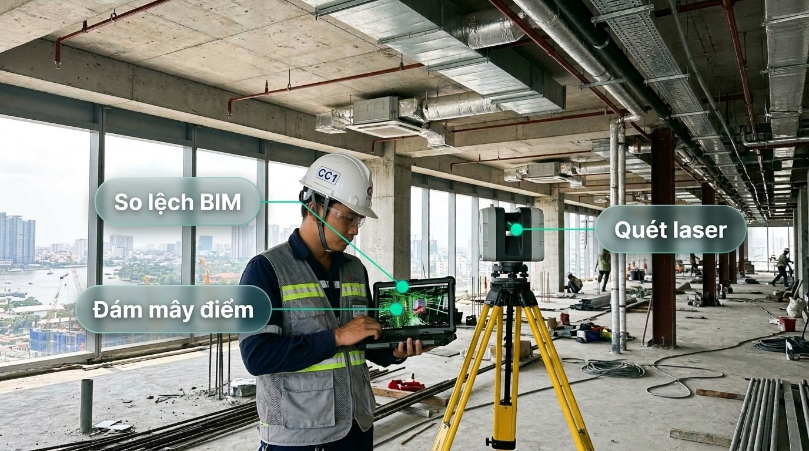
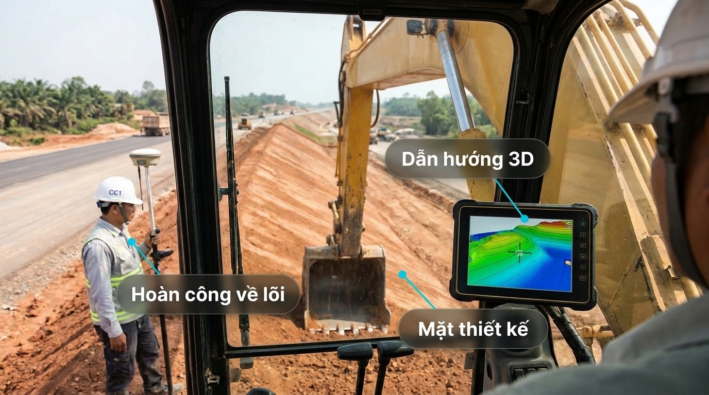

# Giai đoạn 3: Nền dữ liệu và ontology v0

Thời gian: M0–M4 · Phụ thuộc: Giai đoạn 0, 1 · Phụ trách: Kỹ sư dữ liệu; chuyên gia ontology/BIM · Kế hoạch tổng: [plan.md](./plan.md)

## Mục tiêu

Một nền dữ liệu chung, phân quyền theo dự án, với ontology đủ để nối BOQ, bản vẽ, nhật ký và vật tư.

### Hình chi tiết: Ontology và sáu nguồn khối lượng

**Bước 1.** Xe vật tư rời qua cân và cổng quét thùng; tỷ trọng lệch dải chuẩn thì gắn cờ.

**Bước 2.** Drone RTK đo thể tích đống vật liệu, so với sổ kho.

**Bước 3.** Phiếu xe bồn so với thể tích cấu kiện trong BIM để tính hao hụt bê tông.

**Bước 4.** Cảnh báo chênh lệch kèm phiếu cân, ảnh hiện trạng và dòng BOQ liên quan.

### Hình chi tiết: Thiết bị đo và dẫn hướng máy

## Việc cần làm

1. Thiết kế ontology v0: dự án, hạng mục, cấu kiện, vật tư, công tác BOQ, hồ sơ, người, thiết bị.
2. Dựng kho dữ liệu: lưu đối tượng cho tệp, cơ sở dữ liệu quan hệ cho số liệu, chỉ mục vector cho tìm kiếm.
3. Phân quyền theo dự án ở mọi tầng, kể cả chỉ mục vector.
4. Kết nối nguồn: ERP, phần mềm dự toán, BIM, thư mục hồ sơ của 2 dự án mẫu.
5. Quy tắc trích dẫn: mọi câu trả lời trỏ về tệp, trang, dòng.
6. Đo khối lượng dữ liệu thật để phục vụ cổng G2.

## Sản phẩm bàn giao

- Ontology v0 có tài liệu
- Kho dữ liệu đã nạp 2 dự án mẫu
- Báo cáo đo dữ liệu (số tài liệu, số trang, số mẫu khả dụng)

## Nghiệm thu (đo được)

- [ ] 2 dự án mẫu tra cứu được qua trợ lý, có trích dẫn
- [ ] Kiểm thử rò rỉ: người dự án A không thấy dữ liệu dự án B (0 lỗi trên bộ thử)
- [ ] Báo cáo đo dữ liệu nộp trước cổng G2

## Ngân sách **[I]**

1–3 tỷ lưu trữ năm 1; 1–2 tỷ/năm sau đó.

## Rủi ro

| Rủi ro | Cách chặn |
|---|---|
| Dữ liệu dự án rời rạc, thiếu chuẩn | Bắt đầu từ dự án có BIM; quy tắc đặt tên tệp chung |
| Ontology phình to | Chỉ thêm khái niệm khi một câu hỏi trong bộ đề cần nó |

## Nếu không đạt

Chỉ mục chưa đạt: dùng tìm kiếm từ khóa có phân quyền cho tới khi sửa xong.
