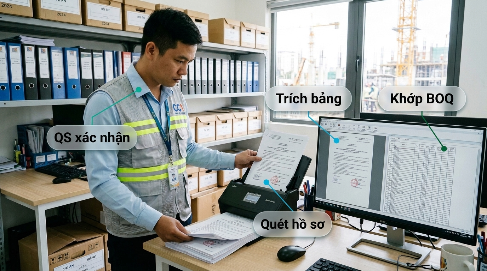

# Giai đoạn 5: OCR, ánh xạ BOQ và nạp dự án

Thời gian: M1–M9 · Phụ thuộc: Giai đoạn 3, 4 · Phụ trách: Nhóm OCR; QS kiêm nhiệm từng dự án · Kế hoạch tổng: [plan.md](./plan.md)

## Mục tiêu

Nạp toàn bộ dưới 30 dự án đang thi công, 10–15 dự án mỗi quý, mỗi dự án có BOQ đã ánh xạ và đối chiếu khối lượng chạy.

## Việc cần làm

1. Dựng luồng OCR: PaddleOCR-VL cho bố cục và bảng, VietOCR cho chữ viết tay; duyệt người khi độ tin thấp.
2. Gán nhãn và tinh chỉnh OCR trên phiếu nhập kho, nhật ký, biên bản nghiệm thu của CC1.
3. Ánh xạ BOQ sang ontology; QS dự án xác nhận từng dòng.
4. Đối chiếu 6 nguồn khối lượng: BOQ, BIM, phiếu nhập, nhật ký, đo hiện trường, thanh toán.
5. Nạp 2 dự án mẫu (M1–M3), rồi theo đợt 10–15 dự án mỗi quý theo danh sách ưu tiên của ban chỉ đạo.
6. Mua thiết bị đo đạc thương mại theo báo giá; nối dữ liệu đo vào lớp đối chiếu.

## Sản phẩm bàn giao

- Luồng OCR có duyệt người
- Bộ dữ liệu gán nhãn OCR
- Mỗi dự án: BOQ đã ánh xạ, đối chiếu chạy, phiếu nghiệm thu nạp dự án

## Nghiệm thu (đo được)

- [ ] OCR theo trường ≥ 95% chữ in, ≥ 85% viết tay; tỷ lệ đi thẳng ≥ 60%
- [ ] 100% dòng BOQ có QS xác nhận trước khi dùng cho đối chiếu
- [ ] Mọi cảnh báo chênh lệch có bằng chứng trỏ về nguồn
- [ ] 100% dự án đang thi công đã nạp trước M9

## Ngân sách **[I]**

Gán nhãn 3–6 tỷ năm 1, 2–4 tỷ/năm sau đó. Thiết bị đo theo báo giá, chưa tính trong bảng này.

## Rủi ro

| Rủi ro | Cách chặn |
|---|---|
| QS kiêm nhiệm quá tải | Gom việc xác nhận theo lô; mô hình đề xuất, QS chỉ duyệt |
| Mẫu biểu khác nhau giữa dự án | Thư viện mẫu biểu chung; mẫu mới đi qua duyệt người |

## Nếu không đạt

Dự án chưa đạt nghiệm thu nạp: chỉ bật tra cứu, chưa bật đối chiếu khối lượng.
