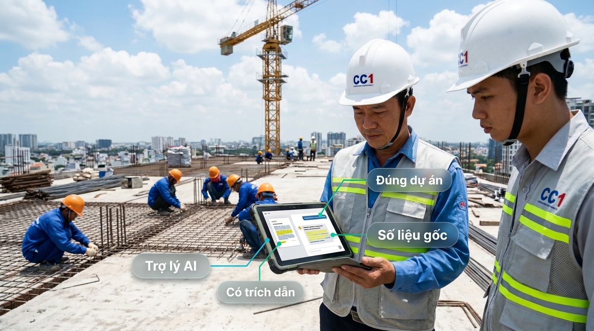
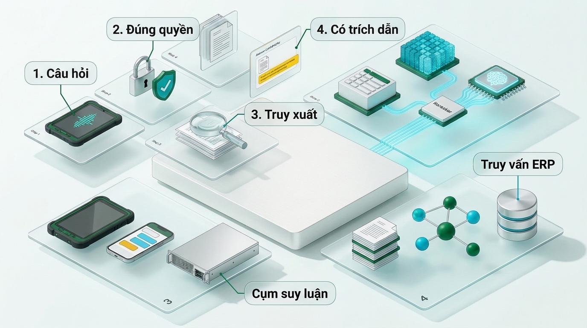
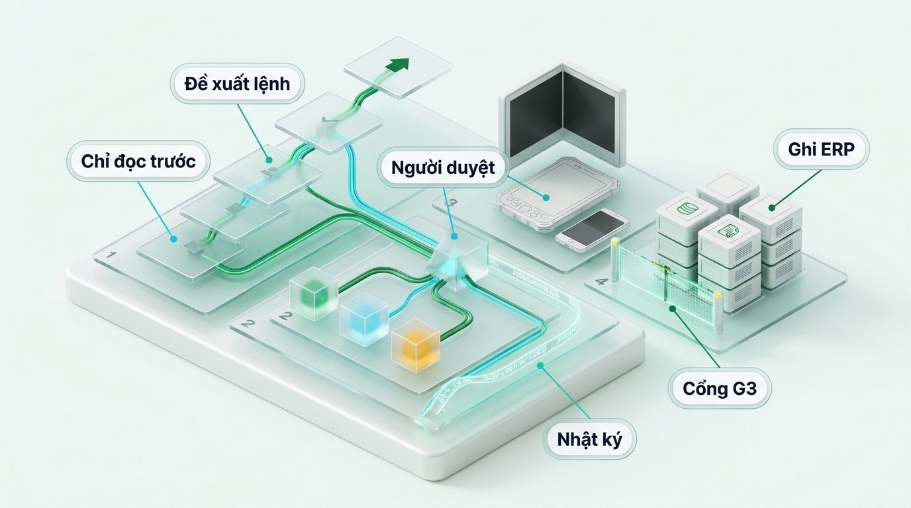

# Giai đoạn 8: Tác tử và tích hợp Site OS, ERP

Thời gian: M4–M12 · Phụ thuộc: Giai đoạn 3, 5, 7 · Phụ trách: Kỹ sư tích hợp hệ thống; chủ sở hữu sản phẩm · Kế hoạch tổng: [plan.md](./plan.md)

## Mục tiêu

Trợ lý làm được việc trong luồng công việc thật, bắt đầu chỉ đọc, chỉ ghi khi đã chứng minh an toàn.

### Hình chi tiết: Trợ lý AI có trích dẫn

**Bước 1.** Chỉ huy trưởng hỏi bằng giọng nói, tiếng Việt, không cần gõ.

**Bước 2.** Câu trả lời đặt cạnh tài liệu gốc, tô sáng đúng đoạn trích.

**Bước 3.** Số liệu lấy thẳng từ ERP qua truy vấn; mô hình không tự đoán số.

### Hình chi tiết: Tác tử AI trong Site OS

**Bước 1.** Giai đoạn chỉ đọc: tác tử soạn nháp nhật ký, kỹ sư sửa.

**Bước 2.** Sau cổng G3: tác tử đề xuất lệnh, người có quyền bấm duyệt mới tạo phiếu.

**Bước 3.** Nhật ký kiểm toán ghi ai duyệt, lúc nào, dựa trên bằng chứng nào.

## Việc cần làm

1. Nối trợ lý vào Site OS, ERP, hệ thống hồ sơ qua API có phân quyền.
2. Giai đoạn chỉ đọc (M4–M8): tra cứu, tóm tắt, cảnh báo chênh lệch, soạn nháp.
3. Nhật ký kiểm toán mọi lệnh gọi công cụ.
4. Họp cổng G3 (M8): duyệt danh sách lệnh ghi.
5. Giai đoạn ghi có duyệt (M8–M12): tạo phiếu, cập nhật tiến độ, mỗi lệnh ghi cần người bấm duyệt.
6. Đo mức dùng hằng tuần của chỉ huy trưởng và QS.

## Sản phẩm bàn giao

- Bộ công cụ tác tử có tài liệu
- Nhật ký kiểm toán
- Biên bản cổng G3

## Nghiệm thu (đo được)

- [ ] 3 tháng chỉ đọc không sự cố trước G3
- [ ] 100% lệnh ghi có người duyệt và có nhật ký
- [ ] ≥ 70% chỉ huy trưởng và QS dùng ít nhất 3 ngày mỗi tuần vào M12

## Ngân sách **[I]**

Nằm trong chi phí đội ngũ.

## Rủi ro

| Rủi ro | Cách chặn |
|---|---|
| Tác tử ghi sai vào hệ thống thật | Cổng G3; duyệt từng lệnh; hoàn tác được |
| Kỹ sư không dùng | Bắt đầu từ việc họ đang mất nhiều thời gian; đo và hỏi hằng tháng |

## Nếu không đạt

Không qua G3: giữ chế độ chỉ đọc.
