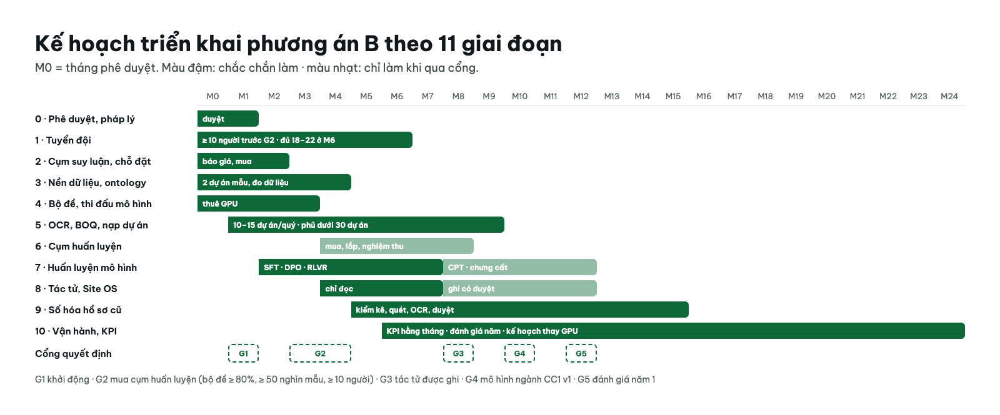

# Kế hoạch triển khai lõi AI CC1: Phương án B theo cổng

Ngày lập: 31/10/2026 · Trạng thái: **bản kế hoạch hoàn chỉnh, chờ chủ đầu tư duyệt** · Mốc M0 = tháng phê duyệt (chưa chốt ngày)

## Quyết định đã chốt (31/10/2026)

| Vấn đề | Chốt |
|---|---|
| Phương án | B theo cổng; phân tích A/B: [options-a-b-analysis.md](./options-a-b-analysis.md) |
| Phạm vi | Toàn tập đoàn, dưới 30 dự án đang thi công, cả công trường khép kín và tuyến |
| Hạ tầng | Mua cụm suy luận ngay; thuê GPU trong nước 3 tháng đầu; mua cụm huấn luyện sau cổng M3–M4; đặt máy tại trung tâm dữ liệu thuê |
| Đội ngũ | 18–22 người + 10–15 người gán nhãn; QS dự án kiêm nhiệm xác nhận BOQ |
| Đo đạc | Thiết bị thương mại đã kiểm định; báo giá cả danh sách cùng lúc |
| Mô hình | Nền mở đa ngôn ngữ, chọn bằng thi đấu; không huấn luyện từ đầu |

## Kết quả cần đạt sau 12 tháng

1. 100% dự án đang thi công đã nạp vào lõi: ontology, BOQ đã ánh xạ, điểm chạm đã nối.
2. Kỹ sư dùng trợ lý hằng ngày: ≥ 70% chỉ huy trưởng và QS dùng ít nhất 3 ngày mỗi tuần.
3. Bộ đề: đúng ≥ 90% nhóm tra cứu, 100% câu trả lời có trích dẫn, 0 câu bịa số liệu ở nhóm bẫy.
4. Đối chiếu 6 nguồn khối lượng chạy tự động cho bê tông, thép, vật tư rời, đào đắp.
5. Mô hình ngành CC1 v1 thắng mô hình nền trên bộ đề, không nhóm nào giảm điểm.
6. 0 sự cố rò rỉ dữ liệu giữa dự án; hồ sơ pháp lý dữ liệu và AI đầy đủ.

## Giai đoạn

| # | Giai đoạn | Thời gian | Phụ thuộc | Ngân sách **[I]** | File |
|---|---|---|---|---|---|
| 0 | Phê duyệt, quản trị, pháp lý | M0–M1 | — | 1–2 tỷ | [phase-00](./phase-00-approval-governance-legal.md) |
| 1 | Tuyển đội | M0–M6 | 0 | 14–24 tỷ/năm | [phase-01](./phase-01-team-hiring.md) |
| 2 | Cụm suy luận + trung tâm dữ liệu | M0–M2 | 0 | 5–8 tỷ máy + 3–6 tỷ chỗ đặt năm 1 | [phase-02](./phase-02-inference-cluster-datacenter.md) |
| 3 | Nền dữ liệu + ontology v0 | M0–M4 | 0, 1 | 1–3 tỷ lưu trữ năm 1 | [phase-03](./phase-03-data-platform-ontology.md) |
| 4 | Bộ đề + thi đấu mô hình | M0–M3 | 3 (một phần) | < 0,5 tỷ thuê GPU (nằm trong làm tròn) | [phase-04](./phase-04-golden-set-model-bakeoff.md) |
| 5 | OCR, ánh xạ BOQ, nạp dự án | M1–M9 | 3, 4 | 3–6 tỷ gán nhãn năm 1 | [phase-05](./phase-05-ocr-boq-project-onboarding.md) |
| 6 | Cổng mua sắm + cụm huấn luyện | M3–M8 | 1, 4 | 25–36 tỷ | [phase-06](./phase-06-procurement-gate-training-cluster.md) |
| 7 | Chương trình huấn luyện mô hình | M2–M12 | 4, 5, 6 | Nằm trong cụm của giai đoạn 6 | [phase-07](./phase-07-model-training-program.md) |
| 8 | Tác tử + tích hợp Site OS, ERP | M4–M12 | 3, 5, 7 | Trong chi phí đội | [phase-08](./phase-08-agents-site-os-integration.md) |
| 9 | Số hóa hồ sơ cũ | M5–M15 | 2, 5 | 3–6 tỷ năm 1, 1–3 tỷ năm 2 | [phase-09](./phase-09-archive-digitization.md) |
| 10 | Vận hành, KPI, đánh giá năm | M6–M24 | Tất cả | Chỗ đặt 4–6 tỷ/năm từ năm 2; thay GPU 5–10 tỷ năm 3 | [phase-10](./phase-10-operations-kpi-review.md) |

Tổng năm 1 khoảng 55–90 tỷ; 3 năm khoảng 105–180 tỷ. Chi tiết: [options-a-b-analysis.md §4](./options-a-b-analysis.md). Mọi số tiền phải thay bằng báo giá trước khi trình ngân sách.

## Cổng quyết định

| Cổng | Thời điểm | Điều kiện đạt | Không đạt thì |
|---|---|---|---|
| G1 · Khởi động | M1 | Ngân sách duyệt; ban chỉ đạo lập; trưởng nhóm nghiên cứu đã nhận việc hoặc đã chốt ứng viên | Lùi M0, không ký mua sắm |
| G2 · Mua cụm huấn luyện | M3–M4 | Bộ đề ≥ 80% nhóm tra cứu; đo được ≥ 50 nghìn mẫu huấn luyện khả dụng; đã tuyển ≥ 10 người | Dừng ở A+: giữ cụm suy luận, tiếp tục thuê GPU, xét lại sau 3 tháng |
| G3 · Tác tử có quyền ghi | M8 | 3 tháng chỉ đọc không sự cố; nhật ký kiểm toán đủ; ban chỉ đạo duyệt danh sách lệnh ghi | Giữ chế độ chỉ đọc |
| G4 · Mô hình ngành CC1 v1 | M10 | Thắng mô hình nền trên bộ đề; không nhóm nào giảm | Phục vụ mô hình nền + LoRA |
| G5 · Đánh giá năm 1 | M12 | 6 kết quả ở đầu file | Ban chỉ đạo điều chỉnh phạm vi năm 2 |

## Quản trị

| Vai trò | Ai | Trách nhiệm |
|---|---|---|
| Ban chỉ đạo | Lãnh đạo tập đoàn + Giám đốc kỹ thuật + Giám đốc tài chính (cần chỉ định) | Duyệt ngân sách, duyệt cổng G1–G5, họp tháng |
| Chủ sở hữu sản phẩm | Cần chỉ định | Ưu tiên tính năng theo nhu cầu chỉ huy trưởng |
| Trưởng nhóm nghiên cứu AI | Tuyển ở giai đoạn 1 | Kỹ thuật mô hình, hạ tầng, chất lượng |
| Đại diện dự án | Chỉ huy trưởng + QS mỗi dự án | Viết bộ đề, xác nhận BOQ, phản hồi |
| Pháp chế, bảo mật | Cần chỉ định | Dữ liệu cá nhân, Luật AI, kiểm thử rò rỉ |

Nhịp làm việc:

- báo cáo tuần: tiến độ, điểm bộ đề, rủi ro;
- họp ban chỉ đạo hằng tháng;
- duyệt cổng theo bảng trên.

## KPI theo dõi hằng tháng

| KPI | Mục tiêu M12 |
|---|---|
| Số dự án đã nạp / tổng dự án | 100% |
| Điểm bộ đề nhóm tra cứu | ≥ 90% |
| Tỷ lệ câu có trích dẫn | 100% |
| Người dùng hoạt động hằng tuần | ≥ 70% chỉ huy trưởng và QS |
| Độ chính xác OCR theo trường (tự động) | ≥ 95% chữ in, ≥ 85% viết tay |
| Tỷ lệ đi thẳng OCR | ≥ 60% |
| Cảnh báo chênh lệch khối lượng có bằng chứng | 100% |
| Tỷ lệ cờ sai trong định danh công nhân | Theo dõi, giảm theo quý |
| Sự cố rò rỉ giữa dự án | 0 |
| Mức sử dụng GPU cụm huấn luyện | ≥ 50% sau M9 |

## Rủi ro chính

| Rủi ro | Mức | Chủ xử lý | Cách chặn |
|---|---|---|---|
| Không tuyển được trưởng nhóm và người giỏi | Cao | Ban chỉ đạo | Bắt đầu tuyển ngay M0; lương cạnh tranh; tính phương án chuyên gia Việt kiều; cổng G2 |
| Dữ liệu dự án không sẵn sàng | Cao | Chủ sở hữu sản phẩm | Dự án mẫu có BIM; đo dữ liệu trước G2 |
| Mua GPU rồi để không | Trung bình | Trưởng nhóm AI | Cổng G2; dùng chung cho thị giác, point cloud |
| Mô hình bịa số liệu | Trung bình | Trưởng nhóm AI | Số liệu chỉ qua truy vấn; câu bẫy trong bộ đề |
| Vi phạm Luật 91/2025, Luật AI 134/2025 | Trung bình | Pháp chế | Đánh giá tác động trước khi bật 1.5 và tác tử ghi |
| Giấy phép mô hình khác công bố | Thấp | Trưởng nhóm AI | Lưu bản sao LICENSE gốc khi chọn |

## Việc còn mở

1. Ngày bắt đầu M0.
2. Trưởng ban chỉ đạo và chủ sở hữu sản phẩm.
3. Tên 2 dự án mẫu.
4. Báo giá thật cho phần cứng, chỗ đặt, lương.

## Liên kết

- `CHAPTER_AI_CORE_OPERATING_PLATFORM.md`: kiến trúc lõi
- `plans/reports/research-261031-0917-open-llm-selection-training.md`: chọn mô hình, huấn luyện
- [options-a-b-analysis.md](./options-a-b-analysis.md): phân tích A/B, chi phí, nguồn giá
