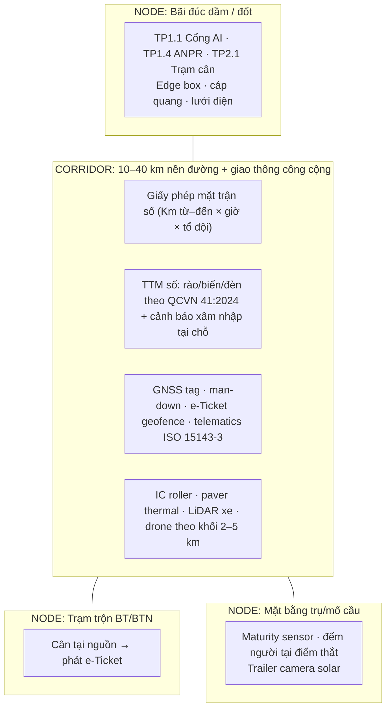

# Công Trường Mở (Cao tốc · Cầu · Đường) — Thế giới quản lý thế nào & CC1 áp dụng ra sao

> Tổng hợp nghiên cứu 2026-10-29. Controller: Opus 5.5. 4 nhánh nghiên cứu song song (Sonnet 5.5), báo cáo gốc:
> [axis1 no-perimeter](./researcher-261029-2130-open-site-axis1-no-perimeter-access.md) ·
> [axis2 traffic/work-zone](./researcher-261029-2130-open-site-axis2-traffic-work-zone.md) ·
> [axis3 linear data/QA](./researcher-261029-2130-open-site-axis3-linear-data-progress-qa.md) ·
> [axis4 infra/logistics/VN](./researcher-261029-2130-open-site-axis4-infra-logistics-vietnam.md)
>
> Nhãn bằng chứng: **[F]** = trang/PDF đã mở đọc · **[V]** = số liệu do vendor tự công bố · **[I]** = suy luận của nhóm tư vấn · **[U]** = chưa kiểm chứng (KHÔNG đưa cho khách hàng).
> JEV: NOT RUN (thiếu `TYPESAFE_API_KEY`). Laya/System One: NOT APPLICABLE (nghiên cứu web, không có artefact chạy được).

---

## 0. TL;DR

1. **Dự án tuyến KHÔNG phải "một công trường mở".** Nó là **chuỗi NODE kín nhỏ** (bãi đúc dầm/đốt, trạm trộn, lán trại, kho, mặt bằng trụ/mố, bến sà lan) **nối bằng một CORRIDOR mở** (hàng chục km nền đường, có giao thông công cộng, mặt trận thi công dịch chuyển hằng ngày). → Gần như mọi touchpoint hiện có **vẫn dùng được tại NODE**; thứ vỡ là **corridor**: trong 16 dòng của ma trận §3, trên corridor có **6 REPLACE · 2 DROP · 5 MODIFY · 1 DEFER · 1 n/a · chỉ 1 KEEP** (exoskeleton).
2. **Lỗ hổng lớn nhất của bộ hồ sơ hiện tại: không có touchpoint nào cho giao diện với giao thông công cộng.** Bằng chứng VN: mở rộng cao tốc Nội Bài–Lào Cai ghi nhận **31 vụ va chạm/TNGT, 6 bị thương, 1 tử vong sau ~3 tháng thi công** [F]. Thế giới đếm "xâm nhập vùng thi công" như KPI (UK ~6.500 vụ/3 năm; NEXCO East 35→53 vụ/năm) [F].
3. **Thế giới không kiểm soát tuyến bằng cổng — mà bằng NGƯỜI + GIẤY PHÉP SỐ + MÁY.** Mô hình mẫu: đường sắt UK (Sentinel + COSS + Protection Controller): mỗi tổ có 1 người chịu trách nhiệm, quẹt thẻ năng lực đầu ca tại mặt trận, làm việc trong "possession" = giấy phép đoạn km × khung giờ [F].
4. **Khóa không gian đổi từ "tầng/zone" sang "lý trình Km+m + offset + lớp".** Tiến độ = biểu đồ thời gian–lý trình, không phải BIM 4D theo tầng. Nhật (MLIT) dùng J-LandXML chứ chưa bắt buộc IFC cho đường [F] → CC1 nên LandXML/lý trình trước, IFC 4.3 là đích xuất.
5. **QA tuyến lấy dữ liệu từ MÁY đang thi công**, không phải quét sau: lu thông minh (IC), thanh nhiệt máy rải (paver thermal), máy đào 3D dùng trạm CORS quốc gia VNGEONET (65 trạm) [F]. Giá trị "BIM/digital twin" mạnh nhất của CC1 nằm ở **NODE cầu** (hình học đốt dầm đúc, cảm biến maturity bê tông).

---

## 1. Mô hình tư duy: NODE + CORRIDOR

Danh mục CC1 thực tế khớp đúng mô hình này: gói **XL03 Hậu Giang–Cà Mau = 12 km tuyến chính + 24 cầu đường bộ, 34 tháng, 3.334 tỷ** [F] → một chuỗi 24 NODE trụ cầu dọc corridor đất yếu ĐBSCL.

---

## 2. Thế giới xử lý công trường tuyến thế nào — 6 nguyên lý

| # | Nguyên lý | Ai làm, ở đâu | Bằng chứng then chốt |
|---|---|---|---|
| 1 | **Định danh dời từ cổng sang 4 chỗ:** người chịu trách nhiệm tổ · ranh ảo (geofence) · máy · điểm thắt tự nhiên (cửa hầm, mặt bằng trụ) | Network Rail UK (Sentinel/COSS); Morley Tunnel UK (tag tại 2 cửa hầm, ~150 người/ca, đã dùng trong sơ tán cháy thật); NSW rail (QR+geofence, >1.000 công trường ngắn hạn/năm) | [F] Sentinel/COSS; [F] Morley; [F/V] NSW: hướng dẫn 10–15 phút → <1 phút |
| 2 | **"Possession" = giấy phép số cho một đoạn tuyến × khung giờ × danh sách tổ** | Network Rail (Protection Controller giữ khóa đoạn chặn, chỉ trả khi mọi COSS xác nhận xong); Cục ĐS Nam Xương (TQ) thử hàng rào điện tử BeiDou RTK (đang thử, 10/2026) | [F] |
| 3 | **Giao diện giao thông (TTM) là hạng mục quản trị riêng, có dữ liệu riêng** | FHWA (Smart Work Zones, chuẩn dữ liệu WZDx đẩy vùng thi công lên Google/Waze); National Highways UK (sổ xâm nhập, máy rải cọc tiêu tự động, SwiftGate); NEXCO Nhật (camera AI di động "Highway Ai-MONITOR" bán từ 27/5/2026, phát hiện ~250 m) | Cảnh báo cuối hàng chờ Texas: **ước tính −44% va chạm** [F, mẫu nhỏ]; Illinois −14% [F, sơ bộ]; Maryland phạt nguội tốc độ vùng thi công: vi phạm ~7% → 0,8–1,5% [F] |
| 4 | **Cảnh báo phải tại chỗ, không về trung tâm** | Oregon DOT: mục tiêu thời gian phản ứng của công nhân ≤ 6 giây; xe 80–100 km/h đi 250 m trong 9–11 giây | [F] → camera cố định + "báo Zalo Ban chỉ huy" (TP1.2) **không đủ nhanh** trên tuyến |
| 5 | **Khóa dữ liệu là lý trình; QA lấy từ máy đang thi công** | IFC 4.3 IfcAlignment (ISO 16739-1:2024); MLIT dùng J-LandXML; FHWA Intelligent Compaction (12 bang); TxDOT paver thermal | Nhật i-Construction: đắp đê sông Tone 213 → 142 công (−33%), khảo sát 15 → 6 công [F]; nhiệt độ thảm BTN biến thiên giảm >50% (US 82) [F]; lu IC đắt hơn 3–5%, hoàn vốn "2–3 dự án" (FHWA, định tính) [F] |
| 6 | **Hạ tầng đi theo thiết bị, không theo phòng server** | DOT Mỹ e-Ticketing: offline-first, tăng sóng, QR, LEO cho mỏ/trạm xa; MnDOT gộp e-ticket + IC + thermal vào 1 hệ; trailer camera solar (LVT) | GDOT: e-ticket tiết kiệm ~1 giờ/ngày rải, tới 15.000 phiếu/dự án BTN, bắt buộc từ 2021 [F]; nhiều DOT **bỏ** GPS bám xe liên tục, chuyển sang geofence tại nguồn + điểm đổ [F] |

---

## 3. Ma trận diff 16 touchpoint hiện có (bộ 20 hình checkpoint) — closed-site → tuyến

Ký hiệu: **KEEP@node** giữ nguyên tại NODE · **MODIFY** sửa · **REPLACE** thay trên corridor · **DROP** bỏ khỏi corridor.

| TP | Tên hiện tại | Tại NODE | Trên CORRIDOR | Thay bằng / sửa thế nào |
|---|---|---|---|---|
| Core | Xương sống hạ tầng (cáp quang + edge box + lưới điện + base RTK nóc BCH) | KEEP | REPLACE | Edge tại trạm trộn/lán trại; corridor = 4G dual-SIM + offline-first + Starlink tại mặt bằng cố định (Starlink thương mại tại VN từ **13/8/2026** [F]); điện = skid solar+ắc quy+máy phát; RTK = VNGEONET NRTK (65 trạm) [F], base UHF dự phòng vùng mất sóng |
| 1.1 | Cổng AI Face ID + PPE | KEEP (lán trại, bãi đúc) | REPLACE | Chỉ huy mặt trận quét thẻ CC1 (QR/NFC) tại buổi giao ca; geofence check-in + kiosk tablet tổ trưởng khi mất sóng; PPE do chỉ huy kiểm tại briefing |
| 1.2 | CCTV AI 24/7 cố định | KEEP (trạm trộn, bãi đúc, cẩu) | REPLACE | Camera AI **gắn xe/trailer, đi theo mặt trận**; cảnh báo = còi/đèn/rung đeo người tại chỗ; trung tâm chỉ nhận log |
| 1.3 | Drone quét 3D vs BIM 4D theo tầng | KEEP | MODIFY | % hoàn thành **theo đoạn lý trình × lớp** (nền/móng dưới/móng trên/BTN); bay theo khối 2–5 km; tích hợp quy trình phép bay NĐ 288/2025 (nộp ≥7 ngày; hạn phép 30/180/360 ngày theo loại [F, nguồn thứ cấp]) |
| 1.4 | Smart Gate ANPR | KEEP (cổng trạm trộn/bãi/mỏ) | REPLACE | Định danh chuyển lên **máy** (operator ID + telematics) và **geofence điểm đổ** + e-Ticket |
| 1.5 | 3D Re-ID gait + UWB + drone 50 m | KEEP tại điểm thắt (cửa hầm, lối lên mặt cầu, mặt bằng trụ) | DROP | Corridor: GNSS tag cho tổ trưởng/người làm đơn độc (BLE crowd sai số lớn vùng nông thôn [F]); **rà soát pháp lý NĐ 356/2025 trước khi thu gait/vị trí** |
| 2.1 | Trạm cân AI + LiDAR thùng xe | KEEP (cổng trạm trộn, mỏ đất đắp) | MODIFY | Cân 1 lần tại nguồn → e-Ticket mang khối lượng → đối soát tại điểm đổ; bỏ LiDAR khỏi corridor |
| 2.2 | Robot in bản vẽ lên sàn | KEEP (mặt cầu, mặt bằng bãi) | REPLACE | GNSS machine control + rover cắm mốc ("không cọc tiêu" kiểu Nhật) |
| 2.3 | Máy xúc 3D RTK | KEEP | MODIFY | Trạm base theo site → VRS/NRTK quốc gia; kiểm độ trễ từng gói thầu |
| 2.4 | iPad AR nghiệm thu MEP | KEEP (trạm trộn, nhà điều hành) | DROP | Không có MEP trên tuyến |
| 3.1 | Robot Spot tuần đêm | KEEP (bãi đúc, trạm trộn) | REPLACE | LiDAR gắn xe bán tải (PennDOT: $3.800 vs $7.800/dặm so với ảnh hàng không; RMSE đứng 0,031 vs 0,052 ft [F, 2015]) |
| 3.2 | Exoskeleton | KEEP (bãi đúc, buộc thép) | KEEP có chọn lọc | Không đổi bản chất |
| 3.3 | Máy tự hành hoàn toàn | — | DEFER | Tự hành thật trên đường đang khai thác: chỉ có xe đệm va (TMA) leader–follower (Colorado từ 2017, ~US$450k/xe) [F] |
| 3.4 | Cẩu tháp AI | KEEP (bãi đúc, trụ cao) | n/a | Trên tuyến cầu: cẩu lao dầm/xe lao — touchpoint riêng nếu cần |
| 3.5 | Site OS đa tác tử | KEEP | MODIFY | Khóa chính = (tuyến, đoạn Km, offset, lớp, mã kết cấu); thêm 3 đối tượng mới: **Giấy phép mặt trận**, **Phương án TTM sống**, **Sổ xâm nhập/near-miss** |
| 4.1–4.2 | Micro-factory · Zero-UI smart contract | KEEP (tầm nhìn) | MODIFY | Smart contract nghiệm thu theo đoạn lý trình × lớp (dữ liệu IC/thermal làm bằng chứng) — chỉ khi chủ đầu tư chấp nhận |

---

## 4. Touchpoint MỚI đề xuất cho công trường tuyến (lớp "L")

Xếp theo ROI × mức bằng chứng × áp lực pháp lý VN.

### Làm ngay (Năm 1)

| ID | Touchpoint mới | Vì sao trước | Neo pháp lý / bằng chứng |
|---|---|---|---|
| **L1** | **TTM số & kiểm tra tuân thủ hằng ngày**: checklist rào/biển/đèn/người điều tiết theo QCVN 41:2024 + TCCS 14:2016, chụp ảnh có GPS-lý trình mỗi ca, đối chiếu phương án đã được cấp phép | Lỗi VN đang thấy là **cơ bản** (biển/rào tạm chưa đúng quy định — chính văn bản Cục ĐBVN 2026 thừa nhận); rẻ nhất, bảo vệ CC1 khi có tai nạn | TT 41/2024/TT-BGTVT Đ5–6 (giấy phép thi công trên đường đang khai thác, phương án đảm bảo GT, biển thông tin ≥5 ngày, báo CSGT) [F]; QCVN 41:2024 (TT 51/2024) [F số hiệu] |
| **L2** | **Giấy phép mặt trận số + Chỉ huy mặt trận** (bản "possession" cho CC1): đoạn Km từ–đến × khung giờ × danh sách tổ đội × người chịu trách nhiệm; điểm danh đầu ca tại mặt trận; đếm quân số theo tổ khi sơ tán | Thay thế logic cổng xoay; nền cho mọi touchpoint corridor khác | Network Rail [F]; NĐ 06/2021 Đ13 (phương án an toàn tổng thể, vùng nguy hiểm) [F thứ cấp; hiệu lực hiện hành = U, cần kiểm lại vì luật đang thay đổi nhanh] |
| **L3** | **e-Ticket vật tư + geofence điểm đổ + telematics hỗn hợp (ISO 15143-3)** | Hàng chục điểm đổ, không có cổng; chống thất thoát BTN/BT/đất đắp; an toàn người nhận phiếu đứng trên làn xe | FHWA EDC e-Ticketing, GDOT [F]; phân cách thương hiệu máy → adapter từng OEM + cảm biến GPS/nhiên liệu cho máy cũ |

### Năm 2

| ID | Touchpoint mới | Ghi chú |
|---|---|---|
| **L4** | **Cảnh báo xâm nhập di động + cảnh báo cuối hàng chờ** tại điểm thu hẹp làn (4→2 làn): camera AI trên xe/trailer + cọc tiêu báo va + còi/đèn/rung đeo người; biển radar tốc độ | Bằng chứng giảm va chạm mạnh nhất là **cảnh báo cuối hàng chờ** (Texas −44%, mẫu nhỏ). Báo động xâm nhập: chưa có số giảm tai nạn, nhiều DOT bỏ vì báo giả → **bắt buộc ghi log báo giả trước khi nhân rộng** |
| **L5** | **Xương sống dữ liệu lý trình + tiến độ thời gian–lý trình** (LandXML/CSV làm nguồn chuẩn, xuất IFC 4.3 sau) | Không hứa ROI (không tìm thấy số đo độc lập cho lập tiến độ tuyến) |
| **L6** | **QA trong quá trình**: lu IC + thanh nhiệt máy rải + LiDAR gắn xe cho nghiệm thu lớp | Dùng IC để **sàng lọc** điểm yếu; giữ khoan lõi/đo nhân làm nghiệm thu đến khi hiệu chỉnh tương quan tại chỗ và CĐT chấp nhận |
| **L7** | **Man-down / người làm đơn độc**: GNSS tag, không cử động 180 s → báo; hẹn giờ check-in chạy phía server (mất sóng vẫn báo) | Tarmac UK, Network Rail [F, nguồn cũ] |
| **L8** | **NODE cầu số**: kiểm soát hình học đốt dầm đúc (sai 1 phần mm tại bãi → lệch hàng mét cuối nhịp, ISARC [F]) + cảm biến maturity bê tông mỗi đợt đổ trụ/dầm (Idaho: rút 5–10 ngày [V]) | Đây là nơi "digital twin" của CC1 có giá trị cao nhất |

### Hoãn (chưa ROI tại VN)
Máy rải cọc tiêu tự động, SwiftGate, xe đệm va tự hành, V2X, edge compute di động theo mặt trận (chưa thấy nhà thầu nào làm). Lý do: kinh tế lao động VN khác UK/US [I]; lỗi đang xảy ra ở VN là lỗi cơ bản.

---

## 5. Ràng buộc pháp lý VN (controller đã kiểm lại)

| Văn bản | Nội dung liên quan | Tác động thiết kế | Kiểm chứng |
|---|---|---|---|
| Luật Đường bộ 35/2024/QH15, Đ32 | Thi công trên đường đang khai thác phải có giấy phép | Mọi điểm nối QL, nút giao | [F thứ cấp] |
| TT 41/2024/TT-BGTVT (hiệu lực 1/1/2025; Đ6 k1 sửa bởi TT 72/2025/TT-BXD) | Hồ sơ cấp phép có phương án đảm bảo GT; biển thông tin; báo CSGT; đình chỉ nếu mất an toàn | Nguồn yêu cầu của **L1** | **Controller kiểm lại [F]** |
| QCVN 41:2024/BGTVT (TT 51/2024) | Báo hiệu đường bộ; biển tạm, rào di động | Checklist L1 | [F số hiệu]; chương vùng thi công chưa đọc toàn văn |
| QCVN 18:2021/BXD (TT 16/2021) | An toàn thi công: máy làm đất/đường, đào, cẩu, điện tạm | Nền an toàn cho NODE + corridor | [F mục lục] |
| Luật BVDLCN 91/2025/QH15 + **NĐ 356/2025/NĐ-CP** (hiệu lực 1/1/2026, thay NĐ 13/2023) | Dữ liệu cá nhân; dữ liệu vị trí/sinh trắc có nghĩa vụ thông báo vi phạm cho chủ thể trong 72 giờ (theo EY) | **Face ID (TP1.1), gait (TP1.5), GNSS tag (L2, L7) cần luật sư rà soát trước khi nhân rộng**; ưu tiên chỉ theo dõi trong ca | **Controller kiểm lại [F]** |
| **NĐ 288/2025/NĐ-CP** (hiệu lực 5/11/2025) | Phép bay UAV (thẩm quyền chia giữa Bộ Quốc phòng và Bộ Công an — Đ21); nộp ≥7 ngày; giấy phép người lái hạng B cho bay ngoài tầm nhìn ≥2 kg | Lịch bay drone theo khối km phải gắn quy trình xin phép | **Controller kiểm lại [F]** (sửa lại báo cáo axis3: không chỉ Bộ QP); hạn phép 30/180/360 ngày = [F thứ cấp] |
| QĐ 258/QĐ-TTg (17/3/2023) | Lộ trình BIM: công trình cấp I+ vốn công/PPP bắt buộc từ 2023, cấp II+ từ 2025 | Hỏi CĐT định dạng nộp (LandXML vs IFC) | [F] |

---

## 6. Pilot đề xuất

- **Ứng viên A — gói XL03 Hậu Giang–Cà Mau** (12 km + 24 cầu, ký 14/1/2023, 34 tháng [F]): đúng mô hình NODE+CORRIDOR, nhưng **có thể đã gần hoàn thành** (34 tháng từ 01/2023 ≈ cuối 2025) → **cần CC1 xác nhận trạng thái**.
- **Ứng viên B — cầu Cát Lái / Long Hưng (PPP, CC1 là nhà đầu tư)** [F]: còn ở giai đoạn đầu → áp dụng từ ngày 1, CC1 có quyền quyết định (không phụ thuộc đối tác liên danh).
- **Ứng viên C — một gói mở rộng trên đường đang khai thác** (nếu CC1 có): nơi L1 + L4 có tác động lớn nhất (bài học Nội Bài–Lào Cai).

Gói pilot tối thiểu: L1 + L2 + L3 trên **01 dự án trọng điểm, đánh giá sau 6 tháng** (khớp chiến lược PoC đã chốt trong `BRAINSTORMING_AND_FULL_ARCHITECTURE.md` §3.2), đo trước/sau: số lỗi TTM/tuần, số sự cố xâm nhập, thời gian điểm danh, chênh lệch khối lượng phiếu vs nghiệm thu.

---

## 7. Giới hạn bằng chứng (đọc trước khi trình khách hàng)

- **Không đưa các số [U] cho CC1**: PennDOT −12%/−23%, Minneapolis −56%, WYDOT 56%, Connecticut −90%, NC AI 92–99%, "GPS thu hồi 90%+", Wyoming IC 54%. Lý do: trang gốc trả 403 hoặc chỉ có snippet.
- Số **[V]** (Giatec, LVT, Technoton, Georgiou/Trimble, Sine) phải ghi rõ "theo nhà cung cấp".
- Báo động xâm nhập & camera AI: **chưa có số giảm tai nạn** nào đáng tin trên thế giới; bán như "giảm thời gian phản ứng", không bán như "giảm X% tai nạn".
- Phần lớn bằng chứng từ Mỹ/UK/Nhật; **không tìm thấy** nhà thầu đường VN/Đông Nam Á nào đang chạy theo dõi công nhân thời gian thực trên tuyến.
- GNSS dưới gầm cầu / mái taluy đào sâu: chưa có số liệu → cần thử nghiệm thực địa 1 tuần.
- Phủ sóng 4G VN "99,8%" là **theo dân số**, không phải theo km tuyến → cần đo sóng (drive test) từng gói.
- Văn bản pháp luật VN đọc qua bản sao thứ cấp (thuvienphapluat/vbpl chặn 403); không phải ý kiến pháp lý.

## 8. Controller đã tự kiểm lại (spot-check)
| Claim | Kết quả |
|---|---|
| NĐ 356/2025/NĐ-CP hiệu lực 1/1/2026, thay NĐ 13/2023 | ✅ khớp (luatvietnam, thuvienphapluat, PwC, EY) |
| NĐ 288/2025/NĐ-CP về UAV, hiệu lực 5/11/2025 | ✅ khớp; **sửa**: thẩm quyền cấp phép chia BQP/BCA |
| TT 41/2024/TT-BGTVT — giấy phép thi công trên đường đang khai thác, Đ5 | ✅ khớp |
| Nội Bài–Lào Cai: 31 vụ, 6 bị thương, 1 tử vong sau >3 tháng | ✅ khớp (Cục CSGT qua baolaocai) |
| Starlink thương mại tại VN 13/8/2026 | ✅ khớp (Viet Nam News) |
| XL03: Km114+200–Km126+223, 12 km, 24 cầu, 34 tháng, 3.334 tỷ | ✅ khớp (Tin nhanh chứng khoán) |

## 9. Câu hỏi mở (chuyển sang AskUserQuestion)
1. Áp dụng vào bộ hồ sơ thế nào: chương "Công trường tuyến" riêng hay sửa từng touchpoint?
2. Có làm hình minh họa 16:9 mới cho các touchpoint L1–L8 (theo ART-DIRECTION hiện có) không?
3. Pilot: gói nào (XL03 / Cát Lái–Long Hưng / gói mở rộng đường đang khai thác)?
4. Tỷ trọng km "trên đường đang khai thác" vs "tuyến mới" trong danh mục CC1 → quyết định L1/L4 là 80% hay 20% rủi ro.
5. CC1 có muốn thuê luật sư rà soát NĐ 356 cho Face ID/gait/GNSS tag trước khi đưa vào đề xuất chính thức?

### Nguồn tiêu biểu (đã mở)
- Network Rail Sentinel: https://info.railsentinel.co.uk/2020/04/14/swipe-for-your-safety-with-sentinel/
- Morley Tunnel: https://ccsbestpractice.org.uk/?p=94849
- FHWA work-zone facts: https://ops.fhwa.dot.gov/Wz/resources/facts_stats.htm
- Texas end-of-queue: https://workzonesafety.org/publication/safety-effects-of-portable-end-of-queue-warning-system-deployments-at-texas-work-zones
- NEXCO Central Ai-MONITOR: https://www.c-nexco.co.jp/corporate/pressroom/news_release/6603.html
- Oregon DOT intrusion alarms: https://www.oregon.gov/ODOT/Programs/ResearchDocuments/SPR790_IntrusionAlertTech.pdf
- MLIT i-Construction case: https://www.mlit.go.jp/report/press/content/001388518.pdf
- MLIT BIM/CIM (J-LandXML): https://www.cgr.mlit.go.jp/kikaku/infradx/e-learning/pdf/BIMCIM06_00_ALL.pdf
- FHWA e-Ticketing: https://www.fhwa.dot.gov/construction/econstruction/hif24067.pdf
- VNGEONET: https://leica-geosystems.com/case-studies/surveying-and-engineering/advancing-vietnam-geodetic
- Nội Bài–Lào Cai: https://baolaocai.vn/dam-bao-an-toan-giao-thong-tren-cao-toc-noi-bai-lao-cai-nhung-van-de-dat-ra-post895729.html
- TT 41/2024: https://caselaw.vn/van-ban-phap-luat/412284-thong-tu-so-41-2024-tt-bgtvt-ngay-15-11-2024-cua-bo-truong-bo-giao-thong-van-tai-quy-dinh-ve-quan-ly-van-hanh-khai-thac-bao-tri-bao-ve-ket-cau-ha-tang-duong-bo
- NĐ 356/2025: https://luatvietnam.vn/dan-su/nghi-dinh-356-2025-nd-cp-quy-dinh-chi-tiet-luat-bao-ve-du-lieu-ca-nhan-422896-d1.html
- NĐ 288/2025: https://vbpl.vn/TW/Lists/vbpq/Attachments/183413/288.2025.ND-CP.doc
- Starlink VN: https://vietnamnews.vn/society/1797454/starlink-officially-launches-satellite-internet-service-in-viet-nam.html
- CC1 XL03: https://www.tinnhanhchungkhoan.vn/cc1-ky-ket-hop-dong-thi-cong-du-an-cao-toc-thanh-phan-hau-giang-ca-mau-post313600.html
